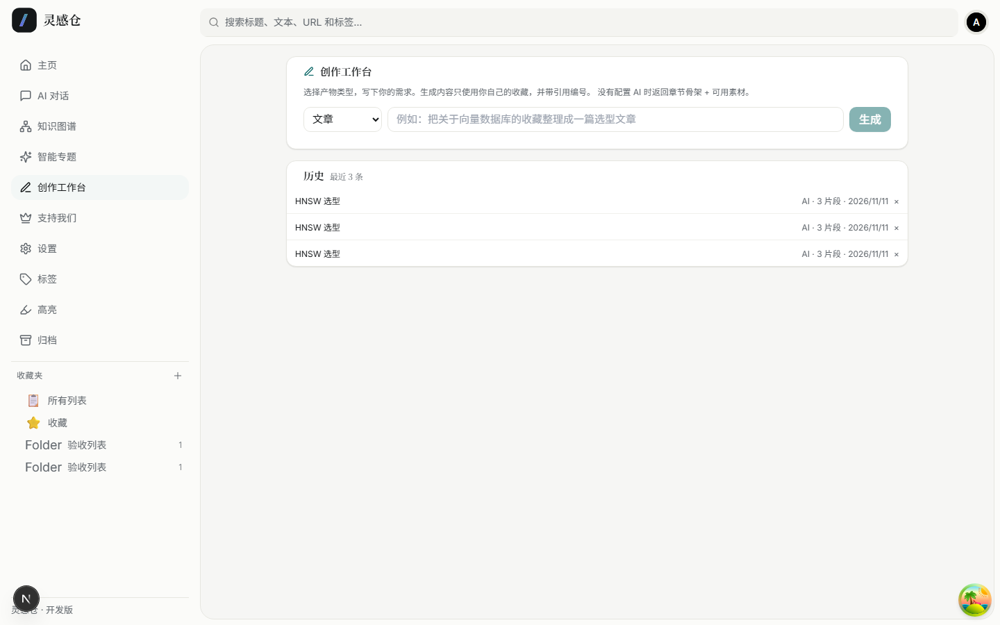
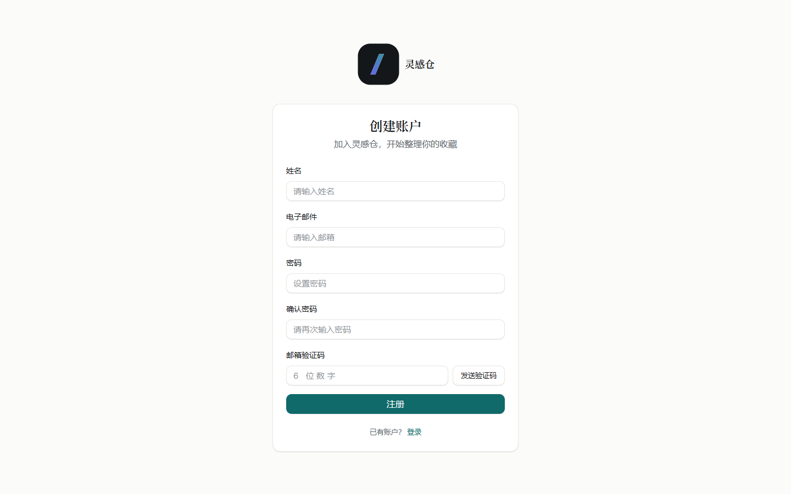
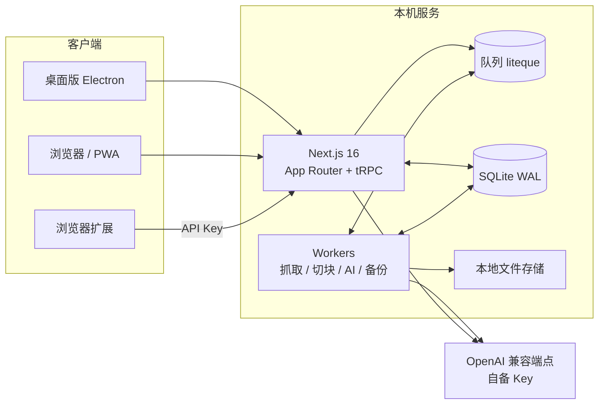

<div align="center">

# 灵感仓 · INSIGHT VAULT

**把互联网收进仓库，让 AI 替你读懂它。**

收藏网页 / 图片 / PDF / 笔记 → 自动抓取归档 → 分块检索 → 带引用的 AI 回答 → 写出来。

<p>
  
  
  
  
  
  
</p>


</div>

---

## 这是什么

一个**装在自己电脑上的** AI 知识库。你把东西扔进去，它负责抓回来、存下来、切好、找得到，并且**回答问题时告诉你这句话出自哪一段**。

和常见方案的区别：

| | 灵感仓 | 在线收藏服务 | 纯笔记软件 |
|---|---|---|---|
| 数据在哪 | 自己电脑的 SQLite，随时可导出/备份 | 厂商服务器 | 自己电脑 |
| AI 用什么模型 | **你自己的 Key**（DeepSeek / 通义 / Kimi / 智谱 / OpenAI / 硅基流动 / Ollama 都行） | 厂商定价 | 多数没有 |
| 断网还能用 | 能（PWA 离线壳，缓存页可开） | 不能 | 能 |
| 回答有出处 | **有**，`[1]` 可点开原文片段 | 有的没有 | 无 |
| 收费模式 | 不卖订阅（模型自备 + 自愿打赏） | 订阅 | 买断/订阅 |

> 底座是开源项目 [Karakeep](https://github.com/karakeep-app/karakeep)（commit `fc22787`）——成熟的抓取、队列与全端架构，我们在它上面做品牌重塑、桌面化、中文内容源适配与能力扩展。

---

## 功能

**采集**

- 🌐 一键收藏网页（浏览器扩展 / 快捷键 `Ctrl+Shift+K` / 粘贴链接自动识别）
- 📝 原生笔记、图片、PDF、Markdown 文件直接拖进来自动入库
- 📥 批量导入：Raindrop、Pocket、Matter、Omnivore、Instapaper、Linkwarden、HTML 书签、Tab Session Manager
- 📡 RSS 订阅自动收集

**整理**

- 🗂️ 收藏夹 / 标签 / 高亮 / 归档 / 收藏（星标）
- 🤖 AI 自动打标签与摘要（可开关，失败会回退到草稿不阻塞）
- 🔍 规则引擎：按条件自动打标、归档、加列表
- 🧹 重复标签合并、失效链接清理

**检索**

- 🔎 全文搜索（标题 / 正文 / 笔记 / 标签）＋ 查询语言（`is:image`、`is:pdf`、`is:video`、`tag:xxx`、`list:xxx`）
- 🧠 语义检索：正文切块 + 向量召回（没有 Meilisearch 时降级为 SQL 匹配，正文照样能搜）
- 🕸️ 知识图谱：实体与关系可视化，1000 个节点也能拖动（空间网格布局，823ms → 72ms）

**AI**

- 💬 对话问答：跨收藏检索，回答带 `[n]` 引用
- 📖 阅读台「就这篇提问」：只在当前这篇的分块里找，不串味
- ✍️ 智能专题 / 创作工作台：把多篇收藏写成结构化长文
- 🔌 任何 OpenAI 兼容端点都能接（本地网关、Ollama、各家云）

**阅读与体验**

- 📱 PWA：可装到桌面，断网能打开缓存页
- 🖨️ 阅读模式：字号 / 字体 / 行距可调，支持打印
- 🌗 深/浅色主题、中英双语界面、键盘可达（Tab 能走完主要操作）

**数据自主**

- 💾 一键备份（打包 JSON 到 zip）→ 删库 → 走导入流水线可完整恢复
- 📤 导出 JSON / Markdown / Netscape 书签，换机器不锁死
- 🔐 全部本地：SQLite + 本地文件存储，不依赖任何云服务

---

## 界面

| 收藏库（分类直达 + 随手记） | AI 对话（回答带引用） |
|---|---|
|  |  |

| 智能专题 | 创作工作台 |
|---|---|
|  |  |

| 设置 · AI 预设（模型自备） | 设置 · 系统状态 |
|---|---|
|  |  |

| 登录（邮箱 + 密码） | 注册（邮箱 + 验证码） |
|---|---|
|  |  |

> 截图都是本机实跑（1440×900），不是设计稿。

---

## 快速开始

### 方式一：Windows 安装包（推荐）

1. 去 [Releases](https://github.com/crushht/insight-vault/releases) 下载 `InsightVault-1.1.0-win-x64.exe`
2. 双击安装（可选安装目录），首次启动会问你数据放哪
3. 注册：填邮箱 → 点「发送验证码」→ 填 6 位码 → 设密码

   没配 SMTP 时，验证码会**直接显示在页面上**（只对本机回环地址生效），所以不配邮件也能用。
4. 登录一次就记住（桌面版会话 365 天），以后打开直接进

> 首次运行会有 Windows SmartScreen 提示（未做代码签名），点「更多信息 → 仍要运行」即可。

### 方式二：源码跑

要求：Node.js 22+ 与 pnpm 11（本机开发用的是 Node 24）。

```bash
git clone https://github.com/crushht/insight-vault.git
cd insight-vault
pnpm install

# 必填：数据目录 + 会话密钥
export DATA_DIR="$PWD/.data"
export NEXTAUTH_SECRET="$(openssl rand -base64 36)"

pnpm --filter @karakeep/db run migrate        # 建库
pnpm dev:web                                  # http://localhost:3000
pnpm dev:workers                              # 另开一个终端：抓取 / 切块 / AI 任务
```

Docker / Kubernetes 编排文件在 `docker/`、`charts/`、`kubernetes/`（继承自上游，本机未实测，仅供参考）。

---

## 配置 AI（模型自备）

打开 **设置 → AI**，选一个预设或填自定义端点：

| 预设 | Base URL | 说明 |
|---|---|---|
| DeepSeek | `https://api.deepseek.com/v1` | 便宜、中文好 |
| 通义千问 | `https://dashscope.aliyuncs.com/compatible-mode/v1` | 阿里云 |
| Kimi | `https://api.moonshot.cn/v1` | 长上下文 |
| 智谱 | `https://open.bigmodel.cn/api/paas/v4` | GLM 系列 |
| 硅基流动 | `https://api.siliconflow.cn/v1` | 多模型聚合 |
| OpenAI | `https://api.openai.com/v1` | 官方 |
| Ollama | `http://localhost:11434/v1` | 完全本地、不用 Key |

Key 存在 `${DATA_DIR}/ai-config.json`，**用 AES-256-GCM 加密**（密钥由 `NEXTAUTH_SECRET` 派生），不进 `.env`、不进代码库。

没配 Key 也能用：搜索、抓取、阅读、导入导出、图谱都正常，只有「AI 回答 / 专题 / 自动打标」不可用，界面会明确提示。

---

## 架构



- **一次写入、两条检索路**：正文切块写 `bookmarkChunks`，有关键词就走 SQL 匹配，有向量库再叠加语义召回
- **抓取与推理都在 workers**：web 进程只管请求，重活丢队列，桌面版会在后台一并拉起
- **所有产物本地**：SQLite + 本地文件，没有外部依赖，备份就是打包两个东西

---

## 技术栈

| 层 | 选型 |
|---|---|
| Web | Next.js 16（App Router、Turbopack）、React 19、Tailwind CSS |
| API | tRPC 11 + Zod，端到端类型安全 |
| 数据 | SQLite（WAL）+ Drizzle ORM（102 个可重放迁移） |
| 队列 | liteque（SQLite 实现，桌面版免装 Redis） |
| 认证 | better-auth 1.7 + 自建邮箱验证码 |
| 抓取 | Puppeteer（可选单文件归档） |
| AI | 任意 OpenAI 兼容端点（对话 / 摘要 / 标签 / 向量） |
| 桌面 | Electron 45 + electron-builder（NSIS） |
| 扩展 | MV3 + Vite + React |
| 质量 | Vitest（869 个单测）+ Playwright（7 套端到端烟测） |

---

## 质量状态

```
pnpm typecheck        22 / 22 包通过
packages/shared       235 个单测
packages/trpc         555 个单测（含 4 类内容形态筛选、阅读台提问 5 条）
apps/web              79 个单测（图谱布局 / 搜索历史 / 英文守卫）
test:e2e:web          13 / 13（账号链路 + 新建 + 搜索 + 分类 + 设置 + 390 宽 + 键盘可达）
test:capture          5 / 5（本地假站点 → 抓取 → 标题改写 → 正文可搜）
test:ie               6 / 6（30 条导出对账 + Raindrop CSV 导入经 workers 落库）
test:pwa              5 / 5（停掉服务器仍能打开缓存页与离线页）
test:ext              10 / 10（构建 + MV3 校验 + 真加载 + popup 中文化）
test:backup           8 / 8（备份 → 解包对账 → 删光 → 导入流水线恢复）
test:ai               4 / 4（本地 mock：引用回答 / 专题 / 流式）
```

逐条断言见 [docs/TEST_PLAN.md](docs/TEST_PLAN.md)。

**已知未验证**：真实第三方模型的长期稳定性（协议与链路已用本地 OpenAI 兼容端点验证）、Meilisearch 全量索引路径、macOS / Linux 出包。

---

## 文档

| 文档 | 内容 |
|---|---|
| [docs/ARCHITECTURE.md](docs/ARCHITECTURE.md) | 架构与模块边界 |
| [docs/DATABASE_DESIGN.md](docs/DATABASE_DESIGN.md) | 表结构与索引设计 |
| [docs/TEST_PLAN.md](docs/TEST_PLAN.md) | 七套测试的逐条断言 |
| [docs/RELEASE.md](docs/RELEASE.md) | 出包、tag、Release 附件流程 |
| [docs/DEPLOYMENT.md](docs/DEPLOYMENT.md) | 部署与运维 |
| [docs/USER_GUIDE.md](docs/USER_GUIDE.md) | 用户手册 |
| [docs/PHASE_2_REPORT.md](docs/PHASE_2_REPORT.md) | 逐轮开发记录（含踩坑） |
| [docs/HANDOFF.md](docs/HANDOFF.md) | 交接与已知陷阱 |

---

## 与上游 Karakeep 的差异

- **桌面化**：Electron 打包、数据目录迁移、单实例锁、托盘、`Ctrl+Shift+K` 全局快捷键、SMTP 设置窗口、启动闪屏
- **账号体系**：邮箱 + 密码登录，注册收 6 位验证码；桌面版会话 365 天，登录一次长期有效
- **中文内容源**：微信公众号（`#js_content` 直取）、B 站、知乎、小红书适配器，均带降级路径
- **能力扩展**：内容形态分类直达、知识图谱性能优化、阅读台提问、PWA 离线、AI 预设面板、导入导出与备份恢复的端到端验证
- **工程治理**：`jsx-a11y` 警告清零、界面英文清扫 + 防回潮测试、七套可重跑的烟测脚本

---

## 路线图

- [x] 账号体系：邮箱密码登录 + 验证码注册 + 长期会话
- [x] 桌面版：Windows 安装包、托盘、快捷键、数据迁移
- [x] 内容形态分类、知识图谱性能、阅读台提问、PWA 离线
- [x] 导入导出 / 备份恢复 / AI 链路的端到端验证
- [ ] 真实模型长期回归（需要可用的 Key）
- [ ] GitHub Actions 全绿（需要仓库权限与 runner 实测）
- [ ] 代码签名 + 自动更新（需要证书与发布渠道）
- [ ] PDF 智能阅读 + 独立 OCR 通道（需要视觉模型 Key）
- [ ] macOS / Linux 出包实测

---

## 常见问题

**Q：没配 AI，能用吗？**
能。抓取、整理、搜索、阅读、图谱、导入导出、备份恢复都正常，只有 AI 回答/专题/自动打标不可用，界面会提示「还没配置 AI 模型」并给入口。

**Q：数据存在哪？换电脑怎么办？**
桌面版在 `%APPDATA%\InsightVault\data`。换机器：设置 → 备份 → 生成备份 → 在新机器用「导入」把 JSON 导回去（这条路径有 8 条烟测兜着）。

**Q：一定要 Meilisearch 吗？**
不。没有 Meilisearch 时搜索降级为 SQL 匹配（标题、正文、笔记、标签都能命中），只是没有拼写容错与排序加权。

**Q：浏览器扩展怎么装？**
扩展目录 `apps/browser-extension`：`pnpm --filter @karakeep/browser-extension run build` → 打开 Chrome/Edge 的「扩展管理」→ 开发者模式 → 加载已解压扩展 → 选 `dist/`。首次使用填你的服务地址（默认 `http://localhost:3000`）与 API Key。

**Q：会和上游 Karakeep 冲突吗？**
不会。这是独立仓库（AGPL-3.0），保留上游版权与许可，改动记录在 `CHANGELOG.md` 与 `docs/PHASE_2_REPORT.md`。

---

## 参与贡献

- 提 Bug / 想法：开 [Issue](https://github.com/crushht/insight-vault/issues)，附上「系统状态」页里的诊断信息（设置 → 系统状态 → 复制诊断信息）
- 提代码：先跑 `pnpm typecheck && pnpm --filter @karakeep/web exec vitest run`，再跑相关烟测
- 别提交 `.env*`、`*.db`、`apps/desktop/release/`——已在 `.gitignore` 里

如果这个项目对你有用，点个 ⭐️ 是最好的鼓励。

---

## 许可与致谢

- 本项目基于 [Karakeep](https://github.com/karakeep-app/karakeep)（AGPL-3.0）改造，遵循 **AGPL-3.0**，见 [LICENSE](LICENSE)
- 上游及其依赖作者、Next.js / Electron / Drizzle / better-auth / Tailwind 等开源项目
- 图标与品牌素材为本项目自制
