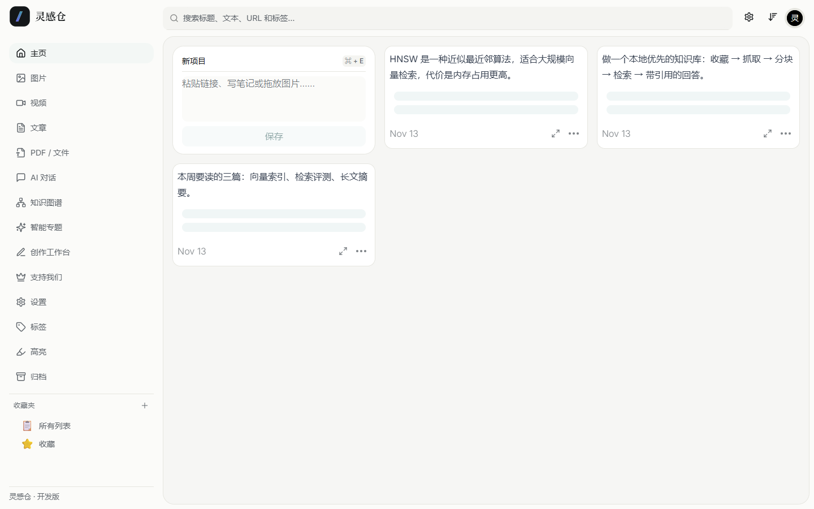
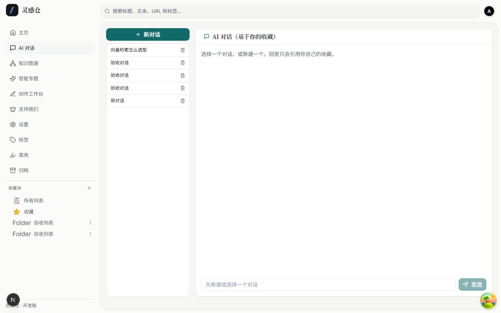
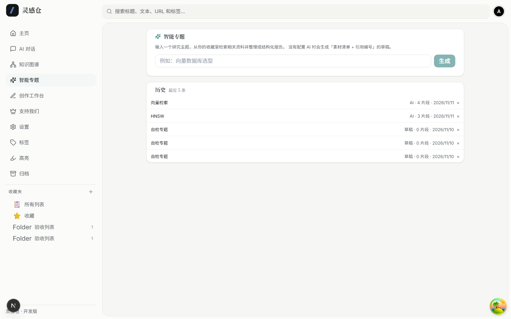
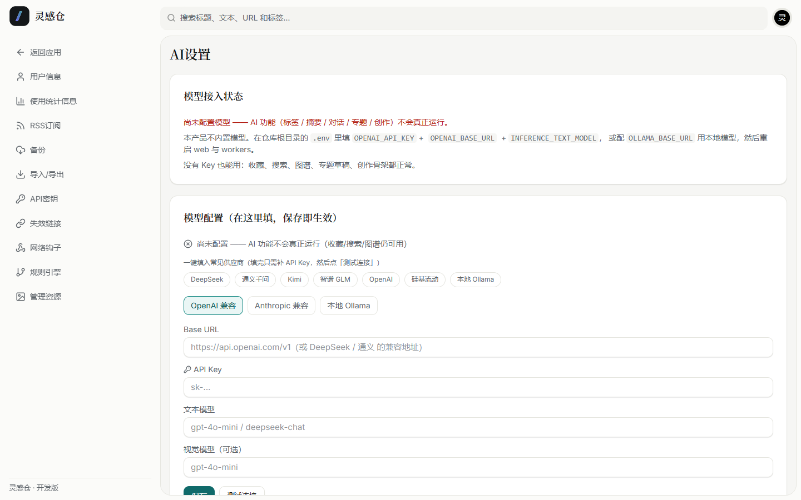
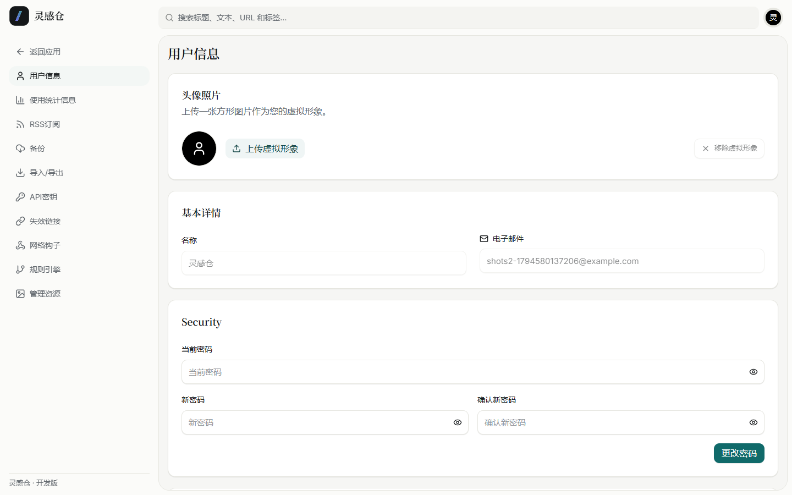
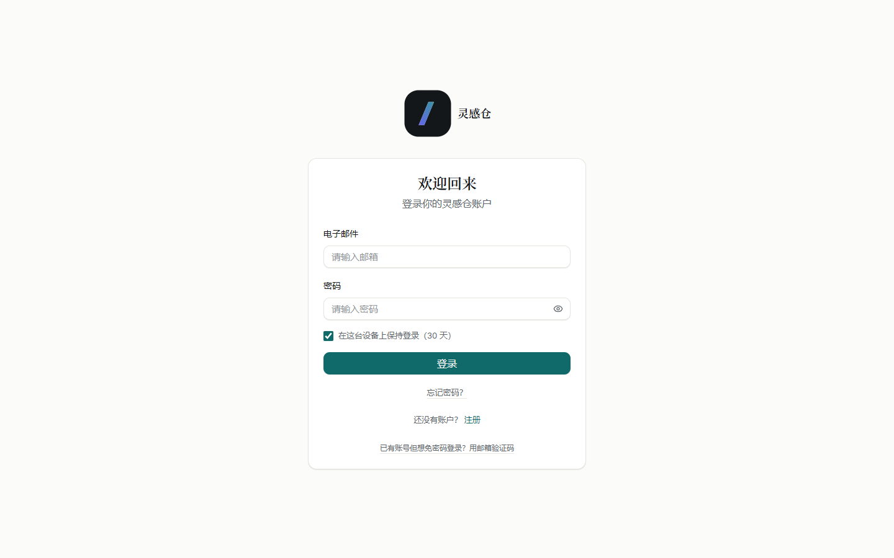
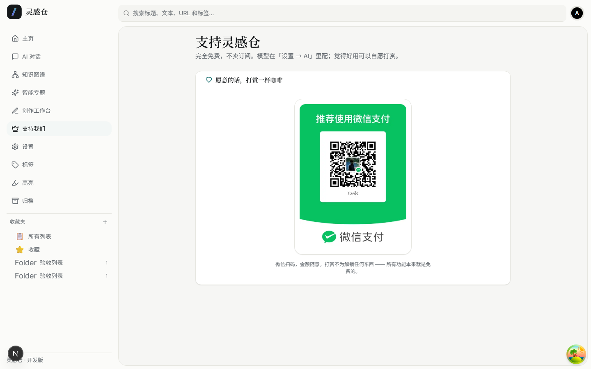

# 灵感仓 · INSIGHT VAULT

> 当前版本 **1.1.0**（2026-11-13）· Windows 安装包 147 MB · 浏览器扩展 1.3.0
>
> 把互联网收进仓库，让 AI 替你读懂它。
> AI 个人知识管理系统：收藏网页 / 图片 / PDF / 笔记 → 自动整理 → 语义检索 → 带引用的 AI 回答 → 写成东西。

本仓库基于开源项目 [Karakeep](https://github.com/karakeep-app/karakeep)（commit `fc22787`）改造，
保留其成熟的抓取、存储、队列与全端架构，在其上做品牌重塑与能力扩展。

---

## 当前状态

| 阶段 | 内容 | 状态 |
|---|---|---|
| P1 | 完整技术审计（9 份文档 + 5 份审计） | ✅ |
| P2 | 品牌与前端重构 | ✅ 完成（含官网） |
| P3 | 收藏与知识管理 | 🟢 含 4 个中国源、Raindrop 导入、导出、无 Meili 时搜索降级 |
| P4 | 组织与协作 | 🟢 关键项完成 |
| P5 | AI 知识引擎 | 🟢 分块 / RAG / 对话 / 引用回跳 / 真流式（**链路已用 mock 验证，只差真模型**） |
| P6 | 图谱 / 专题 / 创作 / 阅读台 | 🟢 全部可用（含表格视图、生成历史、Markdown 导出） |
| P7 | 商业化（订单 / 权益 / 会员中心） | 🟡 闭环可演示，缺真实支付通道 |
| P8 | 跨平台 | 🟢 Web + 浏览器扩展 + PWA + **Windows 桌面版（Electron）** |
| P9 | 交付与部署 | 🟢 部署 / 使用 / 交接 / 交付 / 验收文档 + 一键启动 + **9/9 主链路自检** |

---

## 界面

| 收藏库（分类直达 + 快速新建） | AI 对话（带引用） |
|---|---|
|  |  |

| 智能专题 | 创作工作台 |
|---|---|
|  |  |

| 设置 · AI 预设（模型自备） | 设置 · 系统状态 |
|---|---|
|  |  |

| 登录（邮箱 + 密码） | 注册（邮箱 + 验证码） |
|---|---|
|  |  |

| 支持我们（模型自备 + 自愿打赏） |
|---|
|  |

> 截图来自本机实际运行（1440×900），不是设计稿。

详细进度见 [docs/DEVELOPMENT_ROADMAP.md](docs/DEVELOPMENT_ROADMAP.md)，逐轮变更见 [docs/PHASE_2_REPORT.md](docs/PHASE_2_REPORT.md)，
交付验收见 [docs/FINAL_ACCEPTANCE.md](docs/FINAL_ACCEPTANCE.md)。

---

## 快速开始

```bash
corepack enable
pnpm install

cp .env.sample .env
# 必填：DATA_DIR、NEXTAUTH_SECRET（openssl rand -base64 36）

pnpm --filter @karakeep/db run migrate

pnpm --filter @karakeep/web run dev         # http://localhost:3000
pnpm --filter @karakeep/workers run start   # 12 个队列消费者
```

第一个注册的账号自动成为管理员。

### 账号与登录

| 场景 | 怎么做 |
|---|---|
| 注册 | 填昵称、邮箱、密码，点「发送验证码」，把邮件里的 6 位数字填进去 → **注册完成即登录** |
| 登录 | 只要 **邮箱 + 密码**；上一次用过的邮箱会自动填好，只需补密码 |
| 保持登录 | 默认勾选「在这台设备上保持登录（30 天）」；桌面版是 **365 天**（`AUTH_SESSION_DAYS`），登录一次管一年 |
| 免密码登录 | 登录页折叠入口「用邮箱验证码」：发 6 位码 → 填码即登录 |
| 忘记密码 | 邮件里的重置链接（默认 1 小时有效） |
| 没配 SMTP | 桌面版 / 本机访问时自动进入**本地模式**：验证码直接显示并填入（仅回环地址可用；公网实例不启用） |

> 验证码：注册码 15 分钟、登录码 5 分钟，一次性消费；同邮箱 60 秒冷却、每小时最多 8 次。
> SMTP 在 `.env` 里配（`SMTP_HOST/PORT/SECURE/USER/PASSWORD/FROM`）；桌面版可在托盘菜单「邮箱服务设置」里填。

---

## 桌面版（Windows）

安装包内置 Web 服务、后台任务与 SQLite，装完双击即用，不需要额外装 Node 或数据库。

| 能力 | 说明 |
|---|---|
| 启动画面 | 服务就绪前有进度反馈，不再「双击没反应」 |
| 托盘常驻 | 关窗口不退出（后台继续抓取），托盘可打开 / 快速收藏剪贴板链接 / 重启服务 / 打开数据与日志目录 |
| 全局快捷键 | `Ctrl+Shift+K` 随时唤起窗口 |
| 服务自恢复 | web / workers 意外退出会被自动拉起（最多 3 次，之后弹窗提示手动重启） |
| 记住登录 | 会话写在本地浏览器分区，重开应用仍是登录态 |
| 邮箱服务 | 托盘 →「邮箱服务设置（SMTP）」填一次，验证码就真的发邮件；不填则走本地模式 |
| 数据位置 | `%APPDATA%\InsightVault\data`（SQLite + 资产），日志在同目录 `logs\` |

构建（在仓库根目录）：

```bash
pnpm --filter @karakeep/web run build        # 产出 .next/standalone
pnpm --filter @karakeep/workers run build    # 产出 workers/dist
cd apps/desktop && npx electron-builder --win --x64
# 产物：apps/desktop/release/InsightVault-<version>-win-x64.exe
```

> 已知限制：未做代码签名（首次运行会有 SmartScreen 提示）；macOS / Linux 的打包配置已写好但未实测。


可选依赖：

| 依赖 | 作用 | 不装会怎样 |
|---|---|---|
| Meilisearch | 全文 + 向量检索 | 搜索降级为 SQL LIKE（能用，但无相关度排序与高亮） |
| Headless Chrome | 抓取 SPA / 登录墙页面 | 降级为纯 HTTP 抓取 |
| AI Key（OpenAI 兼容 / Ollama） | 标签 / 摘要 / 对话 | AI 功能返回「未配置」 |

---

## 与上游的差异

### 品牌与体验

- 独立品牌「灵感仓 INSIGHT VAULT」+ 自研品牌标记（方块 + AI 渐变光束）
- 完整 design token 层（`tooling/tailwind/tokens.css`）：品牌色、字号、圆角、阴影、动效
- **默认中文**（上游默认英文）；E2E 注入语言 cookie 保持英文断言
- 认证四页（登录 / 注册 / 忘记密码 / 重置密码）+ 邀请页全部中文化

### 能力扩展

| 能力 | 说明 |
|---|---|
| 内容形态分类 | 侧栏直达「图片 / 视频 / 文章 / PDF / 文件」，底座是查询语言 `is:image` / `is:pdf` / `is:video`（可组合，如 `is:link -is:video`） |
| AI 开箱配置 | 设置 → AI 里一键填入 DeepSeek / 通义 / Kimi / 智谱 / OpenAI / 硅基流动 / Ollama 的地址与模型名，补 Key 即用，可「测试连接」 |
| 搜索更省事 | 空查询时给 6 个可点示例（图片 / 视频 / PDF / 收藏 / 有高亮 / 没看完的链接），并记住本机最近 8 条搜索 |
| 阅读台提问 | `/reader/<id>` 右侧「就这篇提问」：只在这篇的分块里检索，回答带 `[n]` 引用可点开原文 |
| PWA 离线 | 手写 Service Worker：页面网络优先 + 静态资源缓存优先，断网仍能打开缓存页与离线兜底页 |
| 浏览器扩展 | MV3，一键收藏当前页 / 选中文字 / 图片；`pnpm test:ext` 校验构建与加载 |
| 中国内容源适配器 | 微信公众号（`#js_content` 直取）、B 站、知乎、小红书，均带降级路径 |
| URL 归一化去重 | 剥离 `utm_*` / `spm_*` / `share_token` 后判重 |
| 防盗链 Referer | 抓图自动补页面 origin，微信/小红书封面可下载 |
| 语义分块 | 段落→句子切分，500–800 token，15% 重叠，保留原文偏移 |
| RAG 拼装 | 稳定引用编号、prompt 生成、引用越界校验 |
| AI 对话 | `/dashboard/chat`：SSE 流式 + 引用 `[n]` 可点击回跳；无 Key 时明确回答「没有相关内容」 |
| 知识图谱 | `/dashboard/graph`：规则抽取 + 力导向 SVG + **表格视图**（无障碍替代） |
| 支持我们 | `/dashboard/support`（原会员中心）：**模型自备说明 + 微信打赏码**；不卖订阅、无额度墙 |
| 订单状态机 | 幂等、禁止跳步、禁止倒退 |

### 稳定性修复（来自审计）

- SQLite 开启 WAL + `busy_timeout=5000`（双进程写库不再偶发失败）
- 全页归档移到后置作业之前且失败不致命（避免重复 AI 推断与重复 webhook）
- 限流默认开启（此前语义搜索无任何限制）

---

## 目录结构

```
apps/
  web                 Next.js 16 App Router + Hono(/api)
  workers             12 个队列消费者
  browser-extension   浏览器扩展（已品牌化）
  mobile              Expo RN 客户端（未改造）
  cli / mcp           命令行与 MCP server
packages/
  db                  Drizzle schema（101 个迁移）
  trpc                业务核心（含新增 chat / graph / payment）
  shared              配置、推理、分块、RAG、URL 归一化、实体抽取、订单状态机
  shared-server       队列实例、插件加载、tracing
  shared-react        跨端 hooks 与少量 UI
  plugins             5 类插件（资产/搜索/队列/限流/向量）
docs/                 产品与工程文档
tooling/tailwind      design token 单一真源
```

---

## 文档

| 文档 | 内容 |
|---|---|
| [PRODUCT_REQUIREMENTS](docs/PRODUCT_REQUIREMENTS.md) | 定位、用户、信息架构、60+ 条需求与验收标准 |
| [TECHNICAL_AUDIT](docs/TECHNICAL_AUDIT.md) | 审计总纲：规模、模块结论、缺陷、运行验证 |
| [ARCHITECTURE](docs/ARCHITECTURE.md) | As-Is / To-Be 架构、链路图、扩展点 |
| [DATABASE_DESIGN](docs/DATABASE_DESIGN.md) | 表字典、索引、迁移纪律、扩展 DDL |
| [UI_DESIGN_SYSTEM](docs/UI_DESIGN_SYSTEM.md) | 设计系统与可落地 CSS |
| [FEATURE_MATRIX](docs/FEATURE_MATRIX.md) | 现状 vs 目标逐项对照 |
| [DEVELOPMENT_ROADMAP](docs/DEVELOPMENT_ROADMAP.md) | P1–P9 任务与里程碑 |
| [TEST_PLAN](docs/TEST_PLAN.md) | 分层策略、用例矩阵、数据隔离、CI 门槛 |
| [DECISIONS](docs/DECISIONS.md) | 19 条 ADR |
| [DEPLOYMENT](docs/DEPLOYMENT.md) | 部署、环境变量、备份恢复、安全清单 |
| [DELIVERY](docs/DELIVERY.md) | **交付清单**：产物位置、三条命令、验证步骤、已知限制 |
| [REVIEW](docs/REVIEW.md) | **复查报告**：任务书逐项核对 + 可完善清单（A/B/C 三类） |
| [HANDOFF](docs/HANDOFF.md) | **交接说明**：5 分钟上手、改过哪里、陷阱清单 |
| [RELEASE](docs/RELEASE.md) | **发布清单**：仓库设置、打 tag、桌面版出包、发布后自检 |
| [CHANGELOG](CHANGELOG.md) | 版本变更（含账号体系与桌面版改动） |
| [docs/audit/](docs/audit/) | 5 份带行号证据的源码审计（3144 行） |

---

## 质量状态

```
pnpm typecheck        22 / 22 包通过
packages/shared       235 个单测通过
packages/trpc         555 个单测通过（28 文件，含 4 类内容形态筛选 + 阅读台提问 5 条）
apps/web              79 个单测通过（10 文件，含图谱布局 7 条 / 搜索历史 6 条 / 英文守卫 1 条）
浏览器回归            13 / 13（Playwright：账号链路 + 新建笔记 + 搜索 + 分类页 + 设置页 + 390 宽 + 键盘可达）
抓取链路              5 / 5（本地假站点 → 抓取 → 标题改写 → 按标题/正文都能搜到）
导入导出              6 / 6（30 条导出对账 + UI 上传 Raindrop CSV 经 workers 落库）
PWA 离线              5 / 5（停掉服务器后仍能打开缓存页与离线页）
浏览器扩展            10 / 10（构建 + MV3 校验 + 真加载 + popup 中文化）
AI 链路（mock）       4 / 4（本地 OpenAI 兼容 mock：带引用回答 / 专题 mode=ai / 流式 delta）
备份恢复              8 / 8（备份成功 → 解包对账 → 删光 → 走导入流水线恢复 3/3）
接口级账号链路        10 / 10（含重启后 cookie 复用）
数据库迁移            101 个（可重放）
本地运行              Web + Workers + SQLite 全链路
```

**未验证**：真实模型推理（没有 Key；已用本地 OpenAI 兼容 mock 跑通协议与链路，见 `pnpm test:ai`）、
全量 e2e（需 Meilisearch + Chrome）、macOS / Linux 出包。

---

## 许可

沿用上游仓库许可（见 [LICENSE](LICENSE)）。品牌、设计系统与新增模块为本项目原创。

> **合规提示**：上游 Karakeep 采用 AGPL-3.0。本仓库以源码形式完整公开，满足其要求；
> 如果你把本项目改造成对外提供的托管服务，需要同时提供对应版本的源码（AGPL 第 13 条）。
> 商业分发前请自行确认商标与第三方依赖许可（`pnpm licenses list` 可查）。
