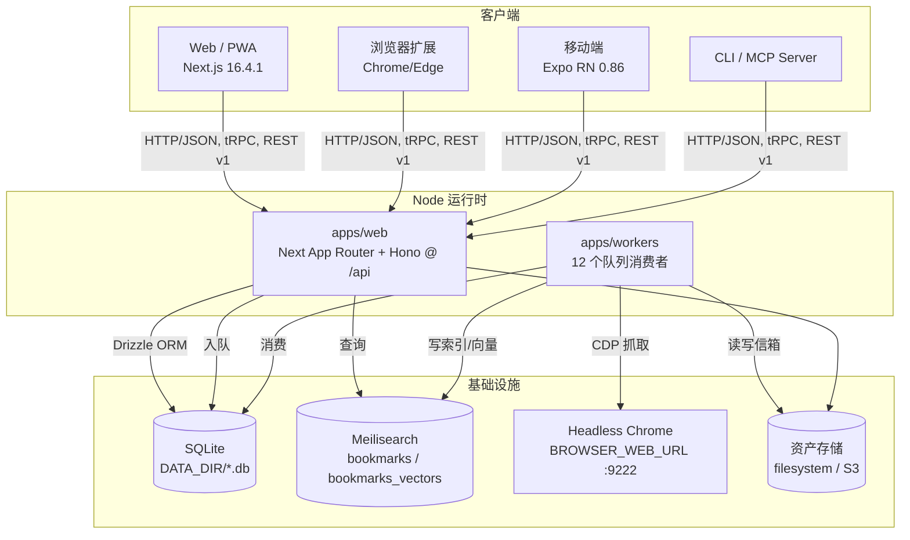
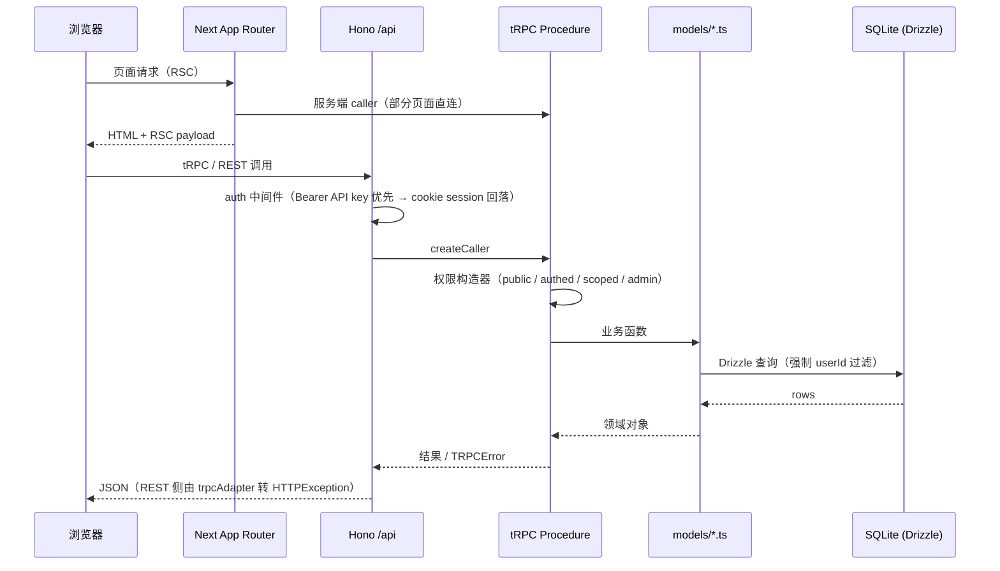
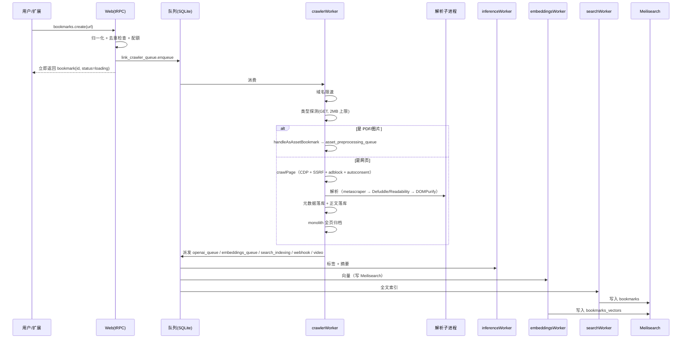
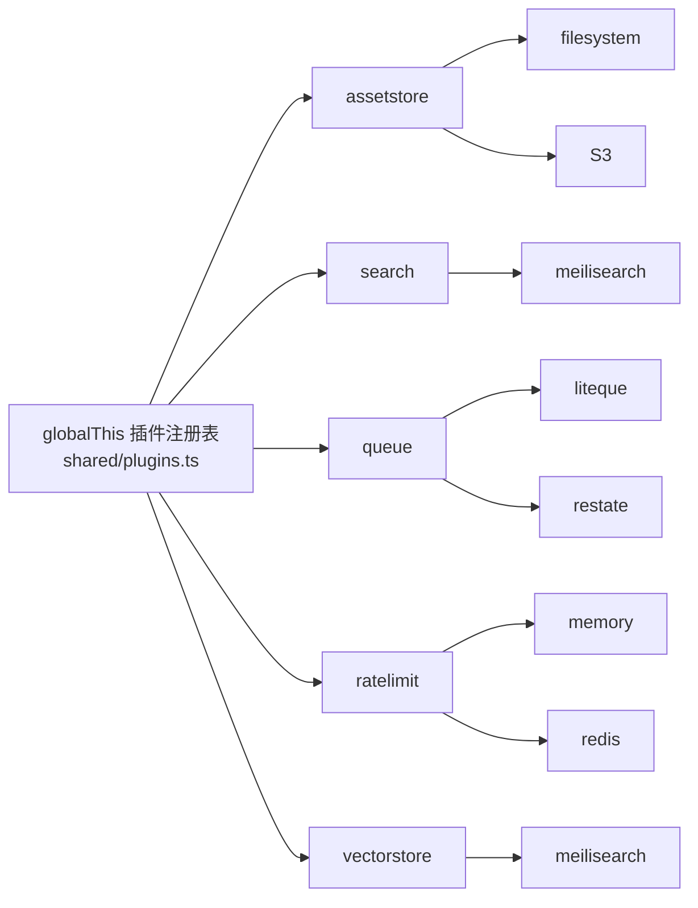
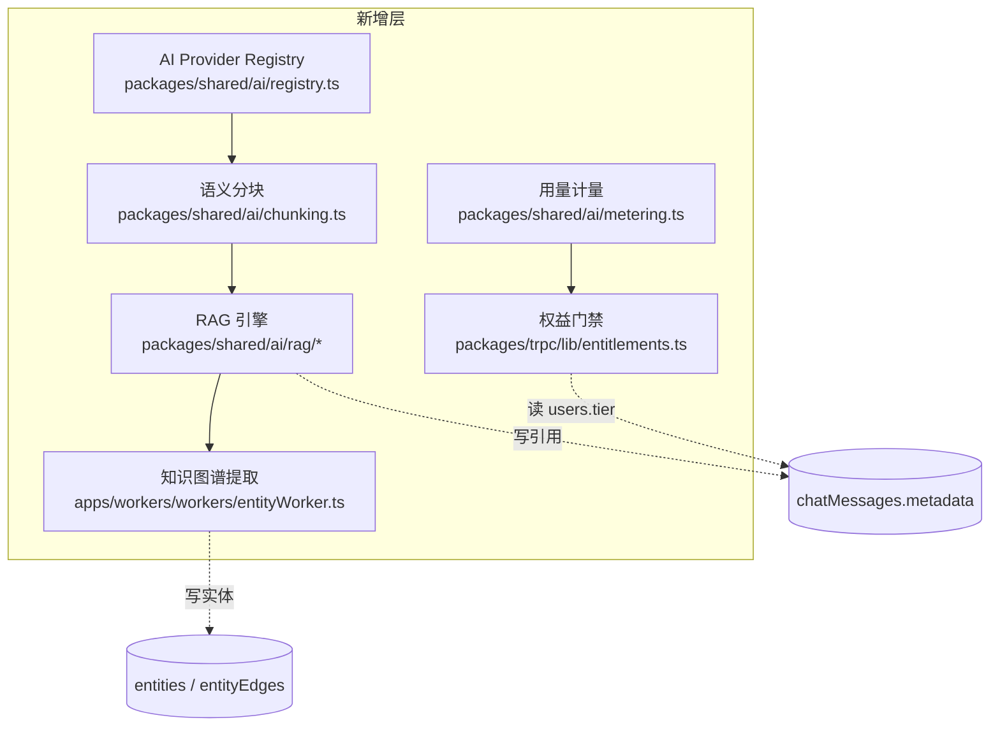
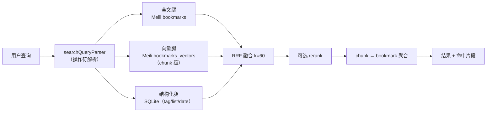
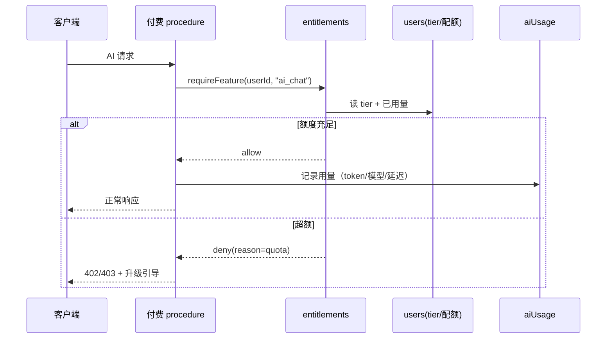
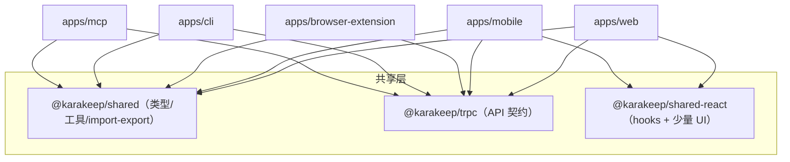

# 架构设计 ARCHITECTURE

> 基线：Karakeep `fc22787`。本文件描述**现状（As-Is）**与**目标（To-Be）**两套架构，并标注每一项改动的落点。
> 证据：`docs/audit/01-database.md`、`02-api-auth.md`、`03-workers-jobs.md`、`04-web-frontend.md`、`05-ai-search.md`

---

## 1. 一句话架构

**单进程 Web（Next.js 16 + Hono） + 单进程 Workers + SQLite（业务库 + 队列） + Meilisearch（全文与向量） + Headless Chrome（抓取）**，通过插件系统在五类后端（资产存储 / 搜索 / 队列 / 限流 / 向量）上可替换。

这是「单机可跑、Docker 一行起、无需外部中间件」的架构——正是个人知识管理产品最需要的形态。我们**保留**它，不引入 Postgres/Kafka/Redis 作为必需依赖。

---

## 2. As-Is 部署拓扑



**关键事实（均有代码证据）**

| 事实 | 证据 |
|---|---|
| 单一 Hono 应用挂在 Next 的 `/api` 下 | `apps/web/app/api/[[...route]]/route.ts:21` → `packages/api/index.ts:86-93` |
| REST **不绕过** tRPC，而是进程内 `createCallerFactory` 调 procedure | `packages/api/middlewares/auth.ts:9-37`、`routes/bookmarks.ts:56-63` |
| 队列后端是 SQLite 队列（liteque），可换 restate | `packages/shared-server/src/queues.ts`、`plugins/queue-liteque`、`plugins/queue-restate` |
| 向量不进 SQLite，写 Meilisearch 独立索引 | `plugins/vectorstore-meilisearch`、`embeddingsWorker.ts` |
| 混合检索在应用层做 RRF，不在 Meili 里做 | `packages/trpc/routers/bookmarks.ts:1157-1180`、`searchRanking.ts:13-47` |
| 订阅状态被物化进 `users` 列，热路径不查订阅表 | `lib/subscriptionEntitlements.ts:11-87`、`quotaService.ts:25-123` |

---

## 3. 请求链路（同步）



**权限构造器**（`packages/trpc/index.ts:133-237`）：

| 构造器 | 语义 | 限流 |
|---|---|---|
| `publicProcedure` | 匿名可访问 | 1000/min |
| `authedProcedure` | 登录用户 | 3000/min |
| `createScopedAuthedProcedure(resource)` | query→`read`，mutation→`readwrite` | — |
| `sessionProcedure` | 拒绝 API key，仅 session | — |
| `createAdminScopedProcedure` | scope + `role === admin` | — |

---

## 4. 异步链路（收藏全生命周期）



### 已知缺陷（必须在 Phase 3 修）

| 缺陷 | 影响 | 证据 | 修法 |
|---|---|---|---|
| `enqueuePostCrawlJobs` 在归档**之前**执行 | 归档失败 → 整 job 重试 → 重复推断 + 重复 webhook（无幂等键） | `crawlerWorker.ts:472` vs `:475-485` | 归档前置，或给后置作业加幂等键 |
| 默认并发全为 1 | 单慢域名占满 crawler；单慢 webhook 阻塞全站 | `config.ts:139-146` | 按队列类型分别提高并发 |
| `restate` 后端 `cancelAllNonRunning()` 未实现 | 管理端统计恒 0、批量取消失效 | `queue-restate/src/index.ts:72-94` | 锁死 liteque 为默认，restate 标注实验 |
| 首次抓取无幂等键 | 用户连点会产生重复任务 | `bookmarks.ts:506-511` | 用 URL 归一化 + 时间窗去重 |
| 只监听 SIGTERM，不等待在飞作业 | 部署重启丢任务 | `exit.ts:5-11`、`index.ts:188-194` | 优雅退出的 drain 窗口 |

---

## 5. 数据层总览

详细表结构见 [DATABASE_DESIGN](DATABASE_DESIGN.md)。要点：

- **33 张表**，全部在 `packages/db/schema.ts`；
- **97 个迁移**，`packages/db/drizzle/0096_*` 为最新；
- 单一 SQLite 文件（WAL），队列与业务共库或分库取决于插件；
- 用户隔离靠 `userId` 列 + 外键，所有单用户查询强制过滤；
- 共享列表是唯一跨用户读通路，且做了字段级脱敏。

---

## 6. 插件与扩展点



规则：**last-one-wins**，加载顺序决定覆盖关系（`shared-server/src/plugins.ts:24-39`）。

**没有** Inference 插件类型——AI provider 走 `inference.ts` 的硬编码分支（`210-250`）。这是我们要补的第六类插件。

---

## 7. To-Be 架构（灵感仓）

### 7.1 新增的六个模块



| 模块 | 位置 | 依赖的上游结构 |
|---|---|---|
| Provider Registry | `packages/shared/ai/registry.ts` | 复用 `inference.ts` 的 `InferenceClient` / `EmbeddingClient` 接口 |
| 语义分块 | `packages/shared/ai/chunking.ts` | 新表 `bookmarkChunks`（迁移 0097+） |
| RAG | `packages/shared/ai/rag/{retrieve,compose,cite}.ts` + `trpc/routers/chat.ts` | 复用 `chatSessions` / `chatMessages`（迁移 0088 已建） |
| 知识图谱 | `apps/workers/workers/entityWorker.ts` + `trpc/routers/graph.ts` | 新表 `entities` / `entityEdges` |
| 用量计量 | `packages/shared/ai/metering.ts` + `aiUsage` 表 | 复用 `eventLogger` 思路 |
| 权益门禁 | `packages/trpc/lib/entitlements.ts` | 复用 `users.tier` 三列物化设计 |

### 7.2 推理接口改造（RAG 的前置）

现状接口只接受**单条 prompt / 单条 user message，无 streaming**，这是 RAG 长不出来的根因（`inference.ts:130-140`、`:344`）。

```ts
// 目标接口（保持向后兼容：旧签名变为 messages 的单元素特例）
interface ChatMessage { role: "system" | "user" | "assistant" | "tool"; content: string; }

interface InferenceClient {
  chat(req: { messages: ChatMessage[]; temperature?: number; maxTokens?: number;
              stream?: boolean; jsonSchema?: object }): Promise<ChatResult> | AsyncIterable<ChatChunk>;
  capabilities(): { text: boolean; vision: boolean; json: boolean; streaming: boolean };
}
```

### 7.3 检索架构（目标）



与现状的差异：**向量从「文档级」升级为「块级」**，并新增聚合与片段高亮。

### 7.4 商业化门禁



---

## 8. 部署形态

### 8.1 单机（默认，Phase 1–8）

```yaml
services:
  web:        # Next standalone，:3000
  workers:    # 队列消费者，无端口
  meilisearch: # :7700，持久卷
  chrome:     # CDP :9222
volumes:
  data:       # DATA_DIR：SQLite + 资产
  meilisearch:
```

环境变量见 [TECHNICAL_AUDIT](TECHNICAL_AUDIT.md) §7。

### 8.2 生产（Phase 9 目标）

| 关注点 | 方案 |
|---|---|
| 反向代理 | Caddy/Nginx，TLS 终止 |
| 备份 | `backup_queue` 定时导出 + 卷快照 |
| 可观测 | OTEL traces（已有 `tracing.ts`）+ 结构化日志 + `/api/metrics` |
| 扩容 | Web 无状态可横向；Workers 按队列拆进程；Meilisearch 独立实例 |
| 多租户 | 单实例内多用户（已支持）；单用户单实例（自托管）两种模式 |

---

## 9. 跨端架构



**必须遵守的跨端规则**：

1. 业务逻辑只写在 `packages/trpc` 与 `packages/shared`，客户端不复制；
2. 数据模型只在 `packages/db` 定义，客户端从 tRPC 类型推导；
3. 跨端共享的 UI 只有 Button/Popover/Textarea/BookmarkHtmlHighlighter——**共享 UI 的 token 必须两端一致**（当前不一致，见 [UI_DESIGN_SYSTEM](UI_DESIGN_SYSTEM.md) §2.4）。

---

## 10. 安全与隔离（架构级约束）

| 约束 | 实现 | 验证 |
|---|---|---|
| 所有单用户查询带 `userId` | models/*.ts | CODE REVIEW + E2E 越权用例 |
| 共享列表字段级脱敏 | `models/bookmarks.ts:810-823`、`highlights.service.ts:43-52` | 单测 |
| AI Key 只在服务端 | `config.ts` 读取，客户端只拿布尔 | 单测（序列化检查） |
| 抓取 SSRF 防护 | `network.ts` 子请求校验 | 单测（已有 `network.test.ts`） |
| 上传类型/大小校验 | asset 路由 + 配额 | E2E |
| 限流 | `plugins/ratelimit-*`（**当前默认关闭**） | 需在 Phase 3 打开 |

**已知待修**：`lists.removeFromList` 缺 `ensureBookmarkOwnership`（`routers/lists.ts:146-157`），editor 可移除他人加入的条目——Phase 7 前必须修。

---

## 11. 技术债清单（按优先级）

| # | 债务 | 影响 | 阶段 |
|---|---|---|---|
| 1 | 后置作业先于归档，无幂等 | 重复推断/重复 webhook | 3 |
| 2 | 限流默认关闭 | 成本裸奔 | 3 |
| 3 | 无分块 | 长文检索质量差、RAG 不可用 | 5 |
| 4 | 推理接口无 messages/streaming | RAG 不可实现 | 5 |
| 5 | 前端 338 处硬编码色 + 387 任意值 | 品牌化无法收敛 | 2 |
| 6 | i18n 覆盖不全（200 个 tsx 无引用） | 中文体验割裂 | 2 |
| 7 | 主色明暗不一致 + 跨端 token 冲突 | 品牌不一致 | 2 |
| 8 | e2e 依赖英文可访问名 | 文案一改全红 | 2 |
| 9 | `restate` 后端能力缺口 | 迁移后管理端失真 | 9 |
| 10 | 邀请码永不过期 | 付费席位不可审计 | 7 |
