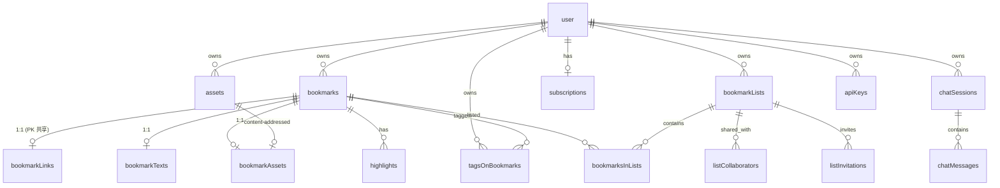

# 数据库设计 DATABASE DESIGN

> 现状部分来自 `docs/audit/01-database.md`（1357 行，逐表证据）；扩展部分是灵感仓的目标设计。
> 约束：**继续使用 SQLite**（单机可跑是产品卖点），不引入 Postgres 作为必需依赖（ADR-007）。

---

## 1. 技术栈与运行形态

| 项 | 值 |
|---|---|
| 驱动 | `better-sqlite3` ^13（同步 API）+ `drizzle-orm` ^0.45（sqlite 方言） |
| 业务库 | `${DATA_DIR}/db.db` 单文件 |
| 队列库 | `${DATA_DIR}/queue.db`（由 liteque 插件自行管理、自行迁移） |
| 迁移 | `packages/db/drizzle/*.sql`，97 个，`pnpm db:migrate` 应用 |
| 生成 | `pnpm db:generate --name <描述>`（drizzle-kit） |
| 大小 | 迁移后空库 626,688 B |

**P0 待修**：未设 `busy_timeout`，WAL 默认关闭（`sqlite.ts:26-46`、`config.ts:307`）。Web 与 Workers 是两个进程，同时写库必然偶发 `SQLITE_BUSY`。上线前必须：

```ts
db.pragma("journal_mode = WAL");
db.pragma("busy_timeout = 5000");
db.pragma("synchronous = NORMAL");
db.pragma("foreign_keys = ON");
```

---

## 2. 实体关系（核心 16 表）



三类内容表通过**共享主键**与 `bookmarks` 做 1:1 扩展：类型由 `bookmarks.type` 决定（`link` / `text` / `asset`），这是「一条收藏一条内容」的设计，也是后续做「文章 + 附件」多内容模型时要动的地方。

---

## 3. 表字典（34 张，按域分组）

### 3.1 身份与会话（7）

| 表 | 用途 | 关键字段 | 备注 |
|---|---|---|---|
| `user` | 账户 | `id, name, email, emailVerified, role, image, bookmarkQuota, storageQuota, browserCrawlingEnabled, tier*` | 配额与订阅物化在此 |
| `account` | better-auth 账号绑定 | `userId, providerId, accountId, password` | 密码哈希在此 |
| `session` | 会话 | `token, userId, expiresAt` | cookie 载体 |
| `verificationToken` | 邮件验证 | `identifier, token, expiresAt` | |
| `apiKey` | API 令牌 | `key(哈希), userId, scopes, name` | scopes 默认值只在 DDL |
| `invites` | 邀请码 | `id, token, createdBy` | **无 expiresAt**（待修） |
| `subscriptions` | 订阅（Stripe/RevenueCat/manual） | `userId, provider, status, tier, periodEnd` | 三源共用 |

> `tier*` 指落库的权益列（`bookmarkQuota` / `storageQuota` / `browserCrawlingEnabled`），由 webhook 物化，请求时只读。

### 3.2 收藏与内容（6）

| 表 | 用途 | 关键字段 |
|---|---|---|
| `bookmarks` | 收藏主表 | `id, userId, type, title(生成列), archived, favourited, createdAt(实为 lastSavedAt), summary, note, embeddingStatus, taggingStatus` |
| `bookmarkLinks` | 链接内容 | `bookmarkId, url, finalUrl, title, description, imageUrl, favicon, htmlContent, crawledAt, crawlStatus, readerViewStatus` |
| `bookmarkTexts` | 文本内容 | `bookmarkId, text` |
| `bookmarkAssets` | 资产型内容 | `bookmarkId, assetId, assetType` |
| `assets` | 资产元数据 | `id, userId, assetType, size, contentType, fileName, key` （字节在 FS/S3） |
| `highlights` | 高亮批注 | `id, bookmarkId, userId, startOffset, endOffset, color, text, note, textAnchor(prefix/suffix)` |

### 3.3 组织（6）

| 表 | 用途 | 关键字段 |
|---|---|---|
| `bookmarkTags` | 标签（用户域） | `id, userId, name, normalizedName` |
| `tagsOnBookmarks` | 标签关联 | `bookmarkId, tagId, userId, attachedBy('human'/'ai'), attachedAt` |
| `bookmarkLists` | 收藏夹 | `id, userId, name, icon, description, type, public` |
| `bookmarksInLists` | 夹内条目 | `bookmarkId, listId, userId, addedAt` |
| `listCollaborators` | 协作者 | `listId, userId, role('owner'/'editor'/'viewer')` |
| `listInvitations` | 协作邀请 | `listId, email, role, token` |

### 3.4 AI 与对话（3）

| 表 | 状态 |
|---|---|
| `customPrompts` | ✅ 已用（自定义提示词） |
| `chatSessions` | ⚠️ **沉睡**（建了表，零引用） |
| `chatMessages` | ⚠️ **沉睡**（`role` 预留 `toolResult`，`metadata` 可放 citations） |

### 3.5 集成与系统（7）

`rssFeeds`、`rssFeedImports`、`webhooks`、`backups`、`config`（**沉睡**）、`ruleEngineRules`、`ruleEngineActions`。

规则引擎的复合外键 `(userId,tagId)→bookmarkTags`、`(userId,listId)→bookmarkLists` 是**全库唯一的 DB 级租户校验**。

### 3.6 导入（3）

`importSessions` → `importSessionBookmarks` / `importStagingBookmarks`（0077 引入，题面 33 表之外的第 34 张）。

### 3.7 计费（2）

`subscriptions`（跨 provider）+ `inAppSubscriptions`（应用内购买凭据，RevenueCat）。

---

## 4. 字段语义陷阱（改代码前必读）

| 陷阱 | 说明 |
|---|---|
| `bookmarks.createdAt` | **实际是 `lastSavedAt`**（0092 迁移改的排序语义），字段名没跟着改 |
| `tagsOnBookmarks.attachedAt` | schema 声明 `integer`，实际 DDL 是 TEXT 亲和 |
| `tagsOnBookmarks.attachedBy` | schema 声明 `notNull`，实际可空 |
| `apiKey.scopes` / `bookmarks.type` / `bookmarkLists.type` | 默认值只存在于 DDL，schema 里没有 |
| `assets` 不存字节 | 只存 `key`，删库不会删对象存储与搜索索引 |

> 直接跑 `drizzle-kit generate` 会产出**错误迁移**（把实际 DDL 改回 schema 声明）。改 schema 前先修这四处漂移，否则迁移历史会分叉。

---

## 5. 索引与查询计划

**69 个命名索引**，分类：

| 类别 | 数量 | 代表 |
|---|---|---|
| 唯一性 | 17 | `bookmarkLinks.url` 去重、`bookmarkTags (userId, normalizedName)` |
| 租户分页 | 4 | `(userId, archived, lastSavedAt, id)`、`(userId, favourited, lastSavedAt, id)` |
| 父实体反查 | 43 | `tagsOnBookmarks.tagId`、`bookmarksInLists.listId` |
| 去重/名称 | 5 | |
| **全文检索** | **0** | SQLite 内无 FTS；全文在 Meilisearch |

**已知问题**：

1. 8 个前缀重复索引（如 `(a)` 与 `(a,b)` 并存），纯写放大 → Phase 4 清理。
2. `listId` / `tagId` 过滤 + `lastSavedAt` 排序 → `USE TEMP B-TREE FOR ORDER BY`，每页重排整个容器 → Phase 4 加覆盖索引或改游标。
3. `title` / `name` 的 `LIKE '%…%'` 是 `SCAN`（前端搜索建议会随数据量退化）。
4. 搜索把命中 id **全量物化**成 `id IN (...)` 交给 Meilisearch，万级会构造上万 id（`lib/search.ts:297-307`）→ Phase 5 改成「检索后置过滤」或分段。

---

## 6. 多租户与隔离

| 类型 | 表数 | 说明 |
|---|---|---|
| 自持 `userId` | 21 | 直接 `WHERE userId = ?` |
| 继承（经父表） | 9 | 如 `tagsOnBookmarks` 经 `bookmarks` |
| 全局 | 4 | `user`、`config`、`invites`、`verificationToken` |

- **无 RLS、无触发器**，隔离完全靠应用层（代码里三处 `// Access control` 注释）。
- **共享列表是刻意的破口**：协作者能读列表内全部书签（含他人的），但**搜索只按 `userId` 过滤**，所以协作内容搜不到（Phase 4 修）。
- **级联只清行**：48 个 `CASCADE` + 6 个 `SET NULL`，不会清理对象存储与搜索索引 → 需要「删除编排」而非依赖外键。
- 指向 `user` 的外键 24 行来自 22 张表：删用户是重操作，必须有事务 + 异步清理。

---

## 7. 迁移规范（我们自己的纪律）

1. 任何 schema 变更必须 `pnpm db:generate --name <中文或英文短描述>`，**禁止手写 SQL 迁移**（除数据修复脚本）。
2. 迁移必须**幂等可重放**：新列带默认值、新表 `IF NOT EXISTS`。
3. 破坏性变更（删列/改类型）走三步：加新列 → 双写 + 回填 → 删旧列（跨两个版本）。
4. 每次迁移在 PR 内附「回滚方案」与「数据量估算」。
5. 迁移文件只在 Phase 内追加，**不修改已发布迁移**。

---

## 8. 目标扩展设计（灵感仓，DDL 草案）

### 8.1 会员与用量（Phase 7）

```sql
-- 权益实体：把「物化三列」升级为可审计的权益记录
CREATE TABLE IF NOT EXISTS user_entitlements (
  userId        TEXT PRIMARY KEY REFERENCES user(id) ON DELETE CASCADE,
  tier          TEXT NOT NULL DEFAULT 'free',        -- free | pro | max
  source        TEXT NOT NULL DEFAULT 'manual',      -- stripe | revenuecat | manual | grant
  periodStart   INTEGER,
  periodEnd     INTEGER,
  aiTokensLimit INTEGER NOT NULL DEFAULT 200000,
  aiCallsLimit  INTEGER NOT NULL DEFAULT 200,
  storageLimit  INTEGER NOT NULL DEFAULT 1073741824,
  updatedAt     INTEGER NOT NULL DEFAULT (unixepoch())
);

-- 用量计数：按周期 + 维度聚合，避免每请求 COUNT(*)
CREATE TABLE IF NOT EXISTS usage_counters (
  userId    TEXT NOT NULL REFERENCES user(id) ON DELETE CASCADE,
  metric    TEXT NOT NULL,          -- ai_calls | ai_tokens | storage_bytes | semantic_search
  period    TEXT NOT NULL,          -- 2026-11（月）
  value     INTEGER NOT NULL DEFAULT 0,
  PRIMARY KEY (userId, metric, period)
);

-- AI 用量事件：明细可审计、可对账
CREATE TABLE IF NOT EXISTS ai_usage_events (
  id        TEXT PRIMARY KEY,
  userId    TEXT NOT NULL REFERENCES user(id) ON DELETE CASCADE,
  task      TEXT NOT NULL,          -- tagging | summarize | embed | chat | ocr | entity
  provider  TEXT NOT NULL,
  model     TEXT NOT NULL,
  promptTokens     INTEGER NOT NULL DEFAULT 0,
  completionTokens INTEGER NOT NULL DEFAULT 0,
  latencyMs INTEGER,
  bookmarkId TEXT,
  costMicros INTEGER NOT NULL DEFAULT 0,   -- 百万分之一货币单位
  createdAt INTEGER NOT NULL DEFAULT (unixepoch())
);
CREATE INDEX IF NOT EXISTS ai_usage_user_time ON ai_usage_events(userId, createdAt);
CREATE INDEX IF NOT EXISTS ai_usage_task_time ON ai_usage_events(task, createdAt);
```

### 8.2 分块与 RAG（Phase 5）

```sql
CREATE TABLE IF NOT EXISTS bookmark_chunks (
  id          TEXT PRIMARY KEY,
  bookmarkId  TEXT NOT NULL REFERENCES bookmarks(id) ON DELETE CASCADE,
  userId      TEXT NOT NULL REFERENCES user(id) ON DELETE CASCADE,
  ordinal     INTEGER NOT NULL,
  text        TEXT NOT NULL,
  tokenCount  INTEGER NOT NULL DEFAULT 0,
  startOffset INTEGER,             -- 原文定位（用于引用回跳）
  endOffset   INTEGER,
  embeddingStatus TEXT NOT NULL DEFAULT 'pending',
  embeddingModel  TEXT,
  embeddingDims   INTEGER,
  contentHash TEXT NOT NULL,
  createdAt   INTEGER NOT NULL DEFAULT (unixepoch())
);
CREATE UNIQUE INDEX IF NOT EXISTS chunk_bookmark_ordinal ON bookmark_chunks(bookmarkId, ordinal);
CREATE INDEX IF NOT EXISTS chunk_user ON bookmark_chunks(userId);

-- 引用：回答中的 [n] 指向具体 chunk
ALTER TABLE chat_messages ADD COLUMN citations TEXT; -- JSON: [{n, chunkId, bookmarkId, quote}]
```

### 8.3 知识图谱（Phase 6）

```sql
CREATE TABLE IF NOT EXISTS entities (
  id            TEXT PRIMARY KEY,
  userId        TEXT NOT NULL REFERENCES user(id) ON DELETE CASCADE,
  kind          TEXT NOT NULL,      -- person | place | org | product | tech | concept | topic
  name          TEXT NOT NULL,
  normalizedName TEXT NOT NULL,
  description   TEXT,
  mentionCount  INTEGER NOT NULL DEFAULT 0,
  createdAt     INTEGER NOT NULL DEFAULT (unixepoch())
);
CREATE UNIQUE INDEX IF NOT EXISTS entity_user_norm ON entities(userId, kind, normalizedName);

CREATE TABLE IF NOT EXISTS entity_mentions (
  id         TEXT PRIMARY KEY,
  entityId   TEXT NOT NULL REFERENCES entities(id) ON DELETE CASCADE,
  bookmarkId TEXT NOT NULL REFERENCES bookmarks(id) ON DELETE CASCADE,
  userId     TEXT NOT NULL REFERENCES user(id) ON DELETE CASCADE,
  chunkId    TEXT,
  quote      TEXT,
  confidence REAL NOT NULL DEFAULT 0.8
);
CREATE INDEX IF NOT EXISTS entity_mention_entity ON entity_mentions(entityId);

CREATE TABLE IF NOT EXISTS entity_relations (
  id           TEXT PRIMARY KEY,
  userId       TEXT NOT NULL REFERENCES user(id) ON DELETE CASCADE,
  fromEntityId TEXT NOT NULL REFERENCES entities(id) ON DELETE CASCADE,
  toEntityId   TEXT NOT NULL REFERENCES entities(id) ON DELETE CASCADE,
  relation     TEXT NOT NULL,       -- mentions | part_of | related_to | works_for ...
  weight       REAL NOT NULL DEFAULT 1.0,
  evidenceBookmarkId TEXT
);
CREATE UNIQUE INDEX IF NOT EXISTS entity_relation_unique
  ON entity_relations(userId, fromEntityId, toEntityId, relation);
```

### 8.4 中文内容适配（Phase 3）

```sql
ALTER TABLE bookmarkLinks ADD COLUMN lang TEXT;              -- zh-CN / en ...
ALTER TABLE bookmarkLinks ADD COLUMN canonicalUrl TEXT;      -- 归一化后的稳定 URL
ALTER TABLE bookmarkLinks ADD COLUMN contentHash TEXT;       -- 正文指纹，用于「内容变了」检测
ALTER TABLE bookmarkLinks ADD COLUMN adapter TEXT;           -- wechat | bilibili | xhs | zhihu | generic
ALTER TABLE bookmarkLinks ADD COLUMN adapterStatus TEXT;     -- ok | login_required | blocked | manual

-- 物化检索文本：把标题/正文/OCR/高亮拼成一份，供 Meilisearch 与关键词检索
CREATE TABLE IF NOT EXISTS bookmark_search_texts (
  bookmarkId TEXT PRIMARY KEY REFERENCES bookmarks(id) ON DELETE CASCADE,
  userId     TEXT NOT NULL REFERENCES user(id) ON DELETE CASCADE,
  title      TEXT NOT NULL DEFAULT '',
  body       TEXT NOT NULL DEFAULT '',
  ocr        TEXT NOT NULL DEFAULT '',
  highlights TEXT NOT NULL DEFAULT '',
  lang       TEXT,
  updatedAt  INTEGER NOT NULL DEFAULT (unixepoch())
);
```

> **不引入 SQLite FTS5**：全文检索继续交给 Meilisearch（已在架构里、支持中文分词配置与向量），避免双写两套索引。若未来要做「无 Meilisearch 的降级模式」，再评估 FTS5 + unicode61 分词。

### 8.5 商业化补强（Phase 7）

```sql
CREATE TABLE IF NOT EXISTS orders (
  id           TEXT PRIMARY KEY,
  userId       TEXT NOT NULL REFERENCES user(id) ON DELETE CASCADE,
  provider     TEXT NOT NULL,        -- stripe | alipay | wechat
  providerRef  TEXT NOT NULL,        -- 外部订单号
  status       TEXT NOT NULL,        -- created|pending|paid|fulfilled|failed|refunding|refunded|canceled
  plan         TEXT NOT NULL,        -- pro_month | pro_year | max_month | max_year
  amountMinor  INTEGER NOT NULL,
  currency     TEXT NOT NULL DEFAULT 'CNY',
  paidAt       INTEGER,
  refundedAt   INTEGER,
  rawPayload   TEXT,
  createdAt    INTEGER NOT NULL DEFAULT (unixepoch())
);
CREATE UNIQUE INDEX IF NOT EXISTS order_provider_ref ON orders(provider, providerRef);
CREATE INDEX IF NOT EXISTS order_user_time ON orders(userId, createdAt);

CREATE TABLE IF NOT EXISTS webhook_events (
  id          TEXT PRIMARY KEY,
  provider    TEXT NOT NULL,
  externalId  TEXT NOT NULL,
  type        TEXT NOT NULL,
  receivedAt  INTEGER NOT NULL DEFAULT (unixepoch()),
  processedAt INTEGER,
  status      TEXT NOT NULL DEFAULT 'received',
  error       TEXT
);
CREATE UNIQUE INDEX IF NOT EXISTS webhook_event_unique ON webhook_events(provider, externalId);
```

---

## 9. 备份、恢复与容量

| 项 | 方案 |
|---|---|
| 备份 | 复用 `backups` 表 + `backup_queue`；导出 JSON + 资产清单；SQLite 用 `VACUUM INTO` 做一致性快照 |
| 恢复 | 导入会话（`importSessions`）回放；资产按 `key` 校验 SHA |
| 删除用户 | 事务删行 → 异步删对象存储 → 异步删 Meilisearch 文档 → 写审计日志 |
| 容量估算 | 单条链接 ≈ 8 KB 元数据 + 正文 200 KB + 截图 300 KB + PDF 1 MB；10 万条 ≈ 60 GB（资产为主） |
| 索引体积 | Meilisearch 约为正文字数的 30–40% |

---

## 10. 验收清单（数据库层）

- [ ] WAL + busy_timeout 已开启，双进程并发写 1000 次 0 失败
- [ ] 69 个索引中 8 个前缀重复索引已清理，`EXPLAIN QUERY PLAN` 无 `TEMP B-TREE`
- [ ] 4 处 schema 漂移已修，`drizzle-kit generate` 产出空迁移
- [ ] 每个新表都有 `userId` + 索引 + 级联策略
- [ ] 删用户后：行、资产、搜索文档、向量全部消失（自动化用例）
- [ ] 任意查询在 10 万条数据下 P95 <300 ms
