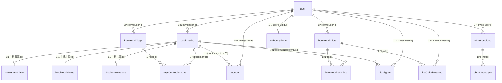

# 数据层审计

> 审计对象：`insight-vault`（Karakeep 快照，commit `fc22787`）的 `packages/db` 与全部数据库相关代码。
> 方法：只读静态阅读 + 用 `node:sqlite` 在内存库内**回放全部 97 个迁移**做产物校验（不触碰仓库文件、不写任何 DB 文件）。
> 结论格式：每条判断后标注证据 `path:line`。凡标注「实测」的，均由回放脚本读出，可复现（脚本内容见 §1.6）。

## 1. 数据库技术栈与运行方式

### 1.1 驱动与 ORM

| 项 | 值 | 证据 |
| --- | --- | --- |
| 驱动 | `better-sqlite3 ^13.0.3`（同步 API，无连接池） | `packages/db/package.json:23` |
| ORM | `drizzle-orm ^0.45.4`，编译期类型 + 运行期 SQL builder | `packages/db/package.json:24` |
| 迁移工具 | `drizzle-kit ^0.31.10`（`dialect: "sqlite"`，`schema: ./schema.ts`，`out: ./drizzle`） | `packages/db/drizzle.config.ts:11-17` |
| 事务类型 | `SQLiteTransaction<"sync", …>`，即**同步事务**，不可与异步 I/O 混用 | `packages/db/index.ts:11-18` |
| 会话级单例 | 模块被 import 时立即打开数据库并注入 OTel 包装，全进程共享一个 `db` | `packages/db/drizzle.ts:15-22` |

驱动是同步的 better-sqlite3，这一点决定了数据层的基本形态：所有查询都是阻塞式调用，事务回调里只能写同步代码（`QuotaService.canCreateBookmarkInTransaction` 用 `.sync()` 版本就是被迫的，`packages/shared-server/src/services/quotaService.ts:49-77`）。

### 1.2 单库还是多库：一个业务库 + 一个队列库

- **业务库**：`${DATA_DIR}/db.db`；未配置 `DATA_DIR` 时退化为 `./db.db`（`packages/db/drizzle.config.ts:7-9`）。`DATA_DIR` 同时是资产默认根目录 `${DATA_DIR}/assets`（`packages/shared/config.ts:505`）。
- **队列库**：`${DATA_DIR}/queue.db`，由 `queue-liteque` 插件**独立**打开并自行迁移（`packages/plugins/queue-liteque/src/index.ts:66-68`、`:72-74`）。它不被 drizzle 管理，也没有任何 `schema.ts` 表定义。选 `queue-restate` 时不存在该文件（插件目录并列见 `packages/plugins/queue-liteque`、`packages/plugins/queue-restate`）。
- 结论：**业务数据是单库单文件**；`queue.db` 属于基础设施旁路，不参与 ER 模型，也不受本审计的表/索引结论约束。

### 1.3 连接参数与 PRAGMA（逐条）

全部 PRAGMA 集中在 `packages/db/sqlite.ts`，没有第二处（全仓 grep `pragma(` 仅命中该文件）：

| PRAGMA | 值 | 生效条件 | 证据 |
| --- | --- | --- | --- |
| `journal_mode` | `WAL` | `DB_WAL_MODE=true` | `packages/db/sqlite.ts:27-29` |
| `journal_mode` | `DELETE` | 默认（`DB_WAL_MODE` 缺省 `false`） | `packages/db/sqlite.ts:30-32`；`packages/shared/config.ts:307`、`:593-595` |
| `synchronous` | `NORMAL` | 仅 WAL 分支 | `packages/db/sqlite.ts:29` |
| `cache_size` | `-65536`（≈64 MiB） | 始终 | `packages/db/sqlite.ts:34` |
| `foreign_keys` | `ON` | 始终（含只读） | `packages/db/sqlite.ts:35` |
| `temp_store` | `MEMORY` | 始终 | `packages/db/sqlite.ts:36` |
| `query_only` | `ON` | 降级模式（只读打开） | `packages/db/sqlite.ts:38-39`、`packages/db/drizzle.ts:16` |
| `analysis_limit` | `400` | 可写连接 | `packages/db/sqlite.ts:45` |
| `optimize` | `0x10002` 启动一次，此后每 24h 一次 `optimize` | 可写连接 | `packages/db/sqlite.ts:5`、`:46`、`:49-54` |

两个必须点名的缺口：

1. **WAL 默认关闭**（`DB_WAL_MODE` 默认 `false`）。在 `journal_mode=DELETE` 下，Web 进程与 Workers 进程同时写同一个 `db.db` 时，读会阻塞写、写会阻塞读。
2. **没有设置 `busy_timeout`**。全仓 `pragma(` 只出现在 `sqlite.ts`，该文件没有 `busy_timeout`（`packages/db/sqlite.ts:26-46`）。better-sqlite3 默认 `busy_timeout=0`，遇到 `SQLITE_BUSY` 立即抛错而不是等待。这与「Web + Workers 共享同一个 db 文件」（`docker/root/etc/s6-overlay/s6-rc.d/svc-web/run:4-5`、`svc-workers/run:4-5`）的部署形态叠加，属于**首要运行期风险**。详见 §7.0。

### 1.4 迁移的执行时机

| 场景 | 时机 | 证据 |
| --- | --- | --- |
| 容器部署 | s6-overlay 的 oneshot 服务 `init-db-migration` 在 web/workers 之前跑一次 | `docker/root/etc/s6-overlay/s6-rc.d/init-db-migration/run:4-6`；依赖声明 `svc-web/dependencies.d/init-db-migration`、`svc-workers/dependencies.d/init-db-migration` |
| 镜像构建 | `rolldown` 把 `migrate.ts` 打成 `/db_migrations/index.js`，并把整个 `drizzle/` 目录复制进去 | `docker/Dockerfile:79-86` |
| 本地开发 | `pnpm db:migrate` → `node --import tsx migrate.ts` | `packages/db/package.json:10`；`scripts/dev-worktree.sh:61` |
| 降级模式 | 直接跳过迁移并打印日志 | `packages/db/migrate.ts:10-12` |
| 单测/嵌入式 | `getInMemoryDB(true)` 对 `:memory:` 执行全量迁移 | `packages/db/drizzle.ts:25-31` |

迁移状态由 drizzle 的 `meta/_journal.json` 维护：**97 个 entry（idx 0–96）**，与 `drizzle/` 下 97 个 `.sql` 一一对应（`packages/db/drizzle/meta/_journal.json`；实测统计见 §1.6）。迁移是**线性追加**的，没有 squash，也没有版本表以外的旁路。

### 1.5 时间戳单位不统一（跨表 JOIN 的隐藏坑）

schema 里有四个时间戳工厂，单位不同：

- `createdAtField()` / `modifiedAtField()` → `mode: "timestamp"`（**秒**）（`packages/db/schema.ts:20-24`、`:32-36`）
- `createdAtMsField()` / `modifiedAtMsField()` → `mode: "timestamp_ms"`（**毫秒**）（`packages/db/schema.ts:26-30`、`:38-42`）

落到表上：`bookmarks.createdAt/lastSavedAt`、`bookmarkLinks.datePublished`、`bookmarkLists.createdAt`、`highlights.createdAt`、`apiKey.createdAt` 是**秒**；而 `user`、`account`、`session`、`chatSessions`、`chatMessages` 是**毫秒**（实测 DDL 列类型均为 `integer`，语义只能靠 schema 判断）。二次开发时任何跨表时间比较/聚合都必须显式对齐单位，否则会差 1000 倍且不报错。

### 1.6 迁移可复现性实测（审计证据）

把 97 个 `.sql` 按文件名排序，用 `node:sqlite` 逐条 `exec`（按 `--> statement-breakpoint` 切分），在 `:memory:` 回放：

- 失败语句：**0**
- 得到用户表：**34** 张；命名索引：**69** 个；隐式主键 autoindex：**34** 个；**视图 0、触发器 0、FTS 虚表 0**
- 表名集合与 `packages/db/schema.ts` 的 34 个 `sqliteTable(...)` 声明一一对应（`packages/db/schema.ts:44-1121`）

> 复现脚本（审计时不落盘，直接管道进 node）：读取 `packages/db/drizzle/*.sql` → 按 breakpoint 切分 → `DatabaseSync(':memory:')` 逐条执行 → `select type,name from sqlite_master`。审计同时用 `PRAGMA table_info` / `PRAGMA foreign_key_list` 做产物级校验（结论见 §3、§6）。

**表数与题面口径差异**：任务描述为「33 张表」，实测 `schema.ts` 有 **34** 个 `sqliteTable()`、回放产物也是 **34** 张表。差 1 的来源是 `importStagingBookmarks`（`packages/db/schema.ts:1064`，由迁移 `0077` 引入），它容易被漏计。本文以 34 为准。

### 1.7 观测性

`instrumentDatabase()` 重写 `sqlite.prepare`，对每条语句的 `run/get/all` 产生 OTel span，属性含 `db.system/statement/operation`（`packages/db/instrumentation.ts:24-70`）。没有 TracerProvider 时是 no-op。这意味着**每条 SQL 的文本会进入 trace 后端**，属于需要在下游做脱敏评估的数据外流面。

## 2. 实体关系总览

核心 15 张表（其余 19 张为认证、导入暂存、规则引擎、RSS、备份等外围表，见 §3）。



三条结构性事实（都会影响二次开发）：

1. **单表继承式的内容分表**：`bookmarkLinks` / `bookmarkTexts` / `bookmarkAssets` 都是「主键 = `bookmarks.id`」的 1:1 附表，靠 `bookmarks.type` 判别（`packages/db/schema.ts:273-275`、`:319`、`:475`、`:485`）。新增书签类型 = 新增一张 PK 共享表 + 扩 `type` 枚举 + 扩 `toZodSchema` 分支，而不是加列。
2. **资产双轨**：`bookmarkAssets` 存「用户上传的图/PDF 的元数据 + 抽取文本」，`assets` 存「抓取产物（截图/存档/视频/HTML 内容/头像/备份）」的目录行，真正的字节在文件系统或 S3（`packages/db/schema.ts:353-407`、`:480-492`；`packages/plugins/assetstore-filesystem/src/index.ts:50-52`）。
3. **标签是多对多 + 生成列去重**：`tagsOnBookmarks` 是复合主键连接表（`packages/db/schema.ts:523-543`），`bookmarkTags.normalizedName` 是 `VIRTUAL` 生成列（`packages/db/schema.ts:502-509`），AI 打标靠它做「同名不同写法的复用」（`apps/workers/workers/inference/tagging.ts:436-441`）。

## 3. 表清单与字段字典

### 3.0 全表速查（实测自迁移回放产物）

| SQL 表名 | JS 变量名 | 主键 | 唯一约束 | 外键 onDelete | 命名索引数 |
| --- | --- | --- | --- | --- | --- |
| `user` | `users` | `id` | `email` | — | 1 |
| `account` | `accounts` | `id` | (`providerId`,`accountId`) | userId→user CASCADE | 2 |
| `session` | `sessions` | `id` | `token` | userId→user CASCADE | 2 |
| `verificationToken` | `verificationTokens` | `id` | (`identifier`,`value`) | — | 2 |
| `apiKey` | `apiKeys` | `id` | (`name`,`userId`)、`keyId` | userId→user CASCADE | 2 |
| `bookmarks` | `bookmarks` | `id` | — | userId→user CASCADE | 4 |
| `bookmarkLinks` | `bookmarkLinks` | `id` | — | id→bookmarks CASCADE | 1 |
| `bookmarkTexts` | `bookmarkTexts` | `id` | — | id→bookmarks CASCADE | 0 |
| `bookmarkAssets` | `bookmarkAssets` | `id` | — | id→bookmarks CASCADE | 0 |
| `assets` | `assets` | `id` | — | userId→user CASCADE；bookmarkId→bookmarks CASCADE | 3 |
| `bookmarkTags` | `bookmarkTags` | `id` | (`userId`,`name`)、(`userId`,`id`) | userId→user CASCADE | 4 |
| `tagsOnBookmarks` | `tagsOnBookmarks` | (`bookmarkId`,`tagId`) | — | bookmarkId→bookmarks CASCADE；tagId→bookmarkTags CASCADE | 1 |
| `bookmarkLists` | `bookmarkLists` | `id` | (`userId`,`id`) | userId→user CASCADE；parentId→bookmarkLists SET NULL | 2 |
| `bookmarksInLists` | `bookmarksInLists` | (`bookmarkId`,`listId`) | — | 三路 CASCADE（含 listMembershipId） | 1 |
| `listCollaborators` | `listCollaborators` | `id` | (`listId`,`userId`) | listId/userId CASCADE；addedBy SET NULL | 3 |
| `listInvitations` | `listInvitations` | `id` | (`listId`,`userId`) | listId/userId CASCADE；invitedBy SET NULL | 4 |
| `highlights` | `highlights` | `id` | — | bookmarkId/userId CASCADE | 2 |
| `userReadingProgress` | `userReadingProgress` | `id` | (`bookmarkId`,`userId`) | bookmarkId/userId CASCADE | 3 |
| `customPrompts` | `customPrompts` | `id` | — | userId→user CASCADE | 1 |
| `ruleEngineRules` | `ruleEngineRulesTable` | `id` | — | 复合 (userId,tagId)→bookmarkTags CASCADE；userId→user CASCADE | 1 |
| `ruleEngineActions` | `ruleEngineActionsTable` | `id` | — | ruleId CASCADE；(userId,tagId)→tags；(userId,listId)→lists | 2 |
| `webhooks` | `webhooksTable` | `id` | — | userId→user CASCADE | 1 |
| `rssFeeds` | `rssFeedsTable` | `id` | — | userId→user CASCADE | 1 |
| `rssFeedImports` | `rssFeedImportsTable` | `id` | (`rssFeedId`,`entryId`) | rssFeedId CASCADE；bookmarkId SET NULL | 5 |
| `subscriptions` | `subscriptions` | `id` | `userId` | userId→user CASCADE | 3 |
| `inAppSubscriptions` | `inAppSubscriptions` | `id` | `userId` | userId→user CASCADE | 1 |
| `invites` | `invites` | `id` | `token` | invitedBy→user CASCADE | 1 |
| `importSessions` | `importSessions` | `id` | — | userId CASCADE；rootListId SET NULL | 3 |
| `importSessionBookmarks` | `importSessionBookmarks` | `id` | (`importSessionId`,`bookmarkId`) | 双 CASCADE | 2 |
| `importStagingBookmarks` | `importStagingBookmarks` | `id` | — | importSessionId CASCADE；resultBookmarkId SET NULL | 5 |
| `chatSessions` | `chatSessions` | `id` | — | userId→user CASCADE | 2 |
| `chatMessages` | `chatMessages` | `id` | — | chatId→chatSessions CASCADE | 2 |
| `config` | `config` | `key` | — | — | 0 |
| `backups` | `backupsTable` | `id` | — | userId/assets CASCADE | 2 |

> 「命名索引数」含唯一索引，不含 34 个 `sqlite_autoindex_*`（每表 1 个，承载主键）。全库合计：69 命名索引 + 34 隐式主键索引 = 103。

---

### 3.1 `user`（JS: `users`）

`packages/db/schema.ts:44-125`。**身份根表**，被 21 张表以 `userId` 直接引用。

| 字段 | SQL 类型 | 可空 | 默认 | 约束/说明 |
| --- | --- | --- | --- | --- |
| `id` | text | 否 | 无（JS `createId()` cuid2） | PK |
| `name` | text | 否 | — | |
| `email` | text | 否 | — | UNIQUE `user_email_unique` |
| `emailVerified` | integer(boolean) | **是** | 无（JS `$defaultFn: false`） | 注释说明：SQLite 的既有列加不上 NOT NULL/DEFAULT，故留空（`schema.ts:51-55`） |
| `image` | text | 是 | — | |
| `role` | text | 是 | `'user'` | 枚举 `admin`/`user` |
| `createdAt` | integer(ms) | **是** | 无（JS） | 迁移 0094 补列，未回填前可空 |
| `updatedAt` | integer(ms) | **是** | 无（JS `$onUpdate`） | |
| `bookmarkQuota` | integer | 是 | — | `null` = 无限额（`quotaService.ts:33`） |
| `storageQuota` | integer(bytes) | 是 | — | `null` = 无限额（`quotaService.ts:106`） |
| `browserCrawlingEnabled` | integer(boolean) | 是 | — | |
| `manualTierName` | text | 是 | — | 管理员手工授予的套餐标签，付费订阅生效时被清空（`schema.ts:71-74`） |
| `bookmarkClickAction` | text | 否 | `'open_original_link'` | 枚举 2 值 |
| `archiveDisplayBehaviour` | text | 否 | `'show'` | 枚举 `show`/`hide` |
| `timezone` | text | 是 | `'UTC'` | |
| `backupsEnabled` | integer(boolean) | 否 | `false` | |
| `backupsFrequency` | text | 否 | `'weekly'` | 枚举 `daily`/`weekly` |
| `backupsRetentionDays` | integer | 否 | `30` | |
| `readerFontSize` | integer | 是 | — | 阅读器设置，`null` = 客户端默认 |
| `readerLineHeight` | real | 是 | — | 全库唯一 `real` 列 |
| `readerFontFamily` | text | 是 | — | 枚举 `serif`/`sans`/`mono` |
| `autoTaggingEnabled` | integer(boolean) | 是 | — | `null` = 用服务端默认 |
| `autoSummarizationEnabled` | integer(boolean) | 是 | — | |
| `tagStyle` | text | 是 | `'titlecase-spaces'` | 7 种写法枚举；0073 引入、0075 改默认 |
| `curatedTagIds` | text(JSON) | 是 | — | `$type<string[]>()`，标签白名单 |
| `inferredTagLang` | text | 是 | — | **唯一的「语言」字段**，且只作用于打标 |

要点：这张表同时是**配置表**（阅读器、备份、AI 偏好）、**额度表**（两个 quota 列）与**订阅覆盖表**（`manualTierName`）。没有 `deletedAt`、没有 `plan`、没有 `period`——「会员」概念完全外挂在 `subscriptions`/`inAppSubscriptions`（§3.25、§3.26）。

### 3.2 `account`（JS: `accounts`）

`packages/db/schema.ts:127-163`。better-auth 凭据/OAuth 账户。迁移 0094 重建，把旧 `user.password` + `user.salt` 迁入 `password`（`0094_migrate_to_better_auth.sql:50-71`）。

| 字段 | SQL 类型 | 可空 | 默认 | 约束/说明 |
| --- | --- | --- | --- | --- |
| `id` | text | 否 | JS cuid2 | PK；旧数据形如 `legacy-oauth:<provider>:<id>` |
| `accountId` | text | 否 | — | 与 `providerId` 组成唯一键 |
| `providerId` | text | 否 | — | `credential` / OAuth provider |
| `userId` | text | 否 | — | FK→`user.id` CASCADE |
| `accessToken` | text | 是 | — | |
| `refreshToken` | text | 是 | — | |
| `idToken` | text | 是 | — | |
| `accessTokenExpiresAt` | integer(ms) | 是 | — | |
| `refreshTokenExpiresAt` | integer(ms) | 是 | — | |
| `scope` | text | 是 | — | |
| `password` | text | 是 | — | bcrypt；历史值前缀 `bcrypt-salted:<salt>:` |
| `createdAt` | integer(ms) | 否 | 无（JS） | |
| `updatedAt` | integer(ms) | 否 | 无（JS） | |

### 3.3 `session`（JS: `sessions`）

`packages/db/schema.ts:165-186`。

| 字段 | SQL 类型 | 可空 | 默认 | 约束 |
| --- | --- | --- | --- | --- |
| `id` | text | 否 | JS | PK |
| `token` | text | 否 | — | UNIQUE `session_token_unique` |
| `userId` | text | 否 | — | FK→user CASCADE |
| `expiresAt` | integer(ms) | 否 | — | |
| `ipAddress` | text | 是 | — | |
| `userAgent` | text | 是 | — | |
| `createdAt` | integer(ms) | 否 | 无（JS） | |
| `updatedAt` | integer(ms) | 否 | 无（JS） | |

### 3.4 `verificationToken`（JS: `verificationTokens`）

`packages/db/schema.ts:188-211`。邮箱验证/魔法链接。无外键（按 identifier 字符串关联邮箱）。

| 字段 | SQL 类型 | 可空 | 默认 | 约束 |
| --- | --- | --- | --- | --- |
| `id` | text | 否 | JS | PK |
| `identifier` | text | 否 | — | 联合唯一 + 索引 |
| `value` | text | 否 | — | 联合唯一 |
| `expiresAt` | integer(ms) | 否 | — | |
| `createdAt` / `updatedAt` | integer(ms) | 否 | 无（JS） | |

### 3.5 `apiKey`（JS: `apiKeys`）

`packages/db/schema.ts:213-234`。`keyHash` 存哈希，`keyId` 为公开前缀。

| 字段 | SQL 类型 | 可空 | 默认 | 约束 |
| --- | --- | --- | --- | --- |
| `id` | text | 否 | JS | PK |
| `name` | text | 否 | — | UNIQUE(`name`,`userId`) |
| `createdAt` | integer(**秒**) | 否 | 无（JS） | 单位与 user/account 不同 |
| `lastUsedAt` | integer(秒) | 是 | — | 0076 引入 |
| `keyId` | text | 否 | — | UNIQUE |
| `keyHash` | text | 否 | — | |
| `scopes` | text(JSON) | 否 | `'["fullaccess"]'` | 0083；**Drizzle 声明里没有 `.default()`，默认值只存在于 DDL** |
| `userId` | text | 否 | — | FK→user CASCADE |

### 3.6 `bookmarks`（JS: `bookmarks`）

`packages/db/schema.ts:236-310`。书签主表，15 列（DDL 顺序）。

| 字段（JS） | 列名 | SQL 类型 | 可空 | 默认 | 说明 |
| --- | --- | --- | --- | --- | --- |
| `id` | `id` | text | 否 | JS cuid2 | PK |
| `dbCreatedAt` | `createdAt` | integer(秒) | 否 | 无（JS） | 不可变的「首次出现」时间，对外叫 `firstCreatedAt` |
| `createdAt` | **`lastSavedAt`** | integer(秒) | 否 | 无（JS） | **排序/过滤真正用的列**；重复保存会刷新（`schema.ts:243-252`） |
| `modifiedAt` | `modifiedAt` | integer(秒) | 是 | 无（JS `$onUpdate`） | 0041 加列并回填 |
| `title` | `title` | text | 是 | — | 用户可覆盖；链接标题在 `bookmarkLinks.title` |
| `archived` | `archived` | integer(boolean) | 否 | `false` | |
| `favourited` | `favourited` | integer(boolean) | 否 | `false` | |
| `userId` | `userId` | text | 否 | — | FK→user CASCADE |
| `taggingStatus` | `taggingStatus` | text | 是 | `'pending'` | 枚举 `pending`/`failure`/`success`；`null` = 未排期 |
| `summarizationStatus` | `summarizationStatus` | text | 是 | `'pending'` | 同上 |
| `embeddingStatus` | `embeddingStatus` | text | 是 | `'pending'` | 0085 引入，**唯一落库的向量状态** |
| `summary` | `summary` | text | 是 | — | AI 摘要 |
| `note` | `note` | text | 是 | — | |
| `type` | `type` | text | 否 | `"text"`（仅 DDL） | 枚举 `link`/`text`/`asset`；schema 未声明 `.default()` |
| `source` | `source` | text | 是 | — | 枚举 `api`/`web`/`extension`/`cli`/`mobile`/`singlefile`/`rss`/`import` |

索引（`schema.ts:289-309`，实际 SQL 见 `0092_add_last_saved_at.sql:7-10`）：

- `bookmarks_userId_lastSavedAt_id_idx`(`userId`,`lastSavedAt`,`id`)
- `bookmarks_userId_archived_lastSavedAt_id_idx`(`userId`,`archived`,`lastSavedAt`,`id`)
- `bookmarks_userId_favourited_lastSavedAt_id_idx`(`userId`,`favourited`,`lastSavedAt`,`id`)
- `bookmarks_lastSavedAt_idx`(`lastSavedAt`)（**唯一不带租户前缀的索引**）

要点：`(createdAt, id)` 的游标分页完全依赖上面三个复合索引（`packages/trpc/models/bookmarks.ts:581-595` 的注释直接点名了 `bookmarks_userId_lastSavedAt_id_idx`）。字段名与列名不一致是本表最容易踩的坑：**写代码时 `bookmarks.createdAt` 实际读写的是 `lastSavedAt` 列**，`firstCreatedAt` 才是 `createdAt` 列。

### 3.7 `bookmarkLinks`（JS: `bookmarkLinks`）

`packages/db/schema.ts:312-351`。`type='link'` 的 1:1 扩展，20 列，承载全部抓取元数据。

| 字段 | SQL 类型 | 可空 | 默认 | 说明 |
| --- | --- | --- | --- | --- |
| `id` | text | 否 | — | PK 且 FK→`bookmarks.id` CASCADE |
| `url` | text | 否 | — | 索引 `bookmarkLinks_url_idx`（仅等值/前缀可用） |
| `title` | text | 是 | — | 抓取标题 |
| `description` | text | 是 | — | |
| `author` | text | 是 | — | 0042 |
| `publisher` | text | 是 | — | 0042 |
| `datePublished` | integer(秒) | 是 | — | 0042 |
| `dateModified` | integer(秒) | 是 | — | 0042 |
| `imageUrl` | text | 是 | — | 封面图 URL |
| `favicon` | text | 是 | — | |
| `htmlContent` | text | 是 | — | 旧的内联正文；大数据走 `contentAssetId` |
| `contentAssetId` | text | 是 | — | 0055 引入，指向 `assets.id`（**无外键**） |
| `readerViewStatus` | text | 是 | — | 0093；枚举 `readable`/`not_readable`/`uncertain`/`unavailable` |
| `readerViewScore` | integer | 是 | — | 0093 |
| `readerViewReasons` | text(JSON) | 是 | — | 0093，`$type<ZReaderViewReason[]>()` |
| `readerViewClassifierVersion` | integer | 是 | — | 0093，模型版本号 |
| `crawledAt` | integer(秒) | 是 | — | |
| `crawlStatus` | text | 是 | `'pending'` | 枚举 `pending`/`failure`/`success` |
| `crawlStatusCode` | integer | 是 | `200` | 0034 |
| `probeMetadataAt` | integer(秒) | 是 | — | 0086，预探测时间，用于跳过重复抓取 |

要点：**没有 `lang`、没有 `canonicalUrl`、没有 `siteName`、没有 `wordCount`、没有 `contentHash`**。中文内容源适配缺的正是这些列（§7.4）。

### 3.8 `bookmarkTexts`（JS: `bookmarkTexts`）

`packages/db/schema.ts:470-478`。`type='text'` 的 1:1 扩展，全表仅 3 列，**0 索引**。

| 字段 | SQL 类型 | 可空 | 默认 | 说明 |
| --- | --- | --- | --- | --- |
| `id` | text | 否 | JS | PK 且 FK→`bookmarks.id` CASCADE |
| `text` | text | 是 | — | 笔记正文原文 |
| `sourceUrl` | text | 是 | — | 0028；文本型书签也可带来源链接 |

要点：它是**唯一把「正文纯文本」落在业务库的地方**；链接型书签没有等价列（正文在 `assets` 文件里，见 §4.5）。`bookmarkTexts` 上没有 FTS 索引，也没有任何索引——按内容检索必须走外部搜索服务。

### 3.9 `bookmarkAssets`（JS: `bookmarkAssets`）

`packages/db/schema.ts:480-492`。`type='asset'` 的 1:1 扩展（用户上传的图/PDF），7 列、0 索引。

| 字段 | SQL 类型 | 可空 | 默认 | 说明 |
| --- | --- | --- | --- | --- |
| `id` | text | 否 | JS | PK 且 FK→`bookmarks.id` CASCADE |
| `assetType` | text | 否 | — | 枚举 `image`/`pdf` |
| `assetId` | text | 否 | — | 指向 `assets.id`（**无外键**，0030 起由代码维护） |
| `content` | text | 是 | — | 抽取文本（PDF 正文/OCR） |
| `metadata` | text | 是 | — | 原始 JSON 字符串 |
| `fileName` | text | 是 | — | |
| `sourceUrl` | text | 是 | — | 0023 |

### 3.10 `assets`（JS: `assets`）

`packages/db/schema.ts:353-407`。抓取产物目录表（字节在 FS/S3）。

| 字段 | SQL 类型 | 可空 | 默认 | 说明 |
| --- | --- | --- | --- | --- |
| `id` | text | 否 | **无**（调用方生成） | PK（`schema.ts:372-373`） |
| `assetType` | text | 否 | — | 13 值枚举：`linkBannerImage`/`linkScreenshot`/`linkPdf`/`assetScreenshot`/`linkFullPageArchive`/`linkPrecrawledArchive`/`linkVideo`/`linkHtmlContent`/`bookmarkAsset`/`userUploaded`/`avatar`/`backup`/`unknown`（`schema.ts:353-367`） |
| `size` | integer(bytes) | 否 | `0` | 额度统计的唯一来源（`quotaService.ts:126-131`） |
| `contentType` | text | 是 | — | |
| `fileName` | text | 是 | — | |
| `bookmarkId` | text | 是 | — | FK→`bookmarks.id` CASCADE；**可空**（头像/备份无归属书签） |
| `userId` | text | 否 | — | FK→user CASCADE |

索引：`assets_bookmarkId_idx`、`assets_assetType_idx`、`assets_userId_idx`（`schema.ts:402-406`）。`assetType` 索引目前没有等值查询路径明显依赖（多数按 bookmarkId/userId 取），是低收益索引。

### 3.11 `bookmarkTags`（JS: `bookmarkTags`）

`packages/db/schema.ts:494-521`。标签字典（按用户隔离）。

| 字段 | SQL 类型 | 可空 | 默认 | 说明 |
| --- | --- | --- | --- | --- |
| `id` | text | 否 | JS | PK |
| `name` | text | 否 | — | 展示名；UNIQUE(`userId`,`name`) |
| `normalizedName` | text（**GENERATED VIRTUAL**） | 是 | 表达式 | `lower(replace(replace(replace(name,' ',''),'-',''),'_',''))`（`schema.ts:502-509`；DDL 见 `0071`） |
| `createdAt` | integer(秒) | 否 | 无（JS） | |
| `userId` | text | 否 | — | FK→user CASCADE |

索引：`bookmarkTags_name_idx`、`bookmarkTags_normalizedName_idx`、UNIQUE(`userId`,`name`)、UNIQUE(`userId`,`id`)（`schema.ts:515-520`）。

要点：`normalizedName` 是**虚拟生成列**（不占存储、可建索引）。生成的 SQL 表达式与 `apps/workers/workers/inference/tagging.ts:84` 的 JS 归一化函数必须手工保持一致——这是明显的双实现耦合点。UNIQUE(`userId`,`id`) 不是业务需要，而是为了支撑 `ruleEngine*` 的复合外键（§3.20）。

### 3.12 `tagsOnBookmarks`（JS: `tagsOnBookmarks`）

`packages/db/schema.ts:523-543`。多对多连接表，**复合主键**。

| 字段 | SQL 类型 | 可空 | 默认 | 说明 |
| --- | --- | --- | --- | --- |
| `bookmarkId` | text | 否 | — | PK 之一；FK→bookmarks CASCADE |
| `tagId` | text | 否 | — | PK 之一；FK→bookmarkTags CASCADE |
| `attachedAt` | **text（实测）** / schema 声明 integer(秒) | 是 | 无（JS） | ⚠️ **类型亲和性漂移**：0000 建表为 `text`，schema 声明 `integer` 且无人读写该列（§7.0/G2） |
| `attachedBy` | text（实测可空） | **是** | — | schema 声明 `.notNull()`，DB 实际可空 → ⚠️ **约束漂移**；取值 `ai`/`human`（`tagging.ts:496-501`） |

索引：仅 `tagsOnBookmarks_tagId_bookmarkId_idx`(`tagId`,`bookmarkId`)（`schema.ts:541`）。「按书签查标签」由复合主键的 `bookmarkId` 前缀承担（`0091` 删掉了冗余的 `bookmarkId` 单列索引）。

### 3.13 `bookmarkLists`（JS: `bookmarkLists`）

`packages/db/schema.ts:545-574`。列表（手动 + 智能 + 分享单元）。

| 字段 | SQL 类型 | 可空 | 默认 | 说明 |
| --- | --- | --- | --- | --- |
| `id` | text | 否 | JS | PK |
| `name` | text | 否 | — | 0008 后不再全局唯一，改由应用层查重 |
| `description` | text | 是 | — | 0043 |
| `icon` | text | 否 | — | 图标标识 |
| `createdAt` | integer(秒) | 否 | 无（JS） | |
| `userId` | text | 否 | — | FK→user CASCADE（**所有者**，协作者另表） |
| `type` | text | 否 | `"manual"`（仅 DDL） | 枚举 `manual`/`smart`（0037） |
| `query` | text | 是 | — | 智能列表的查询 DSL（文本） |
| `parentId` | text | 是 | — | 自引用 FK，**SET NULL**（0019） |
| `rssToken` | text | 是 | — | 持有 token 即可读 RSS（0049） |
| `public` | integer(boolean) | 否 | `false` | 0051；公开列表 |

索引：`bookmarkLists_userId_idx`、UNIQUE(`userId`,`id`)（`schema.ts:570-573`）。后者同样是为 `ruleEngineActions` 的复合外键服务。

### 3.14 `bookmarksInLists`（JS: `bookmarksInLists`）

`packages/db/schema.ts:576-605`。连接表，复合主键，**带一个巧妙的级联钩子**。

| 字段 | SQL 类型 | 可空 | 默认 | 说明 |
| --- | --- | --- | --- | --- |
| `bookmarkId` | text | 否 | — | PK 之一；FK→bookmarks CASCADE |
| `listId` | text | 否 | — | PK 之一；FK→bookmarkLists CASCADE |
| `addedAt` | integer(秒) | 是 | 无（JS） | |
| `listMembershipId` | text | 是 | — | FK→`listCollaborators.id` **CASCADE**（0065） |

要点：`listMembershipId` 的语义是「这条关联是哪个协作者加进来的」；协作者被移出列表时，他添加的条目会随级联一起消失（注释见 `schema.ts:588-589`）。索引仅 `bookmarksInLists_listId_bookmarkId_idx`（`schema.ts:600`）。

### 3.15 `listCollaborators`（JS: `listCollaborators`）

`packages/db/schema.ts:607-631`。列表协作者（共享读的授权来源）。

| 字段（JS） | 列名 | SQL 类型 | 可空 | 默认 | 说明 |
| --- | --- | --- | --- | --- | --- |
| `id` | `id` | text | 否 | JS | PK |
| `listId` | `listId` | text | 否 | — | FK→bookmarkLists CASCADE |
| `userId` | `userId` | text | 否 | — | FK→user CASCADE；UNIQUE(`listId`,`userId`) |
| `role` | `role` | text | 否 | — | 枚举 `viewer`/`editor` |
| `addedAt` | **`createdAt`** | integer(秒) | 否 | 无（JS） | 字段名 `addedAt`，列名 `createdAt` |
| `addedBy` | `addedBy` | text | 是 | — | FK→user **SET NULL** |

索引：`listCollaborators_listId_idx`、`listCollaborators_userId_idx`、UNIQUE(`listId`,`userId`)（`schema.ts:626-630`）。

### 3.16 `listInvitations`（JS: `listInvitations`）

`packages/db/schema.ts:633-664`。

| 字段 | SQL 类型 | 可空 | 默认 | 说明 |
| --- | --- | --- | --- | --- |
| `id` | text | 否 | JS | PK |
| `listId` | text | 否 | — | FK→bookmarkLists CASCADE |
| `userId` | text | 否 | — | FK→user CASCADE；UNIQUE(`listId`,`userId`) |
| `role` | text | 否 | — | `viewer`/`editor` |
| `status` | text | 否 | `'pending'` | 枚举 `pending`/`declined`（注意：**没有 `accepted`**，接受即写 `listCollaborators`） |
| `invitedAt` | integer(秒) | 否 | 无（JS） | |
| `invitedEmail` | text | 是 | — | 未注册用户也能被邀请 |
| `invitedBy` | text | 是 | — | FK→user SET NULL |

### 3.17 `highlights`（JS: `highlights`）

`packages/db/schema.ts:409-441`。划线批注，11 列。

| 字段 | SQL 类型 | 可空 | 默认 | 说明 |
| --- | --- | --- | --- | --- |
| `id` | text | 否 | JS | PK |
| `bookmarkId` | text | 否 | — | FK→bookmarks CASCADE |
| `userId` | text | 否 | — | FK→user CASCADE（划线归属人） |
| `startOffset` | integer | 否 | — | 基于「纯文本」的字符偏移 |
| `endOffset` | integer | 否 | — | |
| `color` | text | 否 | `'yellow'` | 枚举 `red`/`green`/`blue`/`yellow` |
| `text` | text | 是 | — | 0036；划线文本快照 |
| `prefix` | text | 是 | — | 0096；文本锚点前文 |
| `suffix` | text | 是 | — | 0096；文本锚点后文 |
| `note` | text | 是 | — | 用户批注 |
| `createdAt` | integer(秒) | 否 | 无（JS） | |

索引：`highlights_bookmarkId_idx`、`highlights_userId_idx`。要点：偏移是**字符索引**，对 CJK 与 emoji 都按 UTF-16 code unit 计；配合 `prefix`/`suffix` 才构成可重定位锚点（0096 就是为此补的）。

### 3.18 `userReadingProgress`（JS: `userReadingProgress`）

`packages/db/schema.ts:443-468`。

| 字段 | SQL 类型 | 可空 | 默认 | 说明 |
| --- | --- | --- | --- | --- |
| `id` | text | 否 | JS | PK |
| `bookmarkId` | text | 否 | — | FK→bookmarks CASCADE |
| `userId` | text | 否 | — | FK→user CASCADE |
| `readingProgressOffset` | integer | 否 | — | |
| `readingProgressAnchor` | text | 是 | — | 锚点串 |
| `readingProgressPercent` | integer | 是 | — | 0–100（无 CHECK 约束） |
| `modifiedAt` | integer(秒) | 是 | 无（JS） | |

约束：UNIQUE(`bookmarkId`,`userId`)——天然幂等 upsert 键（`schema.ts:464`）。

### 3.19 `customPrompts`（JS: `customPrompts`）

`packages/db/schema.ts:666-684`。AI 提示词自定义（按用户）。

| 字段 | SQL 类型 | 可空 | 默认 | 说明 |
| --- | --- | --- | --- | --- |
| `id` | text | 否 | JS | PK |
| `text` | text | 否 | — | 提示词正文 |
| `enabled` | integer(boolean) | 否 | — | schema 无 `.default()`，插入必须显式给值 |
| `appliesTo` | text | 否 | — | 枚举 `all_tagging`/`text`/`images`/`summary`（0038 由 `attachedBy` 改名） |
| `createdAt` | integer(秒) | 否 | 无（JS） | |
| `userId` | text | 否 | — | FK→user CASCADE |

消费点：`apps/workers/workers/inference/tagging.ts:189-196`（按 `appliesTo ∈ {all_tagging, text|images}` 取）。

### 3.20 `ruleEngineRules`（JS: `ruleEngineRulesTable`）

`packages/db/schema.ts:838-867`，迁移 0045 引入、0084 改造。

| 字段 | SQL 类型 | 可空 | 默认 | 说明 |
| --- | --- | --- | --- | --- |
| `id` | text | 否 | JS | PK |
| `enabled` | integer(boolean) | 否 | `true` | |
| `name` | text | 否 | — | |
| `description` | text | 是 | — | |
| `event` | text | 否 | — | **JSON 字符串**（`{type, listIds?}`；0084 把 `listId` 改写成 `listIds` 数组） |
| `condition` | text | 否 | — | JSON/表达式字符串 |
| `userId` | text | 否 | — | FK→user CASCADE |
| `tagId` | text | 是 | — | 复合 FK(`userId`,`tagId`)→`bookmarkTags(userId,id)` CASCADE |

要点：`tagId` 上的复合外键是**跨租户越权的一道 DB 级保险**——保证规则引用的标签必属于同一用户。`listId` 在 0084 被彻底删除（`0084_rule_engine_multi_list_support.sql:20-31`、`:47-48`），列表目标迁到 `ruleEngineActions` 与 `event` JSON 中。

### 3.21 `ruleEngineActions`（JS: `ruleEngineActionsTable`）

`packages/db/schema.ts:869-903`。

| 字段 | SQL 类型 | 可空 | 默认 | 说明 |
| --- | --- | --- | --- | --- |
| `id` | text | 否 | JS | PK |
| `userId` | text | 否 | — | FK→user CASCADE |
| `ruleId` | text | 否 | — | FK→ruleEngineRules CASCADE |
| `action` | text | 否 | — | 动作字符串 |
| `listId` | text | 是 | — | 复合 FK(`userId`,`listId`)→`bookmarkLists(userId,id)` CASCADE |
| `tagId` | text | 是 | — | 复合 FK(`userId`,`tagId`)→`bookmarkTags(userId,id)` CASCADE |

索引：`ruleEngineActions_userId_idx`、`ruleEngineActions_ruleId_idx`。

### 3.22 `webhooks`（JS: `webhooksTable`）

`packages/db/schema.ts:755-773`。

| 字段 | SQL 类型 | 可空 | 默认 | 说明 |
| --- | --- | --- | --- | --- |
| `id` | text | 否 | JS | PK |
| `createdAt` | integer(秒) | 否 | 无（JS） | |
| `url` | text | 否 | — | |
| `userId` | text | 否 | — | FK→user CASCADE |
| `events` | text(JSON) | 否 | — | `$type<("created" \| "edited" \| "crawled" \| "ai tagged" \| "deleted")[]>()` |
| `token` | text | 是 | — | 0040，签名/校验用 |

### 3.23 `rssFeeds`（JS: `rssFeedsTable`）

`packages/db/schema.ts:727-753`。

| 字段 | SQL 类型 | 可空 | 默认 | 说明 |
| --- | --- | --- | --- | --- |
| `id` | text | 否 | JS | PK |
| `name` | text | 否 | — | |
| `url` | text | 否 | — | |
| `enabled` | integer(boolean) | 否 | `true` | 0046 |
| `importTags` | integer(boolean) | 否 | `false` | 0064 |
| `createdAt` | integer(秒) | 否 | 无（JS） | |
| `lastFetchedAt` | integer(秒) | 是 | — | |
| `lastSuccessfulFetchAt` | integer(秒) | 是 | — | 0082 |
| `lastFetchedStatus` | text | 是 | `'pending'` | 枚举 `pending`/`failure`/`success` |
| `userId` | text | 否 | — | FK→user CASCADE |

### 3.24 `rssFeedImports`（JS: `rssFeedImportsTable`）

`packages/db/schema.ts:775-802`。RSS 条目去重台账。

| 字段 | SQL 类型 | 可空 | 默认 | 说明 |
| --- | --- | --- | --- | --- |
| `id` | text | 否 | JS | PK |
| `createdAt` | integer(秒) | 否 | 无（JS） | |
| `entryId` | text | 否 | — | 条目 ID |
| `rssFeedId` | text | 否 | — | FK→rssFeeds CASCADE；UNIQUE(`rssFeedId`,`entryId`) |
| `bookmarkId` | text | 是 | — | FK→bookmarks **SET NULL**（书签被删后保留导入记录） |

索引 5 个，其中 `rssFeedImports_feedIdIdx_idx` 与 `rssFeedImports_rssFeedId_bookmarkId_idx` 前缀重复（§4.4）。

### 3.25 `subscriptions`（JS: `subscriptions`）

`packages/db/schema.ts:919-962`，迁移 0058。Stripe 订阅镜像。

| 字段 | SQL 类型 | 可空 | 默认 | 说明 |
| --- | --- | --- | --- | --- |
| `id` | text | 否 | JS | PK |
| `userId` | text | 否 | — | FK→user CASCADE，**UNIQUE**（一人一条） |
| `stripeCustomerId` | text | 否 | — | 索引 |
| `stripeSubscriptionId` | text | 是 | — | |
| `status` | text | 否 | — | 8 值：`active`/`canceled`/`past_due`/`unpaid`/`incomplete`/`trialing`/`incomplete_expired`/`paused` |
| `tier` | text | 否 | `'free'` | 仅 `free`/`paid` 两档 |
| `priceId` | text | 是 | — | |
| `cancelAtPeriodEnd` | integer(boolean) | 是 | `false` | |
| `startDate` | integer(秒) | 是 | — | |
| `endDate` | integer(秒) | 是 | — | |
| `createdAt` | integer(秒) | 否 | 无（JS） | |
| `modifiedAt` | integer(秒) | 是 | 无（JS） | |

要点：`tier` 只有二值；额度不是存这里，而是**回写到 `user.bookmarkQuota/storageQuota`**（`packages/trpc/lib/subscriptionEntitlements.ts:50-82`）。订阅状态变化 → 重算额度列，这是本项目「会员」的落地方式（§7.1）。

### 3.26 `inAppSubscriptions`（JS: `inAppSubscriptions`）

`packages/db/schema.ts:967-993`，迁移 0095。RevenueCat 镜像（App Store / Play）。

| 字段 | SQL 类型 | 可空 | 默认 | 说明 |
| --- | --- | --- | --- | --- |
| `id` | text | 否 | JS | PK |
| `userId` | text | 否 | — | FK→user CASCADE，**UNIQUE** |
| `store` | text | 是 | — | `app_store`/`play_store` |
| `productId` | text | 是 | — | |
| `status` | text | 否 | — | 仅 `active`/`expired` |
| `cancelAtPeriodEnd` | integer(boolean) | 否 | `false` | |
| `billingIssue` | integer(boolean) | 否 | `false` | |
| `isSandbox` | integer(boolean) | 否 | `false` | |
| `startDate`/`endDate` | integer(秒) | 是 | — | |
| `createdAt` | integer(秒) | 否 | 无（JS） | |
| `modifiedAt` | integer(秒) | 是 | 无（JS） | |

要点：**两条订阅来源并存**（Stripe 与 RevenueCat），加上 `user.manualTierName` 的人工覆盖，三者合成最终额度（`subscriptionEntitlements.ts:45-82`）。没有「当前生效来源」的落库标记，合并逻辑只存在于代码里。

### 3.27 `invites`（JS: `invites`）

`packages/db/schema.ts:905-917`。注册邀请。

| 字段 | SQL 类型 | 可空 | 默认 | 说明 |
| --- | --- | --- | --- | --- |
| `id` | text | 否 | JS | PK |
| `email` | text | 否 | — | |
| `token` | text | 否 | — | UNIQUE |
| `createdAt` | integer(秒) | 否 | 无（JS） | |
| `usedAt` | integer(秒) | 是 | — | |
| `invitedBy` | text | 否 | — | FK→user CASCADE |

要点：`expiresAt` 在 0060 被删（`0060_drop_invite_expire_at.sql:1`），当前**没有有效期**，只有一次性 `usedAt`。

### 3.28 `importSessions`（JS: `importSessions`）

`packages/db/schema.ts:995-1041`，迁移 0062 引入、0077/0090 扩充。导入任务头。

| 字段 | SQL 类型 | 可空 | 默认 | 说明 |
| --- | --- | --- | --- | --- |
| `id` | text | 否 | JS | PK |
| `name` | text | 否 | — | |
| `userId` | text | 否 | — | FK→user CASCADE |
| `message` | text | 是 | — | 展示用消息 |
| `rootListId` | text | 是 | — | FK→bookmarkLists **SET NULL** |
| `status` | text | 否 | `'staging'` | 7 值：`staging`/`pending`/`running`/`paused`/`completed`/`failed`/`archived` |
| `lastProcessedAt` | integer(秒) | 是 | — | |
| `completedAt` | integer(秒) | 是 | — | 0090 |
| `totalBookmarks` | integer | 否 | `0` | 0090 计数器（冗余汇总） |
| `completedBookmarks` | integer | 否 | `0` | 0090 |
| `failedBookmarks` | integer | 否 | `0` | 0090 |
| `pendingBookmarks` | integer | 否 | `0` | 0090 |
| `processingBookmarks` | integer | 否 | `0` | 0090 |
| `createdAt` | integer(秒) | 否 | 无（JS） | |
| `modifiedAt` | integer(秒) | 是 | 无（JS） | |

索引：`importSessions_userId_idx`、`importSessions_status_idx`、`importSessions_status_completedAt_idx`。

### 3.29 `importSessionBookmarks`（JS: `importSessionBookmarks`）

`packages/db/schema.ts:1043-1062`。旧版「会话 → 已导入书签」映射，0077 后仅作历史兼容。

| 字段 | SQL 类型 | 可空 | 默认 | 说明 |
| --- | --- | --- | --- | --- |
| `id` | text | 否 | JS | PK |
| `importSessionId` | text | 否 | — | FK→importSessions CASCADE |
| `bookmarkId` | text | 否 | — | FK→bookmarks CASCADE |
| `createdAt` | integer(秒) | 否 | 无（JS） | |

约束：UNIQUE(`importSessionId`,`bookmarkId`)。

### 3.30 `importStagingBookmarks`（JS: `importStagingBookmarks`）

`packages/db/schema.ts:1064-1121`，迁移 0077。**导入流水线的真正工作表**（先把待导入项写进来，再逐条处理、记录结果）。

| 字段 | SQL 类型 | 可空 | 默认 | 说明 |
| --- | --- | --- | --- | --- |
| `id` | text | 否 | JS | PK |
| `importSessionId` | text | 否 | — | FK→importSessions CASCADE |
| `type` | text | 否 | — | 枚举 `link`/`text`/`asset` |
| `url` | text | 是 | — | |
| `title` | text | 是 | — | |
| `content` | text | 是 | — | |
| `note` | text | 是 | — | |
| `tags` | text(JSON) | 是 | — | `$type<string[]>()` |
| `listIds` | text(JSON) | 是 | — | `$type<string[]>()`（0077 之前是 `listPath` 字符串） |
| `sourceAddedAt` | integer(秒) | 是 | — | 源平台原始时间 |
| `archived` | integer(boolean) | 是 | — | 0081 |
| `status` | text | 否 | `'pending'` | 枚举 `pending`/`processing`/`completed`/`failed` |
| `processingStartedAt` | integer(秒) | 是 | — | |
| `result` | text | 是 | — | 枚举 `accepted`/`rejected`/`skipped_duplicate` |
| `resultReason` | text | 是 | — | |
| `resultBookmarkId` | text | 是 | — | FK→bookmarks **SET NULL** |
| `createdAt` | integer(秒) | 否 | 无（JS） | |
| `completedAt` | integer(秒) | 是 | — | |

索引 5 个：`(importSessionId,status)`、`completedAt`、`resultBookmarkId`、`status`、`(status,processingStartedAt)`。要点：**没有 `userId` 列**，租户隔离靠 `importSessionId` 回溯（§6.1）；`status` 上有两个前缀重复的索引（§4.4）。

### 3.31 `chatSessions`（JS: `chatSessions`）

`packages/db/schema.ts:686-704`，迁移 0088。

| 字段 | SQL 类型 | 可空 | 默认 | 说明 |
| --- | --- | --- | --- | --- |
| `id` | text | 否 | JS | PK |
| `title` | text | 否 | — | |
| `userId` | text | 否 | — | FK→user CASCADE |
| `createdAt` | integer(**ms**) | 否 | 无（JS） | 注意单位是毫秒 |
| `modifiedAt` | integer(ms) | 是 | 无（JS `$onUpdate`） | |

索引：`chatSessions_userId_idx`、`chatSessions_userId_modifiedAt_idx`。

### 3.32 `chatMessages`（JS: `chatMessages`）

`packages/db/schema.ts:706-725`，迁移 0088。

| 字段 | SQL 类型 | 可空 | 默认 | 说明 |
| --- | --- | --- | --- | --- |
| `id` | text | 否 | JS | PK |
| `chatId` | text | 否 | — | FK→chatSessions CASCADE |
| `role` | text | 否 | — | 枚举 `user`/`assistant`/`toolResult`（已预留工具调用角色） |
| `content` | text | 否 | — | |
| `metadata` | text(JSON) | 是 | — | `$type<unknown>()`，无结构约束 |
| `createdAt` | integer(ms) | 否 | 无（JS） | |

> **重要事实**：`chatSessions` / `chatMessages` 在运行时**没有任何读写方**。全仓 grep（`*.ts`/`*.tsx`）只在 `packages/db/schema.ts` 命中这两张表，没有 router、model、worker 引用它们（对照 `packages/trpc/routers/` 下无 chat 路由）。也就是说 0088 迁移建了两张**当前沉睡的表**，`role` 里的 `toolResult` 表明设计意图是 AI 工具调用会话。二次开发若要做 AI 对话/用量，这是现成的骨架（§7.2、§7.3）。

### 3.33 `config`（JS: `config`）

`packages/db/schema.ts:833-836`，迁移 0026。

| 字段 | SQL 类型 | 可空 | 默认 | 说明 |
| --- | --- | --- | --- | --- |
| `key` | text | 否 | — | PK |
| `value` | text | 否 | — | |

> **重要事实**：这是**全局键值表，且当前无人使用**。全仓 grep `from(config)` / `schema.config` / `update(config)` 零命中；`packages/trpc/routers/config.ts` 返回的是 `clientConfig`（来自环境变量，`packages/shared/config.ts`），与本表无关。它是一张典型的「为将来留的全局配置位」——二次开发如果要放「站点级/全局」配置，这是唯一现成的全局表（无 `userId`，§6.1）。

### 3.34 `backups`（JS: `backupsTable`）

`packages/db/schema.ts:804-831`，迁移 0067。

| 字段 | SQL 类型 | 可空 | 默认 | 说明 |
| --- | --- | --- | --- | --- |
| `id` | text | 否 | JS | PK |
| `userId` | text | 否 | — | FK→user CASCADE |
| `assetId` | text | 是 | — | FK→assets CASCADE（备份文件本身是一个 asset） |
| `createdAt` | integer(秒) | 否 | 无（JS） | |
| `size` | integer(bytes) | 否 | — | |
| `bookmarkCount` | integer | 否 | — | 生成时的书签数快照 |
| `status` | text | 否 | `'pending'` | 枚举 `pending`/`success`/`failure` |
| `errorMessage` | text | 是 | — | |

要点：备份生命周期完全挂在 `assets` 上——删 asset 行会级联删备份记录，但**文件仍需对象存储侧清理**（§6.5）。

## 4. 索引与查询路径

### 4.1 索引总量与生成方式

- `schema.ts` 里 **52 处 `index(...)`** + **17 处 `unique(...)`**（其中 7 处为匿名 `unique().on(...)`）= 迁移产物中的 **69 个命名索引**（实测）。
- 另有 **34 个 `sqlite_autoindex_*`**，每表 1 个，承载主键（含 `tagsOnBookmarks`、`bookmarksInLists` 的复合主键）。
- 全库索引总数 = **69 + 34 = 103**。
- 索引不是一次性建好的：`0008` 建首批 10 个 → `0068` 换成「租户前缀 + 排序键 + id」的复合索引 → `0091` 删 7 个冗余 → `0092` 把排序键从 `createdAt` 换成 `lastSavedAt` 并重建 3 个复合索引（`0092_add_last_saved_at.sql:1-10`）。**索引策略是逐次补丁式演进的，不是设计出来的**。

### 4.2 索引归类（69 个的全量归属）

| 类别 | 数量 | 索引清单 | 服务的读写路径 |
| --- | --- | --- | --- |
| **A. 唯一性约束** | 17 | `user_email_unique`、`session_token_unique`、`accounts_providerId_accountId_unique`、`apiKey_keyId_unique`、`apiKey_name_userId_unique`、`verificationTokens_identifier_value_unique`、`bookmarkTags_userId_name_unique`、`importSessionBookmarks_…_unique`、`rssFeedImports_rssFeedId_entryId_unique`、`userReadingProgress_bookmarkId_userId_unique`、`listCollaborators_listId_userId_unique`、`listInvitations_listId_userId_unique`、`invites_token_unique`、`subscriptions_userId_unique`、`inAppSubscriptions_userId_unique`、`bookmarkLists_userId_id_idx`、`bookmarkTags_userId_id_idx` | 幂等写入与去重；其中**后两个纯为支撑规则引擎的复合外键**（`0045_add_rule_engine.sql:32-33`） |
| **B. 租户过滤 + 排序（分页）** | 4 | `bookmarks_userId_lastSavedAt_id_idx`、`bookmarks_userId_archived_lastSavedAt_id_idx`、`bookmarks_userId_favourited_lastSavedAt_id_idx`、`bookmarks_lastSavedAt_idx`（唯一不带 `userId` 前缀） | 书签列表的三条分页分支（`packages/trpc/models/bookmarks.ts:579-596`） |
| **C. 父实体取子集（含外键级联）** | 43 | 各 `*_userId_idx`、`*_bookmarkId_idx`、`*_listId_idx`、`(chatId,createdAt)`、`(status,processingStartedAt)`、`(status,completedAt)` 等 | 「按父 ID 取子行」与级联删除时的反查；也是 §6 隔离查询的落点 |
| **D. 去重 / 查重** | 2 | `bookmarkLinks_url_idx`（**非唯一**）、`bookmarkTags_normalizedName_idx` | URL 查重（应用层 SELECT，非 DB 约束）、AI 标签归一化复用（`tagging.ts:436-441`） |
| **E. 名称/状态过滤** | 3 | `bookmarkTags_name_idx`、`listInvitations_status_idx`、`assets_assetType_idx` | 标签排序、邀请待办、资产类型 |
| **F. 全文检索（FTS5/trigram）** | **0** | — | **全库 0 个 FTS5 虚表、0 个 trigram 索引**（实测 `sqlite_master` 中 `type='view'` 0、`type='trigger'` 0、无 `CREATE VIRTUAL TABLE`） |

> 归类合计：17 + 4 + 43 + 2 + 3 = 69。

**关键结论：SQLite 里没有任何全文检索设施。** 仓库内 `fts5` 关键字 0 命中（对 `*.sql`/`*.ts`/`*.md` 全量检索），迁移里唯一与「文本检索」沾边的只有 `0085_add_embedding_status.sql:1` 的一列状态位。搜索能力 100% 外置到 Meilisearch 插件（§4.5）。

### 4.3 真实查询路径与执行计划（实测）

在内存库回放 97 个迁移后灌入 **1 个用户 / 2000 条书签 / 200 条标签关联 / 200 条列表关联**，执行 `ANALYZE` 后取 `EXPLAIN QUERY PLAN`：

| 查询形态 | 执行计划（实测） | 判断 |
| --- | --- | --- |
| 无过滤分页 `WHERE userId=? AND archived=0 ORDER BY lastSavedAt DESC, id DESC LIMIT 21` | `SEARCH bookmarks USING INDEX bookmarks_userId_archived_lastSavedAt_id_idx (userId=? AND archived=?)` | ✅ 覆盖排序键，无临时排序 |
| 收藏分页 `AND favourited=1` | `SEARCH … bookmarks_userId_favourited_lastSavedAt_id_idx` | ✅ |
| 列表分页 `bookmarksInLists JOIN bookmarks WHERE listId=? ORDER BY b.lastSavedAt DESC LIMIT 21` | `SEARCH bil USING COVERING INDEX bookmarksInLists_listId_bookmarkId_idx` → `SEARCH b USING PK` → **`USE TEMP B-TREE FOR ORDER BY`** | ⚠️ 每页都要把整个列表成员捞出来再排序；列表越大越慢 |
| 标签分页 `tagsOnBookmarks JOIN bookmarks WHERE tagId=? AND userId=? ORDER BY b.lastSavedAt DESC` | `SEARCH tob USING COVERING INDEX tagsOnBookmarks_tagId_bookmarkId_idx` → `SEARCH b USING PK` → **`USE TEMP B-TREE FOR ORDER BY`** | ⚠️ 同上：按容器过滤后排序索引派不上用场 |
| URL 查重 `bookmarks JOIN bookmarkLinks WHERE url=? AND userId=?` | `SEARCH bl USING INDEX bookmarkLinks_url_idx (url=?)` → `SEARCH b USING PK` | ✅ 走索引，但**非唯一索引**，重复 URL 靠应用层判断（`packages/trpc/routers/bookmarks.ts:138`） |
| 书名/标题模糊 `WHERE userId=? AND title LIKE '%x%'` | **`SCAN bookmarks`**（全表） | ❌ 前导通配符用不上索引 |
| 标签名模糊 `WHERE userId=? AND name LIKE '%tag%'` | **`SCAN bookmarkTags`**（全表） | ❌ 见 `packages/trpc/models/tags.ts:120-121` |
| 额度计数 `SELECT count(*) FROM bookmarks WHERE userId=?` | `SEARCH … COVERING INDEX`（按索引扫用户全部行） | ⚠️ 每次创建书签都数一遍（`quotaService.ts:34-37`） |
| 存储额度 `SELECT sum(size) FROM assets WHERE userId=?` | `SEARCH assets USING INDEX assets_userId_idx` | ⚠️ 每次上传都求和（`quotaService.ts:126-131`） |
| 全局最近 `ORDER BY lastSavedAt DESC LIMIT 20` | `SCAN bookmarks USING INDEX bookmarks_lastSavedAt_idx` | 唯一用到 `bookmarks_lastSavedAt_idx` 的场景；业务里没有对应 API |

> 说明：执行计划会随 `sqlite_stat1` 与数据分布变化；生产环境在启动时执行 `PRAGMA optimize=0x10002`（`packages/db/sqlite.ts:46`）会写入统计信息，因此这里的「实测」是**打上统计信息后的结构基线**，而非固定承诺。可确定的事实是加粗那两条：前导 `LIKE '%…'` 与「按容器过滤 + 按另一表列排序」都不可能命中索引。

`title`/`tag name` 的两条 `LIKE '%…%'` 分别对应智能列表的 `title:` 匹配器（`packages/trpc/lib/search.ts:183-205`）与标签补全（`packages/trpc/models/tags.ts:120-121`）。

### 4.4 冗余索引（8 个，约占 69 的 12%）

以下索引的最左前缀已被另一个索引完全覆盖，属于纯写放大：

| 冗余索引 | 已被覆盖于 | 说明 |
| --- | --- | --- |
| `bookmarkLists_userId_idx` | `bookmarkLists_userId_id_idx`(`userId`,`id`) | 等值 `userId` 可用唯一索引前缀 |
| `subscriptions_userId_idx` | `subscriptions_userId_unique`(`userId`) | 一模一样的前缀 |
| `chatSessions_userId_idx` | `chatSessions_userId_modifiedAt_idx` | 后者以 `userId` 打头 |
| `chatMessages_chatId_idx` | `chatMessages_chatId_createdAt_idx` | 同上 |
| `importSessions_status_idx` | `importSessions_status_completedAt_idx`（`0078` 建前者、`0090` 才建后者） | 顺序建表造成的残留 |
| `importStaging_status_idx` | `importStaging_status_processingStartedAt_idx` | 同上 |
| `userReadingProgress_bookmarkId_idx` | `userReadingProgress_bookmarkId_userId_unique` | 前缀重合 |
| `rssFeedImports_feedIdIdx_idx` | `rssFeedImports_rssFeedId_bookmarkId_idx` | 前缀重合 |

对照证据：`0091_remove_redundant_indicies.sql:1-7` 已经删过 7 个同类冗余，但上面 8 个仍在 `schema.ts` 里（`schema.ts:571`、`:701`、`:722`、`:792`、`:959`、`:1035`、`:1115`、`:465`）。此外 `assets_assetType_idx`（`schema.ts:404`）目前没有明确的等值查询路径，属于低收益索引。

### 4.5 搜索链路：数据库只负责「物化 id」

DB 层与搜索层的关系可以一句话概括：**SQLite 是唯一事实源，搜索/向量是派生视图，二者靠队列异步同步。**

1. **写路径**：任何写操作后调用 `triggerSearchReindex(bookmarkId)` 投递索引任务（`packages/trpc/routers/bookmarks.ts:311-314`、`:559-565`、`:745-747`、`:797-799`、`:1471-1477`、`:1652-1654`）。
2. **文档装配**：worker 从 DB 读 `bookmarkLinks`/`bookmarkTexts`/`bookmarkAssets`/`tagsOnBookmarks`，链接型书签的正文要**回源到对象存储读 HTML 再转纯文本**（`apps/workers/workers/searchWorker.ts:90-120`；`packages/trpc/models/bookmarks.ts:961-1005`）。
3. **索引侧**：Meilisearch 索引名固定 `bookmarks`，可过滤属性只有 `id`、`userId`，可排序属性只有 `createdAt`（`packages/plugins/search-meilisearch/src/index.ts:126`、`:194-195`）。
4. **读路径**：`searchBookmarks` 先 `parseSearchQuery`，若带匹配器则**在 SQLite 里把命中的 id 全量取出来**再以 `id IN (...)` 的形式传给搜索服务（`packages/trpc/lib/search.ts:297-307`；`packages/trpc/routers/bookmarks.ts:1017-1029`），最后用 `Bookmark.loadMulti` 回表补全（`:1196-1200`）。
5. **语义/混合**：`searchMode = fts | semantic | hybrid`；向量由外部 vector store 持有（Meilisearch 的 `_vectors.default`，`packages/plugins/vectorstore-meilisearch/src/index.ts:61-68`），DB 只有 `bookmarks.embeddingStatus`；hybrid 用 RRF 融合两路结果（`packages/trpc/routers/bookmarks.ts:1157-1179`），失败降级为全文（`:1069-1078`）。

这条设计带来三个可量化的问题（详见 §7）：

- **id 物化无上限**：带 `tag:`/`list:`/`url:` 等匹配器时，先把全部命中 id 拉进内存再拼成 `IN` 过滤器，个人书签上万后单次查询会构造上万个 id 的过滤条件。
- **搜索与共享列表不同源**：过滤器恒为 `userId = 当前用户`（`bookmarks.ts:1025-1028`），协作者在共享列表里能读到的书签**搜不到**。
- **DB 不参与相关性/分词**：仓库内没有任何 Meilisearch 分词/词典/`searchableAttributes` 配置（`search-meilisearch/src/index.ts:191-220` 只设置 filterable/sortable），中文分词能力完全取决于外部实例的默认行为。

---

## 5. 迁移演进史

### 5.1 全量 97 个迁移（编号 / 主题 / 影响）

| # | 迁移 | 主题 | 关键变更与影响 |
| --- | --- | --- | --- |
| 0000 | luxuriant_johnny_blaze | 初始 schema | 建 `user`/`account`/`session`/`verificationToken`/`apiKey`/`bookmarks`/`bookmarkLinks`/`bookmarkTags`/`tagsOnBookmarks` + 5 个唯一索引（`0000_…:1-92`） |
| 0001 | dapper_trauma | 内容分表 | 建 `bookmarkTexts`（PK 共享） |
| 0002 | worried_beyonder | 列表 | 建 `bookmarkLists`/`bookmarksInLists`，列表名全局唯一 |
| 0003 | parallel_supernaut | 权限 | `user.role`（`admin`/`user`） |
| 0004 | skinny_vengeance | 抓取正文 | `bookmarkLinks.content`（后被 0055 删） |
| 0005 | quiet_gunslinger | 约束修正 | 删 `apiKey_name_unique`（允许不同用户同名 key） |
| 0006 | funny_mac_gargan | AI 状态 | `bookmarks.taggingStatus` + 历史行回填 `success` |
| 0007 | messy_raza | 抓取正文 | `bookmarkLinks.htmlContent` |
| 0008 | cloudy_skin | 索引 | 首批 10 个索引；`tagsOnBookmarks_tagId_idx` 误建在 `bookmarkId` 上 |
| 0009 | cuddly_cammi | 索引 | `bookmarks_createdAt_idx` |
| 0010 | curved_sharon_ventura | 资产 | `assets` 初版：**blob 直接存库** |
| 0011 | ordinary_phalanx | 资产 | `bookmarkAssets` 初版（含 `assetId` FK） |
| 0012 | noisy_grim_reaper | 资产重构 | 删旧 `assets`/`bookmarkAssets`，建 `bookmarkAssets2`（资产开始移出 DB） |
| 0013 | square_lady_ursula | 资产 | `bookmarkAssets2` 改名 `bookmarkAssets` |
| 0014 | lonely_thaddeus_ross | 书签 | `bookmarks.note` |
| 0015 | first_reavers | 资产 | `bookmarkAssets.content`/`metadata`/`info` |
| 0016 | shallow_rawhide_kid | 资产 | 加 `fileName`，删 `info` |
| 0017 | slippery_senator_kelly | 抓取状态 | `crawlStatus` + 按 `htmlContent` 回填 |
| 0018 | bright_infant_terrible | 书签 | `bookmarks.title`（用户可覆盖标题） |
| 0019 | many_vertigo | 列表 | 取消列表名唯一；加 `parentId`（嵌套，SET NULL） |
| 0020 | sudden_dagger | 资产列 | `screenshotAssetId`/`imageAssetId`/`fullPageArchiveAssetId` |
| 0021 | magical_firebrand | 索引 | `bookmarkLinks_url_idx` |
| 0022 | tough_nextwave | 资产列 | `fullPageArchiveAssetId` |
| 0023 | late_night_nurse | 资产 | `bookmarkAssets.sourceUrl` |
| 0024 | premium_hammerhead | 资产重构 | `assets` 重定义为目录表，三个资产列迁移进 `assets` 后删除 |
| 0025 | aspiring_skaar | 多态 | `bookmarks.type` + 按附表回填 |
| 0026 | silky_imperial_guard | 全局配置 | 建 `config`（当前无人使用，§3.33） |
| 0027 | cute_talon | **AI** | 建 `customPrompts`（自定义提示词起点） |
| 0028 | melodic_norrin_radd | 内容 | `bookmarkTexts.sourceUrl` |
| 0029 | short_gunslinger | **多租户** | `assets` 加 `userId` 并重建（资产首次按用户隔离） |
| 0030 | blue_synch | 资产 | `assets.size`/`contentType`/`fileName`；把 `bookmarkAssets` 的资产并入 `assets` |
| 0031 | yummy_famine | **AI** | `bookmarks.summary` |
| 0032 | futuristic_shiva | **导入** | 建 `rssFeeds`/`rssFeedImports`（RSS 导入） |
| 0033 | nappy_molten_man | 索引修正 | `tagsOnBookmarks_tagId_idx` 改指 `tagId` |
| 0034 | wet_the_stranger | 抓取 | `crawlStatusCode` 默认 200 |
| 0035 | gorgeous_may_parker | 批注 | 建 `highlights` |
| 0036 | luxuriant_white_queen | 批注 | `highlights.text` |
| 0037 | daily_smiling_tiger | 智能列表 | `bookmarkLists.type`/`query` |
| 0038 | calm_clint_barton | **AI** | `customPrompts.attachedBy` → `appliesTo`，`all` → `all_tagging` |
| 0039 | purple_albert_cleary | 集成 | 建 `webhooks` |
| 0040 | long_mindworm | 集成 | `webhooks.token` |
| 0041 | fat_bloodstrike | 书签 | `modifiedAt` + 回填 |
| 0042 | square_gamma_corps | 抓取 | 作者/出版方/发布与修改日期 |
| 0043 | puzzling_blonde_phantom | 列表 | `description` |
| 0044 | add_password_salt | 认证 | `user.salt`（旧 bcrypt 方案；0094 删除） |
| 0045 | add_rule_engine | **规则引擎** | 建 `ruleEngineRules`/`ruleEngineActions` + 两个 `(userId,id)` 唯一索引供复合 FK |
| 0046 | add_rss_feed_enabled_col | 导入 | `rssFeeds.enabled` |
| 0047 | add_summarization_status | **AI** | `bookmarks.summarizationStatus` |
| 0048 | add_user_settings | 设置 | 建 `userSettings`（后并入 `user`） |
| 0049 | add_rss_token | **分享** | `bookmarkLists.rssToken`（持 token 可读 RSS） |
| 0050 | …archive_display_behaviour | 设置 | `userSettings.archiveDisplayBehaviour` |
| 0051 | public_lists | **分享** | `bookmarkLists.public` |
| 0052 | add_bookmark_quota | **订阅** | `user.bookmarkQuota`（`null`=无限） |
| 0053 | storage_quota | **订阅** | `user.storageQuota` |
| 0054 | add_timezone | 设置 | `userSettings.timezone` |
| 0055 | content_asset_id | 存储 | `bookmarkLinks.contentAssetId`，删内联 `content` |
| 0056 | user_invites | 增长 | 建 `invites`（含 `expiresAt`） |
| 0057 | salty_carmella_unuscione | 认证 | 建 `passwordResetToken`（0094 删除） |
| 0058 | add_subscription | **订阅** | 建 `subscriptions`（Stripe 镜像，`userId` 唯一） |
| 0059 | browserless_user_setting | 设置 | `user.browserCrawlingEnabled` |
| 0060 | drop_invite_expire_at | 增长 | 删 `invites.expiresAt` → 邀请**永不过期** |
| 0061 | merge_user_settings | 重构 | 三列并入 `user`，删 `userSettings` |
| 0062 | add_import_session | **导入** | 建 `importSessions`/`importSessionBookmarks` |
| 0063 | add_bookmark_source | 溯源 | `bookmarks.source`（8 值枚举） |
| 0064 | add_import_tags_to_feeds | 导入 | `rssFeeds.importTags` |
| 0065 | collaborative_lists | **分享** | 建 `listCollaborators`；`bookmarksInLists.listMembershipId`（协作者退出即移除其条目） |
| 0066 | collaborative_lists_invites | **分享** | 建 `listInvitations` |
| 0067 | add_backups_table | 备份 | 建 `backups` + `user` 备份三列 |
| 0068 | optimize_bookmark_indicies | 索引 | 3 个租户分页复合索引 + 3 个反查复合索引；删 2 个单列索引 |
| 0069 | fix_pending_summarization | AI 修数 | 非 link 书签的 `pending` 摘要状态置空 |
| 0070 | add_reader_settings | 阅读 | `user` 字体三列 |
| 0071 | add_normalized_tag_name | **AI** | `bookmarkTags.normalizedName` 生成列 + 索引（标签归一化去重） |
| 0072 | add_user_ai_preferences | **AI** | `autoTaggingEnabled`/`autoSummarizationEnabled` |
| 0073 | ai_tag_style | **AI** | `tagStyle` + `inferredTagLang`，全部回填 `as-generated` |
| 0074 | reset_tagging_summarization | AI 修数 | 抓取失败书签的状态重置 |
| 0075 | change_default_tag_style | **AI** | 默认改 `titlecase-spaces`；用 rename/add/drop 规避级联删 |
| 0076 | add_api_key_last_used_tracking | 认证 | `apiKey.lastUsedAt` |
| 0077 | import_listpaths_to_listids | **导入** | 建 `importStagingBookmarks`；会话加状态机；旧数据迁移（`0077_…:27-77`） |
| 0078 | add_import_session_indexes | 导入 | 3 个索引（其中 2 个后被证明冗余） |
| 0079 | add_tag_granularity_settings | **AI** | `user.curatedTagIds`（JSON 白名单） |
| 0080 | user_reading_progress | 阅读 | 建 `userReadingProgress` + 唯一(`bookmarkId`,`userId`) |
| 0081 | …archived_to_import_staging_bookmarks | 导入 | 暂存项支持 `archived` |
| 0082 | add_feed_last_successful_fetch | 导入 | 区分「最后尝试」与「最后成功」 |
| 0083 | add_api_key_scopes | 认证 | `apiKey.scopes`（默认 `["fullaccess"]`） |
| 0084 | rule_engine_multi_list_support | **规则引擎** | `event` 由 `listId` 改 `listIds` 数组；删 `rules.listId`；用临时表保住 actions |
| 0085 | add_embedding_status | **AI/向量** | `bookmarks.embeddingStatus`（DB 内唯一的向量痕迹） |
| 0086 | bookmark_links_probe_metadata_at | 抓取 | 预探测时间，避免重复抓取 |
| 0087 | missing_bookmark_fk_indexes | 索引 | 补 `importStaging.resultBookmarkId`、`rssFeedImports.bookmarkId` |
| 0088 | add_chat_tables | **AI** | 建 `chatSessions`/`chatMessages`（**至今无读写方**） |
| 0089 | add_manual_tier_name | **订阅** | `user.manualTierName`（人工授予套餐，压制 Stripe/RC 降级） |
| 0090 | archive_import_sessions | 导入 | 会话加 `completedAt` + 5 个计数 + 复合索引 |
| 0091 | remove_redundant_indicies | 索引 | 删 7 个前缀冗余索引（仍有 8 个未删，§4.4） |
| 0092 | add_last_saved_at | 语义重构 | `createdAt` 列改名语义为 `lastSavedAt`，回填后重建 3 个复合索引 + 1 个全局索引 |
| 0093 | reader_view_assessment | 阅读 | 阅读器可用性四列（状态/分数/理由/模型版本） |
| 0094 | migrate_to_better_auth | 认证重构 | `account`/`session`/`verificationToken` 重建；密码迁移；`user` 删 `password`/`salt`；邮箱小写化（`0094_…:112-121`） |
| 0095 | add_in_app_subscriptions | **订阅** | 建 `inAppSubscriptions`（RevenueCat 镜像） |
| 0096 | add_highlight_text_anchors | 批注 | `highlights.prefix`/`suffix`（可重定位锚点） |

### 5.2 主题深挖：AI 能力线（14 个迁移）

演进顺序呈现出清晰的「先状态、再提示词、再偏好、再归一化、最后向量」的路径：

1. **状态位先行**：`0006` 加 `taggingStatus` 并把历史行标记为 `success`（"假装已处理"），`0047` 加 `summarizationStatus`。此后 `0069`/`0074` 两次**数据修复迁移**，说明状态位的语义当初没定清（`pending` 既可能是"待办"也可能是"不适用"，最终用 `NULL` 表示不适用，见 `packages/db/schema.ts:262-270` 的 nullable 设计）。
2. **提示词可配置**：`0027` 建 `customPrompts`，`0038` 把 `attachedBy` 改名 `appliesTo` 并把取值从 `all` 细化到 `all_tagging`。这是 AI 功能第一次拥有**用户级配置**。
3. **结果字段**：`0031` 加 `bookmarks.summary`。
4. **用户偏好**：`0072`（开关）→ `0073`（`tagStyle` + `inferredTagLang`，并粗暴回填全表为 `as-generated`）→ `0075`（默认值改 `titlecase-spaces`，且刻意用 rename/add/drop 三步行，注释写明「避免 DROP TABLE 触发级联删除」，`0075_…:2`）→ `0079`（`curatedTagIds` 白名单）。
5. **归一化去重**：`0071` 加 `normalizedName` 虚拟生成列 + 索引，让 AI 产生的 `Machine-Learning`/`machine learning`/`machine_learning` 命中同一行。这是 AI 与 DB 结合最深的一处：**去重逻辑一半在 SQL 表达式里、一半在 JS 里**。
6. **向量**：`0085` 只加了一列 `embeddingStatus`。**没有任何向量列、向量表或索引**——向量在外部 store（§4.5）。
7. **会话**：`0088` 建了 `chatSessions`/`chatMessages`，但**至今零引用**（§3.31-3.32）。

### 5.3 主题深挖：订阅与计费（6 个迁移）

| 迁移 | 语义变化 |
| --- | --- |
| `0052` / `0053` | 额度以**用户列**形式存在（`bookmarkQuota`/`storageQuota`），`null` = 无限 |
| `0058` | Stripe 订阅镜像表，`userId` 唯一；`tier` 只有 `free`/`paid` |
| `0089` | 引入 `manualTierName`：人工授予的套餐在 Stripe/RC 同步时**不被降级**，直到用户真正付费 |
| `0095` | 引入 RevenueCat 镜像表（`inAppSubscriptions`），与 `subscriptions` **平行并存** |

要点：整条线**没有「额度变更流水」表**，也没有「当前生效权益」表。最终额度是 `applyUserTierQuotas()` 在订阅事件里回写到 `user` 两列（`packages/trpc/lib/subscriptionEntitlements.ts:50-82`）。也就是说，**订阅的历史事实（订阅表）与当前权益（用户列）之间没有可审计的中间层**。

### 5.4 主题深挖：分享与协作（6 个迁移）

| 迁移 | 分享能力的边界 |
| --- | --- |
| `0002` | 列表建立（最初列表名全局唯一） |
| `0019` | 取消唯一约束、加 `parentId`（可嵌套） |
| `0049` | `rssToken`：**持有 token 即可读整个列表的 RSS**，无过期时间 |
| `0051` | `public`：公开列表，无需 token 即可读（`packages/trpc/models/lists.ts:161-171`） |
| `0065` | `listCollaborators` + `bookmarksInLists.listMembershipId`：真正的多用户协作读 |
| `0066` | `listInvitations`：邀请必须先有 `userId`（即对方已注册），`invitedEmail` 仅用于展示 |

要点：分享粒度**只到列表**，没有单条书签级分享、没有权限有效期、没有访问审计表。协作者的读权限在模型层判定（`canUserView()` 对所有 role 返回 true，`packages/trpc/models/lists.ts:488-495`），而**列表级查询不带 `userId` 过滤**（`packages/trpc/models/bookmarks.ts:522-539`），因此协作者能看到列表内**全部**成员的书签——包括其他协作者的书签。这是设计意图，也是 §6 最重要的结论。

### 5.5 主题深挖：导入（7 个迁移）

`0032`（RSS 源与条目表）→ `0062`（导入会话与映射）→ `0064`（RSS 导入标签开关）→ `0077`（**架构换血**：从"直接建书签 + 映射表"改为"先写 `importStagingBookmarks` 暂存，再逐条处理并记录 `result`/`resultReason`"，同时把 legacy 数据按 crawl/tagging 状态回填为 `completed`/`processing`，`0077_…:27-77`）→ `0078`（索引）→ `0081`（暂存项 `archived`）→ `0090`（会话归档字段 + 5 个计数列）。

要点：`0077` 是全仓**唯一一次带数据迁移的逻辑重构**，也暴露了旧模型的问题——「导入进度」原先表达不了"部分失败"。新模型把失败原因（`accepted`/`rejected`/`skipped_duplicate`）落库，这是可观测性上的一次实质提升。遗留问题：`importSessionBookmarks` 仍然存在且不再写入（半退役表），`importStagingBookmarks` 没有 `userId`（隔离靠 `importSessionId` 回溯）。

### 5.6 主题深挖：规则引擎（2 个迁移，但引出一个关键约束）

`0045` 建两表，并**同时新建** `bookmarkTags_userId_id_idx` 与 `bookmarkLists_userId_id_idx` 两个唯一索引（`0045_…:32-33`）。这两个索引没有业务含义，唯一用途是让 `FOREIGN KEY (userId, tagId) REFERENCES bookmarkTags(userId, id)` 这种**复合外键**合法——这是 SQLite 里模拟「行级租户校验」的标准手法。

`0084` 是一次**破坏性重建**：先删掉 `event.listId` 为空的历史规则（`0084_…:1-13`），关闭外键、用临时表备份 `ruleEngineActions`、重建 `ruleEngineRules`（去掉 `listId`）、把 `event.listId` 改写成 `event.listIds` 数组、最后恢复 actions 并重建索引（`0084_…:15-55`）。这条迁移是「JSON 列做 schema 演化」的教科书式案例，也说明**规则的事件/条件是字符串 JSON，DB 层校验不了**——校验责任全在应用层。

### 5.7 索引演进时间线（6 次动作）

`0008`（首批 10 个，含一个建错列的索引）→ `0021`（URL 查重）→ `0033`（修正建错的索引）→ `0068`（复合索引换血，删 2 个单列）→ `0078`+`0087`（导入相关补齐）→ `0091`（删 7 个冗余）→ `0092`（排序键 `createdAt` → `lastSavedAt`，3 个复合索引重建）。

这条线索给出的判断：**索引是跟随查询 bug/性能问题逐个补的，缺少一次全局收敛**。证据就是 §4.4 里仍然并存的 8 组前缀重复索引，以及 `bookmarks_lastSavedAt_idx` 这种只服务"没有 API 的查询"的索引。

## 6. 多租户与数据隔离结论

### 6.1 表的三层分类（依 `userId` 归属方式，实测）

| 层 | 数量 | 表 | 隔离方式 |
| --- | --- | --- | --- |
| **直接拥有 `userId`** | 21 | `account`、`apiKey`、`session`、`bookmarks`、`assets`、`highlights`、`userReadingProgress`、`bookmarkTags`、`bookmarkLists`、`listCollaborators`、`listInvitations`、`customPrompts`、`chatSessions`、`rssFeeds`、`webhooks`、`backups`、`ruleEngineRules`、`ruleEngineActions`、`subscriptions`、`inAppSubscriptions`、`importSessions` | 列上带 `userId` + 查询时 `WHERE userId = ctx.user.id` |
| **继承（无 `userId`）** | 9 | `bookmarkLinks`、`bookmarkTexts`、`bookmarkAssets`（PK 即 `bookmarks.id`）、`tagsOnBookmarks`、`bookmarksInLists`（连接表）、`chatMessages`（→ chatSessions）、`importSessionBookmarks`、`importStagingBookmarks`（→ importSessions）、`rssFeedImports`（→ rssFeeds） | 只能通过父表回溯，**没有列级隔离** |
| **全局 / 非租户** | 4 | `user`（身份根）、`config`（全局键值，无人使用）、`invites`（管理员域，靠 `invitedBy`）、`verificationToken`（按邮箱 `identifier` 关联，刻意无 owner） | 不属于任何租户 |

> 21 + 9 + 4 = 34。这张分类表决定了二次开发时的第一条纪律：**任何新表都必须落在第 1 层或第 2 层**，落在第 3 层意味着全局共享。

### 6.2 隔离的执行点：应用层 `WHERE`，不是数据库

SQLite 没有行级安全（RLS），本项目也没有触发器（实测 0 trigger）。隔离完全由应用代码的 `WHERE` 保证，且代码里明确标注了这是访问控制：

- 书签列表的三条查询分支都显式加 `eq(bookmarks.userId, ctx.user.id)`，并注释 `// Access control`（`packages/trpc/models/bookmarks.ts:550`、`:571`、`:588`）。
- 单条书签读取的准入判断是「owner 或在某个可见列表里」（`packages/trpc/models/bookmarks.ts:138-147`）；写操作另有 `ensureOwnership()` 硬校验（`:149-156`）。
- 搜索固定按 `userId` 过滤（`packages/trpc/routers/bookmarks.ts:1025-1028`）。
- 智能列表的匹配器子查询自身不限制租户，靠外层已限定的查询兜底——代码里写明了这个前提（`packages/trpc/lib/search.ts:56-58`）。

**唯一的 DB 级租户校验**是规则引擎的两条复合外键：`(userId, tagId) → bookmarkTags(userId, id)`、`(userId, listId) → bookmarkLists(userId, id)`（`packages/db/schema.ts:861-865`、`:892-901`）。它们靠 `0045` 顺带建的两个 `(userId, id)` 唯一索引成立。这套手法值得复制到新表（§7.3）。

### 6.3 共享列表是「有意的隔离破口」，且破口形状不规则

| 行为 | 结论 | 证据 |
| --- | --- | --- |
| 协作者能读列表内**全部**书签（含其他协作者的书签） | 是 | 列表分页查询不带 `bookmarks.userId`（`packages/trpc/models/bookmarks.ts:522-539`）；`canUserView()` 对所有角色返回 `true`（`packages/trpc/models/lists.ts:488-495`） |
| 协作者能读**单条**他人书签 | 是（若该条在其可见列表内） | `packages/trpc/models/bookmarks.ts:138-147` |
| 协作者能**搜到**他人书签 | **否** | 搜索过滤器只有 `userId`（`packages/trpc/routers/bookmarks.ts:1025-1028`），共享书签不在索引结果里 |
| 协作者读资产时用谁的租户身份 | **书签 owner 的 `userId`** | `packages/trpc/models/bookmarks.ts:961-976`（`readAsset({ userId })` 传的是 `bookmark.userId`） |
| 公开列表（`public=true`）读取 | 任何人可读，可选 `rssToken` 校验 | `packages/trpc/models/lists.ts:161-171` |

由此推出的两条工程结论：

1. **授权模型是「列表级 ACL」，不是「资源 owner」**。资产读取刻意用 owner 身份，说明「文件访问权」由书签访问检查代为把关；任何绕过 `Bookmark` 模型直接按 assetId 读文件的代码路径都会成为越权入口。
2. **「能读」与「能搜」不一致**。共享列表内容在搜索结果里缺失，属于产品口径问题而非安全漏洞；但若二次开发把搜索改成按 `listId` 过滤，必须先决定是否放宽 `userId` 过滤——这是最容易引入越权的地方。

### 6.4 级联策略（实测 `PRAGMA foreign_key_list` 汇总）

`PRAGMA foreign_key_list` 汇总出 **54 行外键引用**，对应 **51 个外键约束**（3 个复合外键各占 2 行：`ruleEngineRules` 1 个、`ruleEngineActions` 2 个）。动作分布：**48 行 `ON DELETE CASCADE`、6 行 `ON DELETE SET NULL`，0 行 `NO ACTION`/`RESTRICT`**。

6 条 `SET NULL` 的完整清单（都是「弱引用」，主记录消失不应带走从记录）：

| 外键 | 语义 |
| --- | --- |
| `bookmarkLists.parentId → bookmarkLists.id` | 父列表删除，子列表升级为根 |
| `listCollaborators.addedBy → user.id` | 邀请人注销，协作关系保留 |
| `listInvitations.invitedBy → user.id` | 同上 |
| `importSessions.rootListId → bookmarkLists.id` | 目标列表删除，导入会话保留 |
| `rssFeedImports.bookmarkId → bookmarks.id` | 书签删除但保留「该条目已导入过」的去重记录 |
| `importStagingBookmarks.resultBookmarkId → bookmarks.id` | 同上 |

其余全部 CASCADE。指向 `user` 的外键共 **24 行、来自 22 张表**（`listCollaborators` 与 `listInvitations` 各有两条：归属人 + 操作人）——**删一个用户会连带清空他的书签、资产行、标签、列表、规则、订阅、会话、导入记录**。

### 6.5 级联的边界：数据库清行，不清文件、不清索引

`assets` 行被级联删除时，对象存储里的 `asset.bin` 不会自动消失：文件删除是另一条代码路径（`packages/trpc/models/bookmarks.ts:1007-1019` 的 `cleanupAssets()` 显式调用 `deleteAsset`；文件布局见 `packages/plugins/assetstore-filesystem/src/index.ts:50-52`、`:147`）。同理，搜索文档与向量分别依赖 `triggerSearchReindex` / embeddings 队列（§4.5），删除用户时也没有"全局清理"入口。

结论：**DB 的级联只保证关系一致性，不保证存储一致性**。二次开发若新增外部存储（图谱、向量、对象文件），必须同时提供「DB 行级联删除 → 外部清理任务」的补偿链，否则会稳定产生孤儿数据。

### 6.6 其他隔离缺口清单

- `invites` 无过期（`0060` 删掉了 `expiresAt`）、无使用次数上限，仅有 `usedAt` 一次性标记。
- `listInvitations.status` 只有 `pending`/`declined`，没有 `accepted`——接受动作直接写 `listCollaborators`，邀请行保留为 `pending` 会成为僵尸数据。
- 没有审计表：谁在什么时候读了/导出了谁的共享列表，完全没有落库。
- `apiKey.keyHash` 是全局查找（`packages/db/schema.ts:224`），`scopes` 是字符串 JSON（`:225-228`），越权范围靠应用层解析。
- `config` 表是全局的且当前无人使用——一旦启用就等于「全租户共享写入点」，需要额外设计管理员校验。

---

## 7. 二次开发风险与改造建议

### 7.0 先修的地基问题（与业务改造无关，但会拖垮改造）

| # | 问题 | 证据 | 影响 | 建议 |
| --- | --- | --- | --- | --- |
| G1 | **未设置 `busy_timeout`**，且 WAL 默认关闭 | `packages/db/sqlite.ts:26-46`（无 busy_timeout）；`packages/shared/config.ts:307`（`DB_WAL_MODE` 默认 `false`） | Web 与 Workers 同时写 `db.db` 时立即 `SQLITE_BUSY`，表现为随机 500 / 任务重试 | 加 `PRAGMA busy_timeout = 5000`；默认开 WAL（`journal_mode=WAL` + `synchronous=NORMAL`） |
| G2 | **schema 与迁移产物 2 处漂移** | `tagsOnBookmarks.attachedAt`：schema `integer(秒)`（`schema.ts:533`），实际列亲和性 **TEXT**（`0000_…:65`，无人迁移过）；`attachedBy`：schema `.notNull()`（`:536`），实际**可空** | 时间列被当字符串存；`attachedBy` 缺失不会被 DB 拦住 | 新增迁移重建 `tagsOnBookmarks`（SQLite 改类型只能重建）；重建时必须同时保全 `PRIMARY KEY(bookmarkId,tagId)` 与索引 |
| G3 | **3 个默认值只存在于 DDL** | `apiKey.scopes`、`bookmarks.type`、`bookmarkLists.type`（`schema.ts:225-228`、`:273-275`、`:559` 均无 `.default()`） | 用 `drizzle-kit generate` 会生成"删除默认值"的迁移；换 ORM/手写 SQL 时行为不一致 | 在 schema 里补齐 `.default()`，使 schema 成为唯一事实源 |
| G4 | **时间戳秒/毫秒混用** | 秒：`bookmarks`/`bookmarkLinks`/`bookmarkLists`/`highlights`（`schema.ts:20-24`）；毫秒：`user`/`account`/`session`/`chatSessions`/`chatMessages`（`:26-30`） | 跨表比较/聚合差 1000 倍且不报错 | 新表统一毫秒并命名 `…AtMs`，或在仓储层强制转换；禁止直接对两列做算术 |
| G5 | **无全文检索** | 0 个 FTS5/trigram（§4.2）；`LIKE '%…%'` 全表扫（§4.3） | 搜索强依赖外部 Meilisearch；离线/单机部署时"搜索不可用"（`packages/trpc/routers/bookmarks.ts:1043-1048` 直接报错） | 见 §7.4 的两条路径（FTS5 或物化 token 表） |
| G6 | **列表/标签分页出现临时排序** | `USE TEMP B-TREE FOR ORDER BY`（§4.3） | 列表越大越慢，分页越深越慢 | 在 `bookmarksInLists` 上冗余 `lastSavedAt`（随书签更新），或改为按 `addedAt` 排序并接受产品语义变化 |
| G7 | **搜索 id 物化无上限** | `packages/trpc/lib/search.ts:297-307` + `routers/bookmarks.ts:1017-1029` | 带 `tag:`/`list:` 的搜索在万级书签库上会构造上万 id 的过滤器 | 给物化加 `LIMIT`（如 5000）并在结果里暴露截断标记；或把 `tags`/`listIds` 加入 Meilisearch 可过滤属性 |
| G8 | **8 个前缀冗余索引** | §4.4 | 每次写入多维护 8 个 B-Tree | 新增迁移批量 `DROP INDEX`（对照 `0091` 的先例） |
| G9 | **两张沉睡表** | `config`（§3.33）、`chatSessions`/`chatMessages`（§3.31-3.32） | 增加认知负担；`chatMessages.metadata` 无结构约束 | 明确其归属（§7.2、§7.3 可以直接复用 chat 骨架）；若确定不用，勿在改造中误以为已有会话隔离能力 |
| G10 | **迁移不可回改** | 97 个线性迁移 + 数据修复迁移（`0069`/`0074`/`0077`/`0084`/`0092`） | 任何列变更只能追加 `0097+`；改历史迁移会导致老实例校验失败 | 新迁移一律追加；涉及重建表时按 `0084` 的临时表 + `PRAGMA foreign_keys=OFF` 模板做 |

### 7.1 改造一：加「会员额度表」

**现状结构**（三处分散）：

- 额度值：`user.bookmarkQuota` / `user.storageQuota`，`null` = 无限（`packages/db/schema.ts:66-67`；判定逻辑 `packages/shared-server/src/services/quotaService.ts:33`、`:106`）。
- 套餐来源：`subscriptions`（Stripe，`tier` 二值）与 `inAppSubscriptions`（RevenueCat），外加 `user.manualTierName` 人工覆盖（`packages/db/schema.ts:71-74`）。
- 合并逻辑：`applyUserTierQuotas()` —— 有付费订阅就写 paid 额度并清空 `manualTierName`；否则保留人工套餐；否则回落 free（`packages/trpc/lib/subscriptionEntitlements.ts:45-82`）。

**风险**：

| 风险 | 证据 | 后果 |
| --- | --- | --- |
| 无「权益」实体，权益 = 被覆写的两个整数列 | 同上 | 回答不了「这个用户上个月是什么套餐」；也做不了试用/降级宽限 |
| 两种订阅源并行，无优先级落库 | `subscriptions` 与 `inAppSubscriptions` 各自 `userId` 唯一（`schema.ts:929`、`:975`） | 同时存在时以代码顺序为准，事后复盘不了 |
| 每次创建书签都 `COUNT(*)`、每次上传都 `SUM(size)` | `quotaService.ts:34-37`、`:126-131` | 万级书签用户每次保存都扫全量索引 |
| 无 `CHECK`、无流水 | 全库 0 个 CHECK 约束（实测 DDL 无 `CHECK`） | 负数/超发不会被 DB 拦住 |

**建议模型（新增迁移 0097+）**：

```sql
-- 1) 权益快照：一人一行，回答"现在是什么套餐、从哪来、到什么时候"
CREATE TABLE userEntitlements (
  userId      text PRIMARY KEY REFERENCES user(id) ON DELETE CASCADE,
  plan        text NOT NULL,                    -- free | paid | manual
  source      text NOT NULL,                    -- stripe | revenuecat | manual | default
  periodStart integer,                          -- 秒
  periodEnd   integer,
  updatedAt   integer NOT NULL,
  CHECK (plan IN ('free','paid','manual')),
  CHECK (source IN ('stripe','revenuecat','manual','default'))
);

-- 2) 用量计数器：按窗口聚合，替代 COUNT(*)/SUM(size)
CREATE TABLE usageCounters (
  userId      text NOT NULL REFERENCES user(id) ON DELETE CASCADE,
  metric      text NOT NULL,                    -- bookmarks | storageBytes | aiTokens
  windowStart integer NOT NULL,                 -- 秒，按自然月对齐
  used        integer NOT NULL DEFAULT 0 CHECK (used >= 0),
  PRIMARY KEY (userId, metric, windowStart)
);

-- 3) 额度流水：只追加，用于对账
CREATE TABLE quotaLedger (
  id        text PRIMARY KEY,
  userId    text NOT NULL REFERENCES user(id) ON DELETE CASCADE,
  metric    text NOT NULL,
  delta     integer NOT NULL,
  reason    text NOT NULL,                      -- create | delete | adminAdjust | subscriptionSync
  refId     text,
  createdAt integer NOT NULL
);
CREATE INDEX quotaLedger_userId_createdAt_idx ON quotaLedger (userId, createdAt);
```

**落地顺序与坑**：

1. 迁移里**回填**：`userEntitlements` 从 `subscriptions`/`inAppSubscriptions`/`manualTierName` 三源合成（优先级与 `subscriptionEntitlements.ts` 保持一致），`usageCounters` 用一次 `COUNT`/`SUM` 初始化，之后靠写入路径增减。
2. **保留 `user.bookmarkQuota/storageQuota` 作为缓存**，读路径不变，避免一次性改动 `quotaService` 的所有调用方；只把 `applyUserTierQuotas()` 改成"写 `userEntitlements` + 刷新额度列"。
3. 计数器与真实数据的偏差需要每日校准任务（`apps/workers/workers/adminMaintenance/tasks` 已有同类任务先例，如 `purgeBookmarksOverQuota.ts`）。
4. SQLite 加 `CHECK` 只能建表时声明，**已存在的表加不了 CHECK**——所以要么新建表（推荐），要么重建 `user`（代价极高，因为 22 张表、24 行外键指向它）。这是本改造最大的技术约束。
5. 不要给 `usageCounters` 加 `(userId)` 单列索引，主键前缀已覆盖（吸取 §4.4 的教训）。

### 7.2 改造二：加「AI 用量统计」

**现状：用量数据存在，但只流向日志与 trace，不落库。**

| 位置 | 有什么 | 证据 |
| --- | --- | --- |
| 打标 | `inference.total_tokens` 只是日志字段 | `apps/workers/workers/inference/tagging.ts:389`、`:403` |
| 摘要 | 同上 | `apps/workers/workers/inference/summarize.ts:174-178` |
| 向量 | `embedding.prompt_tokens`/`embedding.total_tokens` 只是日志/span | `apps/workers/workers/embeddingsWorker.ts:473-474`、`:497` |
| 搜索语义化 | 查询向量生成处**没有任何计数** | `packages/trpc/routers/bookmarks.ts:1131-1148` |
| 推理层 | 返回值里带 `totalTokens`/`promptTokens`，但调用方用完即弃 | `packages/shared/inference.ts:12-18`、`:366`、`:419`、`:547` |

**建议模型**：

```sql
CREATE TABLE aiUsageEvents (
  id           text PRIMARY KEY,
  userId       text NOT NULL REFERENCES user(id) ON DELETE CASCADE,
  bookmarkId   text REFERENCES bookmarks(id) ON DELETE SET NULL,  -- 书签删了流水要留
  kind         text NOT NULL,      -- tagging | summarize | embedding | chat | searchQuery
  provider     text,
  model        text,
  promptTokens integer NOT NULL DEFAULT 0,
  outputTokens integer NOT NULL DEFAULT 0,
  totalTokens  integer NOT NULL DEFAULT 0 CHECK (totalTokens >= 0),
  latencyMs    integer,
  status       text NOT NULL,      -- success | failure
  createdAt    integer NOT NULL,
  CHECK (kind IN ('tagging','summarize','embedding','chat','searchQuery'))
);
CREATE INDEX aiUsage_userId_createdAt_idx ON aiUsageEvents (userId, createdAt);
CREATE INDEX aiUsage_kind_createdAt_idx   ON aiUsageEvents (kind, createdAt);

-- 供额度/看板读的日汇总，避免每次 SUM 明细
CREATE TABLE aiUsageDaily (
  userId text NOT NULL REFERENCES user(id) ON DELETE CASCADE,
  day    text NOT NULL,            -- YYYY-MM-DD（本地时区由 user.timezone 决定）
  kind   text NOT NULL,
  tokens integer NOT NULL DEFAULT 0,
  calls  integer NOT NULL DEFAULT 0,
  PRIMARY KEY (userId, day, kind)
);
```

**落地要点**：

1. **两个写入现场**：workers（tagging/summarize/embeddings，都是队列任务，天然幂等可重试）与 tRPC 同步路径（搜索查询向量化）。后者的用量不落库就等于把成本黑洞留在 API 层。
2. **复用 `chatSessions`/`chatMessages` 骨架**：`chatMessages.role` 已预留 `toolResult`（`packages/db/schema.ts:716`），说明设计意图是工具调用会话。做 AI 对话时把 `aiUsageEvents.bookmarkId` 换成 `chatId` 即可，无需另起一套。
3. **先统一状态语义**：`bookmarks.taggingStatus/summarizationStatus/embeddingStatus` 现在 `NULL`（不适用）与 `pending`（待处理）混用（`schema.ts:262-270`；两次修数迁移 `0069`/`0074` 就是在收拾这个）。用量流水要与作业状态对账，必须先把这套语义定死，否则「有事件无状态」「有状态无事件」永远对不上。
4. **不要存内容**：事件表只放 token/耗时/模型，正文与提示词不落库（`chatMessages.content` 已经是明文正文，隐私面已经够大）。
5. 成本列（`costMicros`）建议后置：价格表变化频繁，先存 token，成本在查询侧按价格表换算。

### 7.3 改造三：加「知识图谱实体表」

**现状：完全没有实体/关系概念。** 最接近的三样东西是：用户级标签字典（`bookmarkTags`，`schema.ts:494-521`）、划线批注（`highlights`）、正文纯文本（`bookmarkTexts.text` / 链接正文在资产里）。

**建议模型（全部落在第 1/2 层，遵守 §6.1）**：

```sql
CREATE TABLE entities (
  id             text PRIMARY KEY,
  userId         text NOT NULL REFERENCES user(id) ON DELETE CASCADE,
  entityType     text NOT NULL,           -- person | org | place | work | event | concept
  name           text NOT NULL,
  normalizedName text GENERATED ALWAYS AS (lower(replace(replace(replace("name",' ',''),'-',''),'_',''))) VIRTUAL,
  description    text,
  createdAt      integer NOT NULL
);
CREATE UNIQUE INDEX entities_userId_type_name_idx ON entities (userId, entityType, normalizedName);
CREATE UNIQUE INDEX entities_userId_id_idx      ON entities (userId, id);   -- 供复合 FK 保证归属

CREATE TABLE entityMentions (
  entityId   text NOT NULL,
  bookmarkId text NOT NULL REFERENCES bookmarks(id) ON DELETE CASCADE,
  startOffset integer NOT NULL,
  endOffset   integer NOT NULL,
  confidence  real,
  source      text NOT NULL,             -- ai | human
  createdAt   integer NOT NULL,
  PRIMARY KEY (entityId, bookmarkId, startOffset),
  FOREIGN KEY (entityId) REFERENCES entities(id) ON DELETE CASCADE
);
CREATE INDEX entityMentions_bookmarkId_idx ON entityMentions (bookmarkId);

CREATE TABLE entityRelations (
  id         text PRIMARY KEY,
  userId     text NOT NULL,
  srcId      text NOT NULL,
  dstId      text NOT NULL,
  predicate  text NOT NULL,
  weight     real,
  evidenceBookmarkId text REFERENCES bookmarks(id) ON DELETE SET NULL,
  createdAt  integer NOT NULL,
  FOREIGN KEY (userId, srcId) REFERENCES entities(userId, id) ON DELETE CASCADE,
  FOREIGN KEY (userId, dstId) REFERENCES entities(userId, id) ON DELETE CASCADE,
  CHECK (srcId <> dstId)
);
CREATE INDEX entityRelations_src_idx ON entityRelations (srcId, predicate);
CREATE INDEX entityRelations_dst_idx ON entityRelations (dstId, predicate);
```

**必须复用的三个既有模式**：

1. **生成列 + 归一化索引**：`normalizedName` 直接抄 `bookmarkTags` 的写法（`schema.ts:502-509`，迁移 `0071`），但注意 SQL 表达式与 JS 函数是双实现（`tagging.ts:84` 的函数必须同步）。中文实体名归一化还需要决定是否去掉全角/半角差异，这一步没有先例可抄。
2. **复合外键保证归属**：`(userId, id)` 唯一索引 + `FOREIGN KEY (userId, srcId)`——这是 `0045` 就验证过的越权防线，图谱这种「多表互联」的结构尤其需要。
3. **PK 共享的 1:1 扩展**：若实体需要「扩展属性」，用 `bookmarkLinks` 那种「子表 PK = 父表 PK」的写法，避免再加 `entityId` 外键列。

**风险**：

| 风险 | 说明 | 缓解 |
| --- | --- | --- |
| 偏移锚点失效 | `entityMentions.startOffset` 与 `highlights` 同病：正文一变就错位。`0096` 为此给 highlights 补了 `prefix`/`suffix`（`0096_add_highlight_text_anchors.sql:1-2`） | mentions 也带 `prefix`/`suffix`，或直接改为「引用 `highlights.id`」 |
| 图谱查询下推不了 | 搜索层可过滤属性只有 `id`/`userId`（`search-meilisearch/src/index.ts:194-195`），实体过滤只能回到 SQLite 做 `IN` 物化——会撞上 §7.0/G7 的上限 | 图查询走 SQLite 递归 CTE，先按 `entityId` 命中小集合，再与搜索层求交 |
| 递归 CTE 成本 | SQLite 支持 `WITH RECURSIVE`，但多跳遍历没有原生图引擎 | 限制遍历深度（≤3 跳），并在 `entityRelations` 上按 `(srcId,predicate)`、`(dstId,predicate)` 双向建索引 |
| 实体消歧 | 别名合并会改写 `entityId`，历史 mentions 的偏移语义随之变化 | 保留 `entityAliases` 独立表 + `mergedInto` 指针，不物理合并 |
| 写放大 | 每条书签的抽取结果可能产生几十条 mentions | 批量事务 + 与 tagging 共用队列；`entityMentions` 不建额外单列索引（主键前缀已覆盖 `entityId`） |

### 7.4 改造四：加「中文内容源适配字段」

**现状缺口（逐项对照）**：

| 缺口 | 现状 | 证据 | 对中文场景的具体影响 |
| --- | --- | --- | --- |
| 内容语言 | `bookmarkLinks` **无 `lang`**；全库唯一语言字段是 `user.inferredTagLang`（描述"打标用的语言"，不是内容语言） | `packages/db/schema.ts:312-351`、`:124` | 没有按语言过滤/分桶的列；中英混排库给不了不同分词策略 |
| 规范化 URL | 无 `canonicalUrl`，只有 `url` | `schema.ts:320` | 同一篇公众号文章的 `?from=`/短链变体会被当成不同书签；查重靠 `url` 全等 |
| 来源平台 | 无 `sourcePlatform`；`bookmarks.source` 只有采集渠道（`web`/`extension`/`rss`…） | `schema.ts:276-287` | 分不清微信/知乎/小红书/B 站，按站点定制抽取与清洗缺少依据 |
| 正文字数/摘要长度 | 无 `wordCount`/`charCount` | — | 做不了「长文优先」排序，也做不了 AI 预算控制（当前 embedding 靠 `MAX_EMBEDDING_CONTENT_EXCERPT_LENGTH=3000` 硬截断，`apps/workers/workers/embeddingsWorker.ts:29`） |
| 内容指纹 | 无 `contentHash` | — | "同文不同链"去重缺少依据；重复抓取也短路不了 |
| 纯文本落库 | 链接型书签**没有纯文本列**：正文在资产文件里，检索时现读现转（`models/bookmarks.ts:961-1005`） | 同上 | 中文分词/建立 FTS 必须先把 HTML 转文本；每次索引都要读一次对象存储 |
| 分词与相关性 | 仓库内**没有任何分词器/词典/`searchableAttributes` 配置** | `packages/plugins/search-meilisearch/src/index.ts:191-220` | 中文搜索质量完全由外部 Meilisearch 实例的默认配置决定，代码层不可控 |
| 数据库内检索 | 0 FTS5、0 trigram；`LIKE '%…%'` 全表扫 | §4.2、§4.3 | 单机/离线场景下中文全文检索不可用 |

**建议的字段增补（`bookmarkLinks` 已是 20 列宽表，加列需谨慎）**：

```sql
-- 走 ALTER TABLE ADD COLUMN（SQLite 对可空列是 O(1)，不重写表）
ALTER TABLE bookmarkLinks ADD COLUMN lang text;              -- BCP-47，如 zh-CN / zh-Hant / en
ALTER TABLE bookmarkLinks ADD COLUMN canonicalUrl text;      -- 规范化后的主 URL
ALTER TABLE bookmarkLinks ADD COLUMN sourcePlatform text;    -- wechat | zhihu | bilibili | xhs | rss | generic
ALTER TABLE bookmarkLinks ADD COLUMN charCount integer;      -- 纯文本字符数（CJK 按字计）
ALTER TABLE bookmarkLinks ADD COLUMN contentHash text;       -- sha256(plaintext) 前 16 字节
ALTER TABLE bookmarkTexts ADD COLUMN lang text;              -- 文本型书签的语言
CREATE INDEX bookmarkLinks_contentHash_idx ON bookmarkLinks (contentHash);  -- 同文去重
```

**再加一层「可检索文本物化表」（比 FTS5 更可控）**：

```sql
CREATE TABLE bookmarkSearchTexts (
  bookmarkId text PRIMARY KEY REFERENCES bookmarks(id) ON DELETE CASCADE,
  userId     text NOT NULL REFERENCES user(id) ON DELETE CASCADE,  -- 冗余租户列，避免 JOIN
  plainText  text NOT NULL,
  lang       text,
  charCount  integer NOT NULL DEFAULT 0,
  updatedAt  integer NOT NULL
);
CREATE INDEX bookmarkSearchTexts_userId_idx ON bookmarkSearchTexts (userId);
```

有了这张表，三件事同时被解决：① 搜索/向量 worker 不再回源读文件；② 中文分词可以在这张表的写入侧做一次（把结果存进外部 Meilisearch 或自建 token 表）；③ 可以给 `charCount` 建索引做长文排序。

**两条检索路径的选择**：

| 方案 | 前提 | 优点 | 代价 |
| --- | --- | --- | --- |
| **A. 启用 SQLite FTS5** | 需要确认部署用的 `better-sqlite3` 构建包含 FTS5（本快照未安装依赖，**未做实测**，必须在目标环境验证 `sqlite3_compileoption_used('ENABLE_FTS5')` 或直接建虚表试探） | 零外部依赖、支持 `MATCH` 与 `bm25()`；可用 `unicode61` + `tokenchars` 处理 CJK | 需要新增虚拟表 + 三个触发器（本项目当前 0 trigger，属新范式）；FTS 表要跟随主表同步，删除/更新路径都得改 |
| **B. 物化 token 表 + 外部搜索** | 无需额外依赖 | 与现有 Meilisearch 架构一致；分词策略可独立演进 | 中文分词仍在外侧；单机部署依然没有本地检索 |

建议：**先做 B（字段 + 物化表）**，因为它是 A 的前置条件；A 作为可选增强，在做之前先验证 FTS5 可用性。

**落地顺序**：

1. 新增迁移：`ALTER TABLE … ADD COLUMN`（全部可空，无默认值，避免表重写）。
2. 回填任务：从既有 `htmlContent`/资产文件/`bookmarkTexts.text` 生成 `plainText`、`lang`（可用 `inferredTagLang` 或简单启发式）、`charCount`、`contentHash`。
3. 改造 `searchWorker` 与 `embeddingsWorker`，改为读 `bookmarkSearchTexts`（`apps/workers/workers/searchWorker.ts:98-101`、`embeddingsWorker.ts:289-326`）。
4. 站点适配层：`sourcePlatform` 由爬虫侧按域名映射写入；`canonicalUrl` 的规范化规则（去 utm、解短链）需要单测覆盖，属业务规则不是 DB 变更。
5. 语言相关：`user.inferredTagLang` 与新增的 `bookmarkLinks.lang` 是**两个不同概念**，不要合并。

### 7.5 风险与机会总排序

| 优先级 | 项 | 类型 | 一句话 | 证据锚点 |
| --- | --- | --- | --- | --- |
| P0 | 并发写失败 | 风险 | 无 `busy_timeout` + WAL 默认关，双进程写库会撞 `SQLITE_BUSY` | `sqlite.ts:26-46`、`config.ts:307` |
| P0 | 共享列表分页临时排序 | 风险 | 列表/标签分页 `USE TEMP B-TREE`，大列表退化 | §4.3 实测 |
| P1 | 搜索 id 物化无上限 | 风险 | 万级书签下过滤器膨胀 | `lib/search.ts:297-307` |
| P1 | schema 漂移 2 处 + 3 个 DDL-only 默认值 | 风险 | `drizzle-kit generate` 会产出错误迁移 | §7.0/G2、G3 |
| P1 | 订阅三源无权益实体 | 改造机会 | 加 `userEntitlements` + `usageCounters` + `quotaLedger` | §7.1 |
| P2 | AI 用量只进日志 | 改造机会 | 加 `aiUsageEvents`，复用 `chat*` 骨架 | §7.2 |
| P2 | 中文内容源无字段 | 改造机会 | 加 `lang`/`canonicalUrl`/`contentHash` + 物化文本表 | §7.4 |
| P2 | 无知识图谱 | 改造机会 | 加 `entities`/`entityMentions`/`entityRelations`，复用生成列 + 复合 FK | §7.3 |
| P3 | 8 个冗余索引 | 技术债 | 写放大 12% | §4.4 |
| P3 | `config`/`chat*` 沉睡、`importSessionBookmarks` 半退役 | 技术债 | 先定义归属再动 | §3.31-3.33、§5.5 |
| P3 | 无审计/无邀请过期 | 合规债 | 分享与邀请均无时效、无访问流水 | §6.6 |

---

### 附录：审计可复现命令

```bash
# 1) 迁移回放（内存库，零落盘）
#    在 packages/db/drizzle 下执行：读取 *.sql → 按 "--> statement-breakpoint" 切分
#    → node:sqlite DatabaseSync(':memory:') 逐条 exec → 统计 sqlite_master
# 2) 约束核对
#    PRAGMA table_info(<table>)        → 列 / 类型亲和性 / 可空 / 默认值
#    PRAGMA foreign_key_list(<table>)  → 外键与 onDelete
#    PRAGMA index_list(<table>)        → 索引与唯一性
# 3) 查询路径
#    EXPLAIN QUERY PLAN <具体 SQL>     → 是否命中索引 / 是否 TEMP B-TREE
```

> 本审计全部结论来自上述只读手段；未修改仓库内任何源码或迁移文件，产出仅限 `docs/audit/` 目录。
