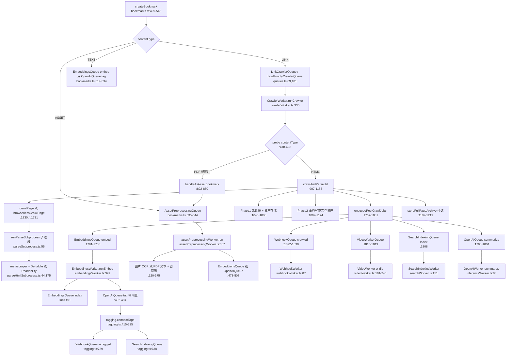
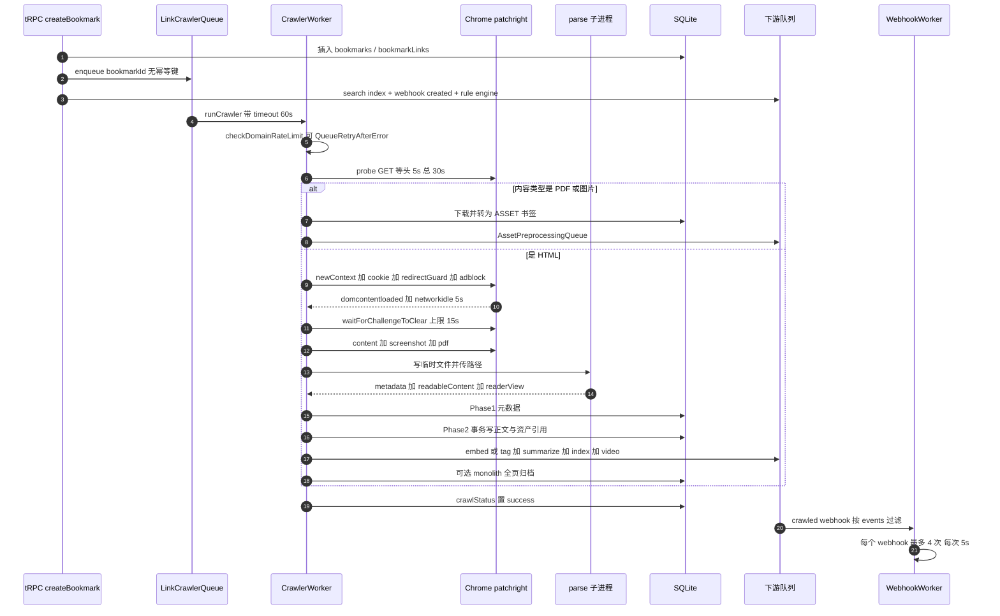

# 后台任务系统审计

- 审计对象：`E:\fork\2\insight-vault`（Karakeep 完整快照，基线 commit `872d383` = upstream `fc22787` 导入）
- 审计范围：`apps/workers/**`、`packages/shared-server/src/queues.ts`、`packages/shared/queueing.ts`、`packages/plugins/queue-*`、以及队列生产方 `packages/trpc/**` 中的入队点
- 审计方式：只读静态审计。全部断言来自逐文件阅读源码，未启动服务、未执行任何作业
- 证据约定：`path:line` 为仓内相对路径与实际行号；跨文件推理的结论标注 `[推断]`
- 输出约束：本次审计只写 `docs/audit/`，未改动任何源码

## 0. 审计对象核对

任务书中点名的部分文件在快照中不存在，实际审计使用等价文件（下表「实际情况」列）。这影响的是章节编号而非结论，所有结论均基于真实存在且已读取的文件。

| 任务书点名 | 实际情况 | 说明 |
| --- | --- | --- |
| `apps/workers/jobs.ts` / `api.ts` / `payment.ts` / `prices.ts` / `analytics.ts` / `demo.ts` / `repository.ts` / `workers/inference/repository.ts` | 不存在 | 全仓检索无同名文件；队列定义实际在 `packages/shared-server/src/queues.ts:1-364`，HTTP 面在 `apps/workers/server.ts:1-51` |
| `apps/workers/workers/*` 「11 个 worker」 | 存在 11 个 worker 文件 + 1 个未点名的 `inference/inferenceWorker.ts:1-124` | `openai_queue` 的消费者是 `OpenAiWorker`（`apps/workers/index.ts:53-58`），必须计入 |
| `packages/shared-server/src/queues.ts`（10.4KB） | 存在，364 行 / 10610 字节 | 与任务书描述一致 |

已逐行读取的核心文件（行数取自实际文件）：

| 文件 | 行 | 文件 | 行 |
| --- | --- | --- | --- |
| `apps/workers/index.ts` | 197 | `apps/workers/workers/crawlerWorker.ts` | 2282 |
| `apps/workers/server.ts` | 51 | `apps/workers/workers/assetPreprocessingWorker.ts` | 508 |
| `apps/workers/workerUtils.ts` | 58 | `apps/workers/workers/embeddingsWorker.ts` | 499 |
| `apps/workers/utils.ts` | 157 | `apps/workers/workers/searchWorker.ts` | 191 |
| `apps/workers/network.ts` | 651 | `apps/workers/workers/videoWorker.ts` | 288 |
| `apps/workers/metrics.ts` | 39 | `apps/workers/workers/feedWorker.ts` | 381 |
| `apps/workers/workerTracing.ts` | 65 | `apps/workers/workers/importWorker.ts` | 747 |
| `apps/workers/exit.ts` | 11 | `apps/workers/workers/backupWorker.ts` | 495 |
| `apps/workers/trpc.ts` | 14 | `apps/workers/workers/ruleEngineWorker.ts` | 114 |
| `apps/workers/scripts/parseHtmlSubprocess.ts` | 364 | `apps/workers/workers/webhookWorker.ts` | 186 |
| `apps/workers/workers/utils/parseSubprocess.ts` | 169 | `apps/workers/workers/adminMaintenanceWorker.ts` | 96 |
| `apps/workers/workers/utils/browser.ts` | 341 | `apps/workers/workers/inference/inferenceWorker.ts` | 124 |
| `apps/workers/workers/utils/botChallenge.ts` | 94 | `apps/workers/workers/inference/tagging.ts` | 739 |
| `apps/workers/workers/utils/redirectGuard.ts` | 124 | `apps/workers/workers/inference/summarize.ts` | 193 |
| `apps/workers/workers/utils/metadataResolver.ts` | 135 | `packages/shared-server/src/queues.ts` | 364 |
| `apps/workers/workers/utils/readerViewAssessment.ts` | 248 | `packages/shared/queueing.ts` | 112 |
| `apps/workers/workers/utils/autoconsent.ts` | 167 | `packages/shared/config.ts` | 717 |
| `apps/workers/workers/utils/crawlerUtils.ts` | 53 | `packages/plugins/queue-liteque/src/index.ts` | 160 |
| `apps/workers/workers/utils/feedParser.ts` | 42 | `packages/plugins/queue-restate/src/dispatcher.ts` | 215 |
| `apps/workers/metascraper-plugins/metascraper-reddit.ts` | 403 | `packages/plugins/queue-restate/src/runner.ts` | 169 |
| `apps/workers/metascraper-plugins/metascraper-amazon-improved.ts` | 77 | `packages/plugins/queue-restate/src/index.ts` | 219 |
| `packages/shared-server/src/bannerImages.ts` | 53 | `packages/shared-server/src/assetdb.ts` | 160 |

---

## 1. 队列后端与运行模型

### 1.1 进程启动顺序

`apps/workers/index.ts` 是唯一入口，`main()` 的顺序是硬编码的：

1. `loadAllPlugins()` — 插件（队列/搜索/向量/资产/限流）全部注册（`apps/workers/index.ts:127`）
2. `initTracing("workers")`（`apps/workers/index.ts:128`）
3. `initEventLogger("workers")`（`apps/workers/index.ts:129`）
4. `prepareQueue()` → 队列后端迁移（`apps/workers/index.ts:131`；实现见 `packages/shared-server/src/queues.ts:70-73`）
5. `buildServer()` 先起 HTTP（`apps/workers/index.ts:133`），保证健康检查在 worker 全部就绪前就能应答
6. 并行构建所有被启用的 worker：`Promise.all`（`apps/workers/index.ts:135-142`）
7. `startQueue()` — restate 后端的服务暴露发生在这里（`apps/workers/index.ts:144`；`packages/plugins/queue-restate/src/index.ts:144-182`）
8. 只有 feed / backup 被启用时才启动各自的 cron 调度器（`apps/workers/index.ts:146-152`）
9. 单独启动 import 轮询 worker（`apps/workers/index.ts:154-160`）

构建表 `workerBuilders` 共 12 项：`crawler`、`lowPriorityCrawler`、`embeddings`、`inference`、`search`、`adminMaintenance`、`video`、`feed`、`assetPreprocessing`、`webhook`、`ruleEngine`、`backup`（`apps/workers/index.ts:37-105`），另有第 13 个 runner `import`（`apps/workers/index.ts:107-110`、`157-160`）。其中 `crawler` 与 `lowPriorityCrawler` 复用同一个 `CrawlerWorker.build(queue)`，只是传入不同队列（`apps/workers/index.ts:38-47`）。

启用规则：`WORKERS_ENABLED_WORKERS` 非空时作为白名单，`WORKERS_DISABLED_WORKERS` 永远是否决项（`apps/workers/index.ts:113-124`；环境定义 `packages/shared/config.ts:23-40`）。

### 1.2 健康检查与指标

- `GET /health` 返回 `{status:"ok",timestamp}`，**无鉴权**（`apps/workers/server.ts:11-13`）
- `GET /metrics` 走 `bearerAuth({token: serverConfig.prometheus.metricsToken})`（`apps/workers/server.ts:14-18`）
- 监听地址来自 `WORKERS_HOST`（默认 `127.0.0.1`）与 `WORKERS_PORT`（默认 `0`，即系统随机端口）（`packages/shared/config.ts:21-22`、`apps/workers/server.ts:20-30`）。随机端口意味着容器外无法直接抓 `/metrics`，必须显式设 `WORKERS_PORT` `[推断]`
- 指标注册表：`karakeep_worker_stats{worker_name,status}`、`karakeep_crawler_status_codes_total{status_code,proxy}`、`karakeep_bookmark_crawl_latency_seconds`（histogram，桶 0.1s→1200s）（`apps/workers/metrics.ts:16-39`）
- `collectDefaultMetrics` 仅在 `PROMETHEUS_AUTH_TOKEN` 存在时开启（`apps/workers/metrics.ts:9-14`；`packages/shared/config.ts:550-554`）
- import 轮询另有 6 个指标（`apps/workers/workers/importWorker.ts:34-71`）

### 1.3 优雅退出

- 唯一信号监听是 `SIGTERM`：`exit.ts` 中的 `shutdownPromise` 在被触发时 `abort()` 共享的 `exitAbortController`（`apps/workers/exit.ts:3-11`）。没有 `SIGINT` 处理
- 主流程用 `Promise.race([所有 runner + httpServer.serve() + importWorker.start(), shutdownPromise])` 挂起（`apps/workers/index.ts:162-173`）
- 任一 worker 抛错时把 `exitCode` 置 1，但**仍走完整关停路径**（`apps/workers/index.ts:168-171`）
- 关停顺序：停 cron → 停 import → 逐个 `worker.stop()` → `httpServer.stop()` → 停 eventLogger → 停 tracing → `process.exit(exitCode)`（`apps/workers/index.ts:175-194`）
- `exitAbortController` 还被浏览器上下文回收器与断线重连逻辑用作「不要重启」的哨兵（`apps/workers/workers/utils/browser.ts:193-199`、`255-276`）

### 1.4 并发控制

并发度不是全局的，而是每个 queue runner 一份，通过 `RunnerOptions.concurrency` 下传：

- 通用契约：`RunnerOptions { pollIntervalMs?, timeoutSecs, concurrency, validator? }`（`packages/shared/queueing.ts:67-72`）
- liteque 后端把它透传给 `LQRunner`，`pollIntervalMs` 默认 1000（`packages/plugins/queue-liteque/src/index.ts:123-136`）
- restate 后端**忽略 `runner.run()`**（`packages/plugins/queue-restate/src/index.ts:108-114`），并发由 dispatcher 里的 `RestateSemaphore` 按 `queue:<name>` 与 `opts.concurrency` 持有租约实现（`packages/plugins/queue-restate/src/dispatcher.ts:72-102`）
- 具体取值见第 2 节；默认值极保守：crawler 1、embeddings 1、asset 预处理 1、webhook 1、ruleEngine 1、inference 1，只有 search 是 50（`packages/shared/config.ts:139-146`）

### 1.5 重试与「不计次数」的限速重试

- 每个队列声明 `defaultJobArgs.numRetries` 与 `keepFailedJobs:false`（`packages/shared-server/src/queues.ts:89-364`，逐队列见第 2 节）
- worker 侧通过 `job.runNumber` / `numRetriesLeft` 判断是否最后一次：crawler 自算 `numRetriesLeft = maxRetries - job.runNumber`（`apps/workers/workers/crawlerWorker.ts:336`），onError 里用 `job.numRetriesLeft == 0` 决定是否落永久失败态（`apps/workers/workers/crawlerWorker.ts:266-274`）
- `QueueRetryAfterError` 是「退避但不计数」的通道：liteque 映射为 `RetryAfterError`（`packages/plugins/queue-liteque/src/index.ts:108-121`），restate 映射为 `{type:"rate_limit"}` 且 dispatcher 里 `continue` 时**不递增 `runNumber`**（`packages/plugins/queue-restate/src/dispatcher.ts:168-176`）
- 唯一使用者是爬虫的域名限速（`apps/workers/workers/crawlerWorker.ts:528-540`）
- restate 的作业级重试策略：`maxAttempts = NUM_RETRIES`、`initialInterval 5s`、`maxInterval 1m`（`packages/plugins/queue-restate/src/dispatcher.ts:46-54`）；runner 服务本身 `maxAttempts:1`，避免双层重试（`packages/plugins/queue-restate/src/runner.ts:50-56`）

### 1.6 幂等键

`EnqueueOptions` 支持 `idempotencyKey / priority / delayMs / groupId`（`packages/shared/queueing.ts:20-25`）。实际使用点：

| 幂等键 | 位置 | 语义 |
| --- | --- | --- |
| `crawl:<排序后 JSON>` | `packages/shared-server/src/queues.ts:115-117`，用于 `packages/trpc/routers/bookmarks.ts:845`、`packages/trpc/routers/admin.ts:298,956`、`packages/trpc/lib/ruleEngine.ts:313` | 同 payload（含 flags）不重复抓 |
| `index:<bookmarkId>` | `packages/shared-server/src/queues.ts:255-269` | 同书重复索引合并 |
| `video:<bookmarkId>` | `packages/trpc/routers/bookmarks.ts:891` | 点播去重 |
| `<feedId>-<整点 ISO>` | `apps/workers/workers/feedWorker.ts:80` | 一 feed 一小时一次 |
| `<userId>-<YYYY-MM-DD>` | `apps/workers/workers/backupWorker.ts:89` | 一用户一天一次 |

**缺口（观察）**：创建书签时的首次抓取**不带**幂等键（`packages/trpc/routers/bookmarks.ts:506-511`），而 recrawl 带（`:842-846`）；`embeddings(embed)`、`openai(tag/summarize)`、`webhook`、`search(delete)` 均不带幂等键（`packages/trpc/models/bookmarks.ts:1033-1050`、`apps/workers/workers/crawlerWorker.ts:1779-1830`）。

### 1.7 作业级 tracing 与事件日志

- `withWorkerTracing(name, fn)` 为每个 job 开 span，属性 `job.id / job.priority / job.runNumber`（`apps/workers/workerTracing.ts:31-49`）
- `withWorkerEventLog(name, fn)` 用 `withEventLog` 包裹并注入同样的字段（`apps/workers/workerTracing.ts:51-64`）
- 两者串联顺序在 worker 里固定为 `withWorkerTracing(name, withWorkerEventLog(name, run))`，例如 `apps/workers/workers/crawlerWorker.ts:244-249`、`apps/workers/workers/searchWorker.ts:31-34`
- 爬虫内部再按阶段开子 span：`span()` 生成 `crawlerWorker.<name>`（`apps/workers/workers/crawlerWorker.ts:139-141`）、`traced()` 做装饰（`:144-149`），子 span 名字包括 `getContentTypeAndMetadata`、`handleAsAssetBookmark`、`crawlAndParseUrl`、`crawlPage`、`crawlPage.navigate`、`crawlPage.captureAssets`、`crawlPage.cleanup`、`archiveWebpage` 等（`:577,822,907,1230,1303,1625,1665,2136`）
- 解析在独立子进程里跑，也有自己的 span（`apps/workers/workers/utils/parseSubprocess.ts:66-76`）
- 事件日志类型是受限枚举，`addLogFields<"crawlerWorker.run">` 这类调用在编译期就限定字段名（`apps/workers/workers/crawlerWorker.ts:347-349`、`386-393`）

### 1.8 两种队列后端的能力差异

| 维度 | liteque（默认） | restate |
| --- | --- | --- |
| 存储 | SQLite `path.join(dataDir,"queue.db")`，`prepare()` 执行 `migrateDB`（`packages/plugins/queue-liteque/src/index.ts:66-74`） | 外部 Restate 服务，`prepare()` 空实现（`packages/plugins/queue-restate/src/index.ts:140-142`） |
| enqueue 返回值 | liteque 数字 id 转字符串（`:42-49`） | Restate invocationId（`:38-70`） |
| 执行模型 | 进程内 `LQRunner` 轮询（`:123-143`） | dispatcher + runner 两个 Restate 服务，`runner.run()` 是 no-op（`:97-127`） |
| 并发 | runner 本地 `concurrency` | `RestateSemaphore` 分布式租约（`dispatcher.ts:72-102`） |
| 限速重试 | `RetryAfterError`（`:113-117`） | `{type:"rate_limit"}` + `ctx.sleep`（`dispatcher.ts:168-176`） |
| 统计 | `lq.stats()` 四元组（`:51-53`） | `pending_retry` 恒 0、`failed` 恒 0，只有 pending/running 来自信号量（`index.ts:72-90`） |
| 批量取消 | `cancelAllNonRunning()` 可用 | **抛 `Method not implemented`**（`index.ts:92-94`） |

后两条是迁移到 restate 后管理面会立刻失真的能力缺口（见第 10 节 R6）。

---

## 2. 队列清单

全部 12 个队列都定义在 `packages/shared-server/src/queues.ts`，并由 `createDeferredQueue()` 懒初始化（`packages/shared-server/src/queues.ts:37-68`）：首次 `ensureInit()/enqueue()/stats()` 时才去 `loadAllPlugins()` 并 `createQueue()`，这样模块可被 web 侧 import 而不触发插件加载（`:19-31`）。

并发列取自实际 `createRunner` 调用点，重试列取自 `defaultJobArgs.numRetries`。

| # | 队列名 | payload（schema） | 消费者（并发） | 重试 | 幂等键 | keepFailedJobs | 证据 |
| --- | --- | --- | --- | --- | --- | --- | --- |
| 1 | `link_crawler_queue` | `{bookmarkId, runInference?, archiveFullPage=false, storePdf=false}`（`queues.ts:81-87`） | `CrawlerWorker`（`crawler.numWorkers`=1） | 5 | 首次无 / recrawl 有 | false | `queues.ts:89-97`；`crawlerWorker.ts:319-324`；`config.ts:139` |
| 2 | `low_priority_crawler_queue` | 同上 | `CrawlerWorker`（同 1，独立并发池） | 5 | 同上 | false | `queues.ts:101-109`；`index.ts:43-47` |
| 3 | `openai_queue` | `{bookmarkId, type:"summarize"\|"tag"=tag, embedding?:number[]}`（`queues.ts:120-128`） | `OpenAiWorker`（`inference.numWorkers`=1） | 3 | 无 | false | `queues.ts:130-135`；`inferenceWorker.ts:72-76` |
| 4 | `embeddings_queue` | 判别联合 `embed{bookmarkId,force?,runTaggingOnComplete=true}` / `index{bookmarkId,userId,embedding}` / `delete{bookmarkId}`（`queues.ts:145-162`） | `EmbeddingsWorker`（`embedding.numWorkers`=1） | 3 | 无 | false | `queues.ts:165-173`；`embeddingsWorker.ts:68-73` |
| 5 | `searching_indexing` | `{bookmarkId, type:"index"\|"delete"}`（`queues.ts:176-182`） | `SearchIndexingWorker`（`search.numWorkers`=50） | 5 | `index:*` 有，`delete` 无 | false | `queues.ts:183-191`；`searchWorker.ts:53-57`；`config.ts:141` |
| 6 | `admin_maintenance_queue` | 判别联合 `tidy_assets{args}` / `migrate_large_link_html` / `purge_bookmarks_over_quota{args.userId}`（`queues.ts:194-228`） | `AdminMaintenanceWorker`（1） | 1 | 无 | false | `queues.ts:245-253`；`adminMaintenanceWorker.ts:55-59` |
| 7 | `video_queue` | `{bookmarkId, url, onDemand?}`（`queues.ts:271-278`） | `VideoWorker`（1） | 5 | 点播有 `video:*` | false | `queues.ts:280-288`；`videoWorker.ts:66-71` |
| 8 | `feed_queue` | `{feedId}`（`queues.ts:291-293`） | `FeedWorker`（1） | 1 | 有 | false | `queues.ts:296-302`；`feedWorker.ts:156-160` |
| 9 | `asset_preprocessing_queue` | `{bookmarkId, fixMode=false}`（`queues.ts:305-308`） | `AssetPreprocessingWorker`（`assetPreprocessing.numWorkers`=1） | 2 | 无 | false | `queues.ts:312-318`；`assetPreprocessingWorker.ts:109-113` |
| 10 | `webhook_queue` | `{bookmarkId, operation:"crawled"\|"created"\|"edited"\|"ai tagged"\|"deleted", userId?}`（`queues.ts:321-326`） | `WebhookWorker`（`webhook.numWorkers`=1） | 3 | 无 | false | `queues.ts:327-335`；`webhookWorker.ts:47-55` |
| 11 | `rule_engine_queue` | `{bookmarkId, events: RuleEngineEvent[]}`（`queues.ts:338-342`） | `RuleEngineWorker`（`ruleEngine.numWorkers`=1） | 1 | 无 | false | `queues.ts:343-351`；`ruleEngineWorker.ts:48-53` |
| 12 | `backup_queue` | `{userId, backupId?}`（`queues.ts:354-357`） | `BackupWorker`（2） | 2 | 有 | false | `queues.ts:359-364`；`backupWorker.ts:162-167` |

作业级超时（`RunnerOptions.timeoutSecs`）：

| 队列 | timeoutSecs | 来源 |
| --- | --- | --- |
| crawler ×2 | `CRAWLER_JOB_TIMEOUT_SEC` = 60 | `crawlerWorker.ts:321`；`config.ts:122` |
| openai | `INFERENCE_JOB_TIMEOUT_SEC` = 30 | `inferenceWorker.ts:75`；`config.ts:84` |
| embeddings | `EMBEDDING_JOB_TIMEOUT_SEC` = 60 | `embeddingsWorker.ts:71`；`config.ts:100` |
| searching_indexing | `SEARCH_JOB_TIMEOUT_SEC` = 30 | `searchWorker.ts:56`；`config.ts:142` |
| admin_maintenance | 600（硬编码） | `adminMaintenanceWorker.ts:58` |
| video | `CRAWLER_VIDEO_DOWNLOAD_TIMEOUT_SEC` = 600 | `videoWorker.ts:68`；`config.ts:155` |
| feed | 30（硬编码） | `feedWorker.ts:159` |
| asset_preprocessing | `ASSET_PREPROCESSING_JOB_TIMEOUT_SEC` = 60 | `assetPreprocessingWorker.ts:112`；`config.ts:145` |
| webhook | `5*(3+1)+1` = 21 | `webhookWorker.ts:50-53`；`config.ts:187-188` |
| rule_engine | 10（硬编码） | `ruleEngineWorker.ts:51` |
| backup | 600（硬编码） | `backupWorker.ts:165` |

补充观察：

- 队列名与实际用途有一处易混：搜索队列叫 `searching_indexing`（不是 `search_indexing`）（`queues.ts:184`）
- 未使用的优先级：`QueuePriority.Low = 50`、`Default = 0`，数值越低越先执行；低优先级抓取走**独立队列**而不是只降优先级，注释明确是为了不挤占主队列并发（`queues.ts:14-17`、`99-100`）
- `groupId` 被所有入队点写成 `userId`（例如 `crawlerWorker.ts:1773-1776`），restate 后端用它做同用户公平调度（`packages/plugins/queue-restate/src/semaphore.ts:16`、`:545`）

---

## 3. 收藏抓取流水线（逐步骤 + 证据）

### 3.0 入口：谁把作业塞进队列

`createBookmark` 在事务提交后按内容类型分流（`packages/trpc/routers/bookmarks.ts:499-545`）：

- LINK → `LinkCrawlerQueue` 或 `LowPriorityCrawlerQueue`（`:500-513`）
- TEXT → `EmbeddingsQueue(embed)` 或 `OpenAIQueue(tag)`（`:514-534`）
- ASSET → `AssetPreprocessingQueue`（`:535-544`）

随后并行触发规则引擎 `bookmarkAdded`、搜索索引、`created` webhook（`:547-566`）。低优先级判定来自 `crawlPriority === "low"` 或 `shouldUseLowPriorityQueues(ctx)`（`:487-489`）。

### 3.1 作业外壳

`CrawlerWorker.build(queue)`（`apps/workers/workers/crawlerWorker.ts:234-327`）：

- 初始化浏览器环境（adblocker / autoconsent / cookies / 回收器），单例 promise（`:193-200`、`:235`）
- `run` = `withWorkerTracing("crawlerWorker.run", withWorkerEventLog("crawlerWorker.run", job => runCrawler(job, queue.opts.defaultJobArgs.numRetries)))`（`:244-249`）——注意重试上限是从**队列声明**读的，不是配置
- `onComplete`：`crawlStatus = "success"`（`:250-263`）
- `onError`：`numRetriesLeft == 0` 时在一个事务里把 `crawlStatus="failure"`，并把仍为 `pending` 的 `taggingStatus/summarizationStatus/embeddingStatus` 置 `null`（`:264-317`）

### 3.2 `runCrawler` 主链

| # | 步骤 | 函数 / 位置 | 关键行为 |
| --- | --- | --- | --- |
| 1 | 作业 id 与重试余额 | `runCrawler` `crawlerWorker.ts:330-336` | `jobId = "<id>:<runNumber>"`；`numRetriesLeft = max(maxRetries - runNumber, 0)`，`maxRetries` 来自队列声明的 `defaultJobArgs.numRetries`（=5） |
| 2 | payload 校验 | `zCrawlLinkRequestSchema.safeParse` `:338-342` | 非法 payload 直接返回 `completed`（不重试） |
| 3 | 读书签快照 | `getBookmarkDetails(bookmarkId)` `:362`；实现 `workerUtils.ts:19-58` | 一次查询带出 url/userId/createdAt/crawledAt/probeMetadataAt 与 8 类资产 id |
| 4 | 用户级降级开关 | `users.browserCrawlingEnabled` `:364-371` | 只有显式 `false` 才禁用浏览器（`:382`） |
| 5 | 选定整轮代理 | `selectRunProxies()` `:373`；实现 `network.ts:318-325` | 每轮从代理池随机选一个，整轮所有请求复用 |
| 6 | 域名限速 | `checkDomainRateLimit(ctx)` `:406`；实现 `:506-541` | 未配置直接返回；超限抛 `QueueRetryAfterError`，退避带 0~40% 抖动（`:531-539`） |
| 7 | 内容类型探测 | `getContentTypeAndMetadata(ctx,{skipMetadataExtraction})` `:418-423`；实现 `:577-708` | 纯 HTTP GET，body 上限 2MB（`:545`），等头 5s（`:550`）、总 30s（`:551`）；HTML 才继续；challenge 页与非 2xx/3xx 视为不可信（`:653-661`、`:679-688`） |
| 8 | 路由：PDF / 图片 / 网页 | `:427-486` | PDF→`handleAsAssetBookmark(ctx,"pdf")`；图片集合内且在上传白名单→`"image"`；否则走网页链路 |
| 9 | 文件型书签落地 | `handleAsAssetBookmark` `:822-880` | `downloadAndStoreFile` 下载（`:2052-2134`，临时文件 + 流式字节上限 `maxAssetSizeMb`）；事务里写 `assets`、`bookmarkAssets`、把 `bookmarks.type` 改为 ASSET、删 `bookmarkLinks`（`:837-869`）；最后入队 `AssetPreprocessingQueue`（`:870-878`） |
| 10 | 网页抓取 + 解析 | `crawlAndParseUrl(ctx,args)` `:907-1183` | 详见 3.3 |
| 11 | 抓取后置作业 | `enqueuePostCrawlJobs(ctx,job)` `:472`；实现 `:1767-1831` | 详见 3.5 |
| 12 | 全页归档（最后） | `storeFullPageArchive(ctx,html,url,oldId)` `:475-485`；实现 `:1189-1219` | 独立最后一步，因为最容易失败（注释 `:8`） |
| 13 | 抓取延迟指标 | `:488-493` | 只有 `crawledAt === null` 且 `job.priority === 0` 才记录（排除重抓与导入） |

### 3.3 `crawlAndParseUrl` 的九个动作

1. **预抓归档短路**：存在 `precrawledArchiveAssetId` 时直接 `readAsset` 得到 HTML，不再访问网络（`:937-952`）；截图交给 `screenshotPrecrawledArchive`（`:948`）
2. **浏览器抓取**：否则 `crawlPage(ctx, forceStorePdf)`（`:954`）
3. **HTTP 状态码指标与重试判定**：`crawlerStatusCodeCounter.labels(status, proxy).inc()`（`:967-974`）；`shouldRetryCrawlStatusCode` 为 403/429/≥500 时，只要还有重试余额就抛错重来（`:979-988`；判定实现 `crawlerUtils.ts:37-42`）
4. **子进程解析**：`runParseSubprocess(htmlContent, browserUrl, jobId, abortSignal)`（`:994`）→ 返回 `{metadata, readableContent, readerViewAssessment}`
5. **元数据合并**：`resolveMetadata(renderMeta, probeMetadata, renderBlocked)`（`:1021`；实现 `metadataResolver.ts:111-135`）。渲染被判定为「被墙」（retryable status 或 challenge 页）时，探测元数据优先
6. **Reader View 判定**：`readerViewAssessment` 直接写入书签；若渲染页是 challenge 页但评估里没写 `challenge_page`，则补进去（`:1022-1027`）
7. **Phase 1：元数据立即落库**（`:1040-1054`）：`title/description/imageUrl/favicon/crawlStatusCode/author/publisher/datePublished/dateModified`，`data:` 开头的图片置 null
8. **资产采集与存储**：截图 `storeCapturedAsset(ctx,"screenshot",…)`（`:1058-1061`）、PDF（`:1064-1067`）、HTML 正文 `storeHtmlContent`（`:1070`）、Banner `downloadAndStoreBanner`（`:1075-1088`）
9. **Phase 2：事务写正文与资产引用**（`:1099-1174`）：`crawledAt/htmlContent/contentAssetId/readerView*`；三类资产用 `updateAsset(oldId,newAsset,txn)` 先删旧再插新（`workerUtils.ts:7-17`）；事务后统一 `silentDeleteAsset` 删旧资产对象（`:1177-1179`）

### 3.4 `crawlPage`：浏览器路径与降级

`crawlPage` 是 `traced("crawlPage", …)`（`crawlerWorker.ts:1230-1365`）：

- **两条降级分支**：用户禁用浏览器 → `browserlessCrawlPage`（`:1239-1241`）；拿不到浏览器实例 → 同样降级（`:1243-1246`）
- **无浏览器实现**：一次 `fetchWithProxy`，5s 超时，无截图无 PDF（`:1731-1756`）
- **上下文参数**：viewport 1440×900、`userAgent` 取自浏览器真实版本、`timezoneId` 可配（错配代理地理会成为 bot 信号）、`proxy`、`serviceWorkers:"block"`（`:1253-1261`；UA 归一化 `crawlerUtils.ts:49-53`，实现 `browser.ts:124-144`）
- **Cookie 注入**：`getGlobalCookies()` 全部 `addCookies`（`:1266-1270`），来源是 `BROWSER_COOKIE_PATH` 指定的 JSON（`browser.ts:301-322`）
- **页面加固** `setupPage`（`:1480-1571`）：
  - CDP 级重定向守卫 `installRedirectGuard`（`:1488-1493`；实现 `redirectGuard.ts:27-124`），拦截 3xx 跳转到内网/私有地址，并回答代理认证
  - Ghostery adblocker（`:1496-1499`）
  - 自动关闭 alert/confirm/prompt（`:1503-1507`）
  - 路由级：abort 已中止的请求、阻断 `media` 与 `video/*`/`audio/*`（`:1511-1526`）、对每个 http(s) 子请求做 `validateUrl` SSRF 校验（`:1528-1544`）
  - autoconsent 最后安装（`:1553`；`autoconsent.ts:33-60`）
  - abort 时 detach CDP 并 `unrouteAll`，避免关闭被卡住（`:1557-1568`）
- **导航**：`validateUrl` 后再 `goto(waitUntil:"domcontentloaded", timeout=navigateTimeoutSec)`，与 abort 竞速（`:1280-1311`）
- **等待**：`networkidle` 5s（`:1319-1327`）→ `waitForPageLoadAndAutoconsent`（`:1329-1334`）→ `waitForChallengeToClear`（`:1337-1344`；实现 `botChallenge.ts:41-94`，状态码集合 401/403/429/503、500ms 轮询、上限 `CRAWLER_CHALLENGE_WAIT_SEC`=15s，DataDome 硬验证码不等待 `metadataResolver.ts:87`）
- **采集**：`capturePageAssets`（`:1348-1352`；实现 `:1625-1658`）并行取 `page.content()`、截图、PDF
- **清理**：`finally { closePageAndContext(...) }`（`:1361-1363`；实现 `:1665-1729`），page 关闭 5s、context 关闭 10s（`browser.ts:75-76`），超时则留给回收器（`:150-200`，周期 5 分钟）

截图规格：`page.screenshot({type:"jpeg", fullPage:CRAWLER_FULL_PAGE_SCREENSHOT, quality:80})`（`:1610-1619`），资产 `contentType: image/jpeg`、文件名 `screenshot.jpeg`（`:1870-1878`）。

PDF 规格：仅当 `CRAWLER_STORE_PDF` 或请求带 `storePdf` 才拍（`:1643-1648`），`page.pdf({format:"A4", printBackground:true})`。

### 3.5 解析：metascraper + Defuddle + Readability

解析跑在**有内存上限的独立子进程**里（`apps/workers/workers/utils/parseSubprocess.ts:1-3`、`:55-168`）：

- 命令：生产 `process.execPath`、开发 `tsx`，都带 `--max-old-space-size=CRAWLER_PARSER_MEM_LIMIT_MB`（默认 512）（`:37-53`；`config.ts:168`）
- 传递方式：HTML 写临时文件，只把路径和 `metadataOnly` 通过 stdin 传（`:87-105`），结束后 `fs.rm` 临时目录（`:106-108`）
- 超时：`CRAWLER_PARSE_TIMEOUT_SEC` 默认 60s（`:82`；`config.ts:169`）
- OOM 识别：exit 137 / SIGKILL / SIGABRT 归类为 OOM 并提示调大内存上限（`:117-146`）
- 子进程内 stdout 只输出 JSON，日志重定向到 stderr（`apps/workers/scripts/parseHtmlSubprocess.ts:40-42`）

metascraper 插件链（顺序即优先级，`parseHtmlSubprocess.ts:44-72`）：
`metascraperDate(dateModified+datePublished)` → `metascraperAmazonImproved()` → `metascraperAmazon()` → `metascraperYoutube({gotOpts:{agent}})` → `metascraperReddit()` → `metascraperAuthor()` → `metascraperPublisher()` → `metascraperTitle()` → `metascraperDescription()` → `metascraperX()` → `metascraperImage()` → `metascraperSafeFavicon()` → `metascraperUrl()`。

正文提取（`extractReadableContent`，`parseHtmlSubprocess.ts:175-232`）：

1. `normalizeLazyLoadImages` 把 `data-src / data-actualsrc / data-srv / data-original / data-lazy / data-lazyload / data-img-src / data-url` 提升为 `src`（`:84-93`、`:112-134`），并保护真实内联图片（`isPlaceholderDataImage`，`:95-110`）
2. 两个提取器按序尝试：**Defuddle 优先**（`:143-152`，`useAsync:false` 且 `fetch` 直接抛错以禁止联网），**Readability 兜底**（`:154-157`）
3. 输出经 DOMPurify 净化，并用 `hasVisibleContent` 判断「有东西可读」，否则换下一个提取器（`:195-206`）
4. 都失败则 `readableContent=null` + `unavailableReaderViewAssessment()`（`:208-213`）
5. 成功则 `assessReaderView(source, extracted, url)` 得到 `status/score/reasons/classifierVersion`（`:215-227`；`readerViewAssessment.ts:8-15`）
6. 特殊通道：如果某个 metascraper 插件直接给了 `meta.readableContentHtml`（Reddit 就是这么做的），就走「净化 + 评估」而不跑 Defuddle（`:304-327`）

额外防御：解析前把内联的 `data:audio/*`、`data:video/*` URI 替换成 `about:blank`，只影响解析副本，原始 HTML 仍用于归档（`parseHtmlSubprocess.ts:234-266`、`:278-286`）。

### 3.6 Banner、归档与正文存储

- **Banner**：`meta.image` 存在且 `CRAWLER_DOWNLOAD_BANNER_IMAGE`（默认 true）才下载（`:1075-1088`）；`data:` URI 走本地解码（`decodeDataUriImage`，`:1919-1960`，三重护栏：编码长度、mediatype 必须在位图集合内、解码后字节数）；网络图片走 `fetchImage`（`:1984-2002`，ArrayBuffer 就地增长避免双份内存）；存前用 `optimizeBannerImage` 转 1200px WebP q80（`packages/shared-server/src/bannerImages.ts:6-53`）
- **HTML 正文**：`storeHtmlContent`（`:2245-2282`）——小于 `HTML_CONTENT_SIZE_INLINE_THRESHOLD_BYTES`（默认 5120 字节，`config.ts:185`）就内联写 `bookmarkLinks.htmlContent`，否则存为 `LINK_HTML_CONTENT` 资产并写 `contentAssetId`
- **全页归档**：`archiveWebpage`（`:2136-2238`）通过 `execa("monolith", ["-","-Ije","-t",timeout,…args,"-b",url,"-o",path])` 把 HTML 从 stdin 喂给 monolith（`:2158-2179`），代理通过 `https_proxy/http_proxy/no_proxy` 环境变量下传（`:2164-2168`）；`CRAWLER_FULL_PAGE_ARCHIVE_MAX_SIZE_MB > 0` 时丢弃超大归档（`:2199-2206`）；文件大小先过配额（`:2208-2218`）再存
- **配额与大小限制**：所有资产写入前都过 `QuotaService.checkStorageQuota`，下载侧还有 `maxAssetSizeMb`（默认 50）的流式硬上限（`:2069-2088`、`:1847-1856`）

### 3.7 抓取后置作业（`enqueuePostCrawlJobs`）

`crawlerWorker.ts:1767-1831`，全部继承父作业的 `priority` 与 `groupId=userId`（`:1773-1776`）：

1. 若 `job.data.runInference !== false`：`EMBEDDING_ENABLE_AUTO_INDEXING` 开 → `EmbeddingsQueue(embed, runTaggingOnComplete:true)`；否则直接 `OpenAIQueue(tag)`（`:1779-1797`）
2. 无条件 `OpenAIQueue(summarize)`（`:1798-1804`）
3. `triggerSearchReindex(bookmarkId)` → `SearchIndexingQueue(index)`，幂等键 `index:<id>`（`:1808`；`queues.ts:255-269`）
4. `CRAWLER_VIDEO_DOWNLOAD` 开 → `VideoWorkerQueue({bookmarkId,url})`（`:1810-1819`）
5. `WebhooksService.triggerWebhook(bookmarkId,"crawled",userId)`（`:1822-1830`；实现 `packages/trpc/models/webhooks.service.ts:77-95`，用户没有 webhook 时直接 return，不入队）

---

## 4. 资产预处理与媒体能力

### 4.1 `assetPreprocessingWorker` 结构

- 队列 `asset_preprocessing_queue`，payload `{bookmarkId, fixMode}`（`queues.ts:305-318`），并发 1、超时 60s（`assetPreprocessingWorker.ts:109-113`）
- `run()`（`:387-508`）：
  1. 取书签（带 `asset` 与 `assets`）并断言必须是资产型（`:393-413`）
  2. `readAsset` 读出二进制（`:415-424`）
  3. 按 `bookmark.asset.assetType` 分派：`image` → 只做 OCR；`pdf` → 文本 + 首页截图（`:435-467`）
  4. `fixMode` 是幂等开关：已有截图/已有文本时跳过（`:196-206`、`:288-296`、`:346-354`）
  5. 结果变化或非 fixMode 时，入队 `EmbeddingsQueue(embed)`/`OpenAIQueue(tag)`、`OpenAIQueue(summarize)`、`triggerSearchReindex`（`:473-507`）

### 4.2 图片 OCR

- 默认 Tesseract.js：`createWorker(OCR_LANGS, undefined, {cachePath: OCR_CACHE_DIR ?? os.tmpdir()})` → `worker.recognize(buffer)` → 置信度 `<= OCR_CONFIDENCE_THRESHOLD` 就丢弃 → `worker.terminate()`（`assetPreprocessingWorker.ts:120-137`）
- `OCR_LANGS` 默认 `["eng"]`、阈值默认 50（`config.ts:110-116`）
- LLM OCR 可选：`OCR_USE_LLM=true` 时走 `InferenceClientFactory.build().inferFromImage(prompt, contentType, base64, {schema:null})`，无客户端则回落 Tesseract（`:139-169`；prompt 来自 `buildOCRPrompt()`，`:27`）
- 结果写入 `bookmarkAssets.content`，`metadata` 置 null（`:330-337`）

### 4.3 PDF

- 文本：`pdf2json` 的 `PDFParser(null,true)` + `getRawTextContent()`，同时取 `pdfData.Meta`（`:171-187`），写入 `bookmarkAssets.content` 与 `metadata`（JSON 字符串）（`:367-373`）
- 文本为空直接抛错（`:359-363`）——扫描版 PDF 需要靠 OCR 链路（当前**没有** PDF→图片→OCR 的串联）
- 首页图：`pdf2pic.fromBuffer(asset,{density:100,quality:100,format:"png",preserveAspectRatio:true})(1,{responseType:"buffer"})`（`:211-221`），依赖 ghostscript + graphicsmagick（注释 `:212-215`；Docker 镜像确实装了这两个包，`docker/Dockerfile:163-166`）
- 截图存为 `ASSET_SCREENSHOT` 资产（`:238-261`），配额不足时视为「成功但跳过」（`:268-273`）

### 4.4 视频（`videoWorker`）

- 队列 `video_queue`，并发 1，超时默认 600s（`videoWorker.ts:66-71`；`config.ts:155`）
- 开关：自动下载看 `CRAWLER_VIDEO_DOWNLOAD`（默认 false），点播看 `CRAWLER_VIDEO_DOWNLOAD_ON_DEMAND`，`onDemand` 走后者（`:112-120`；`config.ts:153-156`）
- 下载：先 `resolveValidatedRedirectUrl` 归一化目标（`:125-138`，5s 超时 + 代理），再 `execa("yt-dlp", args, {cancelSignal})`（`:156`）
- 参数：`-f best[filesize<NM]`（可配大小上限，默认 50MB）、追加 `CRAWLER_YTDLP_ARGS`、`-o <tmp>/<assetId>`、`--no-playlist`、可选 `--proxy`（`:76-99`）
- 结果类型写死 `ASSET_TYPES.VIDEO_MP4` + `AssetTypes.LINK_VIDEO`（`:203-224`）；yt-dlp 会自动补扩展名，所以用 `findAssetFile` 按前缀回找（`:280-288`）
- 明确的安全边界注记：yt-dlp 自己发 HTTP 且能跟随本进程无法校验的跳转，完整 SSRF 防护依赖出口代理/网络策略（`:76-83`）

**媒体能力结论（观察）**：全仓无 `ffmpeg`、无 `whisper`、无转录、无视频缩略图/封面抽取（检索 `ffmpeg|transcri|thumbnail` 仅命中注释与 Reddit 插件的 `post.thumbnail` 字段，`metascraper-reddit.ts:58,163`）。视频能力只有「下载并原样存为 mp4 资产」。

### 4.5 能力矩阵

| 能力 | 实现 | 依赖 | 证据 |
| --- | --- | --- | --- |
| 网页截图 | Playwright/patchright `page.screenshot` JPEG q80 | 浏览器 | `crawlerWorker.ts:1610-1619` |
| 网页 PDF | `page.pdf` A4 | 浏览器 | `:1643-1648` |
| 全页归档 | monolith 子进程 | `monolith` 二进制 | `:2158-2179`；`docker/Dockerfile:2-13,194-195` |
| 正文抽取 | Defuddle → Readability + DOMPurify | jsdom | `parseHtmlSubprocess.ts:143-232` |
| 元数据 | 13 个 metascraper 插件 | — | `parseHtmlSubprocess.ts:44-72` |
| Banner 优化 | sharp → WebP 1200px q80 | sharp | `bannerImages.ts:18-53` |
| 内联图解码 | `data-uri-to-buffer` | — | `crawlerWorker.ts:1919-1960` |
| 图片 OCR | Tesseract.js（或 LLM OCR） | 语言包下载 | `assetPreprocessingWorker.ts:120-169` |
| PDF 文本 | pdf2json | — | `:171-187` |
| PDF 首页图 | pdf2pic | ghostscript + graphicsmagick | `:211-221`；`docker/Dockerfile:163-166` |
| 视频下载 | yt-dlp | yt-dlp + JS 运行时（YouTube） | `videoWorker.ts:156`；`docker/Dockerfile:171-192` |
| 视频转码/封面/字幕 | **无** | — | 全仓无 ffmpeg/whisper |
| 音频转录 | **无** | — | 同上 |

---

## 5. AI 推理队列与嵌入队列

### 5.1 `openai_queue`

- payload：`{bookmarkId, type:"summarize"|"tag"=tag, embedding?:number[]}`（`queues.ts:120-128`）
- 消费者 `OpenAiWorker`（`inference/inferenceWorker.ts:44-81`），并发 `INFERENCE_NUM_WORKERS`=1、超时 30s
- `runOpenAI`：无推理客户端时直接静默返回（`:86-92`）；`zOpenAIRequestSchema.safeParse` 失败抛错（`:94-99`）；按 `type` 分派 `runSummarization` / `runTagging`（`:114-123`）
- 状态回写：`onComplete` 写 `success`、永久失败写 `failure`，字段取决于 `type`（`tag` → `taggingStatus`，`summarize` → `summarizationStatus`）（`:21-42`、`:54-69`）

**tagging**（`inference/tagging.ts`）：

- 全局开关 `INFERENCE_ENABLE_AUTO_TAGGING`（`:635-640`；`config.ts:108`），用户级 `users.autoTaggingEnabled`（`:650-665`）
- 标签候选两条路：用户 `curatedTagIds` 白名单（`:670-678`）或相似书签的标签（`getPotentiallyRelevantTags`，`:551-628`，可用 `job.data.embedding` 免等索引，`:682-694`）
- 按书签类型分派抽取：图片（`inferTagsFromImage` `:144-187`）、PDF（`:250-277`）、文本（`:279-306`）
- 落库：`connectTags` 内插 `bookmarkTags` 与 `tagsOnBookmarks`（`:415-525`，`:465`、`:496`）
- 后置：`ai tagged` webhook + `triggerSearchReindex`（`:726-738`）

**summarize**（`inference/summarize.ts`）：写 `bookmarks.summary`（`:182`），再 `triggerSearchReindex`（`:189`）。

### 5.2 `embeddings_queue` 的三态设计

设计意图写在注释里（`queues.ts:137-163`）：`embed` 只生成向量并派发，不写向量库；`index` 单独持久化；`delete` 删除。这样索引失败的重试不会重复触发 tagging。

`EmbeddingsWorker`（并发 1、超时 60s、带 `validator: zEmbeddingsRequestSchema`，`embeddingsWorker.ts:68-73`）：

- 无向量库客户端：`embed` 仍会继续派发 tagging（`:358-368`）
- `delete` → `deleteVectors([bookmarkId])`；`index` → `addVectors([{id,userId,vector}])`（`:370-387`）
- `runEmbed`（`:399-498`）：
  1. 自动索引关闭且非 `force` → 跳过生成，只派发 tagging（`:407-415`）
  2. 读书签（`link/text/asset/tags`）→ 无则跳过（`:417-423`）
  3. 无 embedding 客户端 → 只派发 tagging（`:429-438`）
  4. `buildEmbeddingText`（`:257-345`）：Title / Type / Tags / Summary / Note / Domain / URL / Page title / Description / Author / Publisher / Published（链接型），文本型与资产型各有分支；正文摘要预算 `contentBudget = clamp(0.4*contextLength, 500, 3000)`（`:247-255`），元数据摘要上限 800 字符（`:30`），最终整体截断到 `EMBEDDING_CONTEXT_LENGTH`（默认 8000，`config.ts:98`）
  5. 生成失败/为空抛错（`:462-469`）
  6. 先入队 `index`，**最后**派发 tagging 并携带向量——注释明确这是为了让 tagging 之后没有任何可能抛错的操作（`:477-494`）

失败降级：永久失败时仍补一个无向量的 tag 作业（`:54-65`、`:128-148`），保证书签不会永远没有标签。

与爬虫的耦合：`EMBEDDING_ENABLE_AUTO_INDEXING`（默认在纯 OpenAI 配置下为 true，`config.ts:426-430`）决定爬虫入队 `embed` 还是直接 `tag`（`crawlerWorker.ts:1780-1797`）。资产路径同理（`assetPreprocessingWorker.ts:479-496`）。

---

## 6. 搜索索引队列

- 队列 `searching_indexing`，payload `{bookmarkId, type:"index"|"delete"}`（`queues.ts:176-182`），并发 `SEARCH_NUM_WORKERS`=50、超时 30s（`searchWorker.ts:53-57`）
- `runSearchIndexing`（`:151-190`）：payload 校验失败直接抛（`:154-159`）；无搜索客户端静默返回（`:161-167`）；`batch = job.runNumber === 0`（`:175`）——**首次尝试走批量，重试走单条**，注释说明是为了可靠性
- `runIndex`（`:64-141`）组装 `BookmarkSearchDocument`（schema `packages/shared/search.ts:5-23`）：链接型带 `url/linkTitle/description/content/publisher/author/datePublished/dateModified`，资产型带 `content/metadata`，文本型带正文，公共字段含 `note/summary/title/createdAt/tags`（`:90-120`）；正文来自 `Bookmark.getBookmarkPlainTextContent`（`:98-101`）
- **删除竞态处理**：写完后重新查一次书签，如果已被删除则补一次 `deleteDocuments`（`:128-140`）——这是对「删除作业先于索引作业到达」的补偿
- 批量实现：Meilisearch 插件侧 `BatchingDocumentQueue`（`packages/plugins/lib/batchingDocumentQueue.ts:24-80`），按 `batchSize`/`batchTimeoutMs` 聚合，flush 时对同一 docId 只保留最后一次操作（`:76-80`）
- 入队点：书签创建（`bookmarks.ts:559`）、抓取后（`crawlerWorker.ts:1808`）、标签变更（`models/tags.ts:291,329,369`）、更新/更新标签（`bookmarks.ts:745,797,1471,1652`）、AI 打标后（`tagging.ts:738`）、摘要后（`summarize.ts:189`）、删除（`models/bookmarks.ts:1033-1041`）、管理端重建（`routers/admin.ts:324,974`）

---

## 7. 规则引擎、Webhook、Feed、备份、导入

### 7.1 规则引擎（`rule_engine_queue`）

- 入队前先做**廉价的规则匹配预判**：`RuleEngine.triggerOnEvent` 先 `matchesAnyRule`（只读 `enabled` 规则的 `event` 字段），无匹配则不入队（`packages/trpc/lib/ruleEngine.ts:105-156`）
- 事件类型 7 种：`bookmarkAdded / tagAdded / tagRemoved / addedToList / removedFromList / favourited / archived`（`packages/shared/types/rules.ts:7-48`）
- 动作 7 种：`addTag / removeTag / addToList / removeFromList / downloadFullPageArchive / favouriteBookmark / archiveBookmark`（`rules.ts:170-198`；执行实现 `ruleEngine.ts:268-340`）
- 其中 `downloadFullPageArchive` 会回灌 `LowPriorityCrawlerQueue`，且带幂等键（`ruleEngine.ts:304-316`）——这是规则引擎 → 爬虫唯一的反向联动
- worker 用**冒充用户上下文**执行：`buildImpersonatingAuthedContext(userId)` → `RuleEngine.forBookmark(ctx, bookmarkId)` → `onEvent`（`ruleEngineWorker.ts:85-97`；trpc 封装 `apps/workers/trpc.ts:7-14`）
- 并发 1、超时 10s、重试 1（`ruleEngineWorker.ts:48-53`），意味着复杂规则链（批量 addToList）在 10s 内跑不完会被重试

### 7.2 Webhook（`webhook_queue`）

- 入队方：`WebhooksService.triggerWebhook`，用户无 webhook 时直接返回（`webhooks.service.ts:83-95`）
- 5 种 operation：`crawled / created / edited / ai tagged / deleted`（`queues.ts:323`）
- 消费（`webhookWorker.ts:87-186`）：
  1. 取书签；`deleted` 允许书签已不存在（`:81-85`、`:96-102`）
  2. 取该用户全部 webhook，按 `events.includes(operation)` 过滤（`:112-120`）
  3. 对每个命中的 webhook 串行重试 `retryTimes+1` 次（默认 4 次），单次 `AbortSignal.timeout(5s)`（`:130-176`）；作业级超时预算 `5*(3+1)+1=21s`（`:50-53`）
  4. 全部 webhook 之间用 `Promise.allSettled` 并发，单个失败不影响其他（`:126-181`）
  5. 投递体固定为 `{jobId,bookmarkId,userId,url,type,operation}`，可选 `Authorization: Bearer <webhook.token>`（`:136-153`）
- 出站请求走 `fetchWithProxy`，因此继承 SSRF 校验、跨源重定向剥凭证（`network.ts:396-411`、`:502-578`）

### 7.3 Feed（`feed_queue` + cron）

- 调度器 `FeedRefreshingWorker = cron.schedule("0 * * * *")`，默认 `scheduled:false`，只有 feed worker 启用时才 `.start()`（`feedWorker.ts:60-113`、`:109-112`；`index.ts:146-148`）
- 打散：`getFeedMinuteOffset(feedId)` 用字符码哈希取模 60 得到分钟偏移，`delayMs = delayMinutes*60000`（`:26-35`、`:79-104`）
- 幂等键 `<feedId>-<整点 ISO>`（`:80`）
- 抓取（`run`，`:167-381`）：先查配额（`:186-195`）→ `fetchWithProxy` 5s 超时、固定 UA（`:201-215`）→ 必须 200 且 `content-type` 含 `xml`（`:217-230`）→ `parseFeedItems`（`:246-254`；实现 `utils/feedParser.ts:34-42`，`guid ?? id ?? link`，`:27-30`）→ 与 `rssFeedImportsTable` 比对去重（`:271-294`）
- 入库：通过 `buildImpersonatingTRPCClient(feed.userId)` 调 `bookmarks.createBookmark({source:"rss"})`（`:300-311`），因此**每一条新条目都会重新触发 crawl / search / webhook / rule engine**
- 可选 `importTags`：把 RSS category 作为标签附加（`:335-359`）
- 记账：`rssFeedImportsTable` 用 `onConflictDoNothing` 写入，注释说明非事务是刻意的——下一轮会补链（`:361-374`）
- 状态：`onComplete/onError` 写 `rssFeedsTable.lastFetchedStatus/lastFetchedAt`（`:128-154`）

### 7.4 备份（`backup_queue` + cron）

- 调度器 `cron.schedule("0 0 * * *")`（`backupWorker.ts:41-116`），同样默认不启动、由 `index.ts:150-152` 启动
- 频率与打散：`daily` 用 `sha256(userId)` 前 8 字节取 `% 86400000` 作为当天延迟；`weekly` 再用 `%7` 决定星期几（`:61-99`）
- 幂等键 `<userId>-<YYYY-MM-DD>`（`:89`）
- 执行（`run`，`:173-319`）：
  1. 查用户与 `backupsRetentionDays`（`:182-193`）
  2. `Backup.create/fromId`，并把 `backupId` 回写到 `req.data` 以便错误处理能标记失败（`:210-216`）
  3. `streamBookmarksToJsonFile` 流式写 JSON（`:325-415`，每批 1000 条，`:354`），先写 `{"lists":…,"bookmarks":[…]}`（`:348-350`），逐条 `toExportFormat`（`:379-392`）
  4. `createZipArchiveFromFile` 用 archiver zip level 9（`:420-448`）
  5. 配额校验 → 插 `assets(assetType: BACKUP)` → `saveAssetFromFile`（`:248-275`）
  6. `backup.update({status:"success", assetId, size, bookmarkCount})`（`:278-283`）
  7. `cleanupOldBackups` 按保留天数删除（`:453-495`）
- 并发 2、轮询 5s、超时 600s（`:162-167`），注释为「大导出留足时间」

### 7.5 导入（不是队列，是轮询器）

- `ImportWorker` 不走队列：`index.ts` 直接 `new ImportWorker(); importWorker.start()`（`index.ts:154-160`），`start()` 是一个 `while(this.running)` 循环（`importWorker.ts:115-157`）
- 参数：`pollIntervalMs 5000`、`maxInFlight 50`、`batchSize 10`、`staleThreshold 1h`、`archiveInterval 1h`、`archiveAfter 30d`（`:104-113`）
- 循环体：每小时归档一次完成会话（`:123-132`、`:164-175`）→ 每 60 轮重置 stale 项（`:134-138`、`:710-747`）→ `checkAndCompleteProcessingItems`（`:141`）→ `processBatch`（`:143`）
- `processBatch`（`:177-262`）：统计 pending → 计算背压余量（`:683-701`，`maxInFlight - 当前 processing`）→ 取候选 id（`:324-348`，按 `importSessions.lastProcessedAt` 做跨用户公平）→ **原子认领**：`UPDATE … SET status="processing" WHERE status="pending" AND id IN (…) RETURNING`（`:209-221`），拿不到就放弃本轮 → 把会话置 `running`（`:226-238`）→ `Promise.allSettled` 并行处理（`:241-243`）
- 单项处理（`:379-…`）：用冒充用户 tRPC 调 `createBookmark`，`crawlPriority:"low"`、`source:"import"`（`:409-416`），因此会落到 `LowPriorityCrawlerQueue`（`bookmarks.ts:491-511`）；`alreadyExists` 时标记 `skipped_duplicate`（`:465-481`）；成功后先标 `accepted`，等下游完成再标 `completed`（`:483-496`）
- **下游完成判定**（`:574-678`）：以 `bookmarkLinks.crawlStatus` 与 `bookmarks.taggingStatus` 都不为 `pending` 作为完成条件，`failure` 记为失败并入 `failed`（`:599-669`）——这是导入与爬虫/推理队列之间唯一的耦合点
- 资产型书签明确不支持（`:439-451`，返回 `unsupported`）

---

## 8. 全链路 mermaid

### 8.1 队列联动总图

### 8.2 单个链接书签的时序

### 8.3 失败与状态机

| 字段 | 取值 | 由谁写 | 证据 |
| --- | --- | --- | --- |
| `bookmarkLinks.crawlStatus` | `pending`（默认）/ `success` / `failure` | 创建默认；`onComplete` 写 success；`onError` 且无重试余额写 failure；recrawl 端点重置为 pending | `packages/db/schema.ts:342-344`；`crawlerWorker.ts:250-263`、`:274-315`；`bookmarks.ts:847-850` |
| `bookmarks.taggingStatus` | `pending/success/failure/null` | `attemptMarkStatus`；爬虫/资产 worker 永久失败时把 pending 清成 null | `inferenceWorker.ts:21-42`；`crawlerWorker.ts:282-292` |
| `bookmarks.embeddingStatus` | 同上 | `attemptMarkEmbeddingStatus`（只对 `index` 成功与 `embed` 失败生效） | `embeddingsWorker.ts:80-104` |
| `bookmarks.summarizationStatus` | 同上 | `attemptMarkStatus` | `inferenceWorker.ts:33-35` |
| `bookmarkLinks.readerViewStatus/Score/Reasons` | `readable/not_readable/uncertain/unavailable` | Phase2 事务 | `schema.ts:333-340`；`crawlerWorker.ts:1109-1113` |
| `rssFeedsTable.lastFetchedStatus` | `success/failure` | feed worker 的 onComplete/onError | `feedWorker.ts:128-154` |
| `backupsTable.status` | `success/failure` | backup worker | `backupWorker.ts:143-159`、`:278-283` |
| `importStagingBookmarks.status` | `pending/processing/completed/failed` | 导入轮询器 | `importWorker.ts:209-221`、`:628-669` |

---

## 9. 中国内容源（微信公众号 / B 站 / 小红书）抓取可行性分析

### 9.1 现状：没有任何站点专用代码

全仓检索 `wechat|weixin|bilibili|xiaohongshu|zhihu|douyin|mp.weixin|小红书|公众号`，只有 **1** 处命中，且是一条注释：

- `apps/workers/scripts/parseHtmlSubprocess.ts:136-142`：说明 Defuddle 的异步 extractor（YouTube 转录、Reddit/X/**Bilibili** API 等）被刻意关闭，因为它们会自己发 HTTP 请求绕过爬虫代理设置

因此当前对这三类站点的行为，完全由「通用浏览器抓取 + 13 个 metascraper 插件 + Defuddle/Readability」决定。

### 9.2 三类站点的实际行为推演

| 站点 | 现有链路会发生什么 | 关键代码依据 | 判定 |
| --- | --- | --- | --- |
| 微信公众号 `mp.weixin.qq.com/s?...` | 探测 GET 得到 HTML → 浏览器渲染 → metascraper 取 `og:title/og:description/og:image`（微信图文页通常有）→ 正文交给 Defuddle，微信正文在 `#js_content` 且默认 `visibility:hidden` 由 JS 解除，Defuddle 对不可见节点常被清洗 → 可能 `readableContent=null`；图片懒加载属性 `data-src` 已被 `normalizeLazyLoadImages` 处理 | `crawlerWorker.ts:577-708`、`1230-1365`；`parseHtmlSubprocess.ts:84-134`、`175-232` | 元数据大概率可用；正文不可靠；缩略图受 Referer 防盗链影响（`fetchAsset` 不带 Referer，`crawlerWorker.ts:1962-1982`） |
| B 站 `bilibili.com/video/BV…` | 浏览器渲染后 `og:title/og:image` 可取；无 B 站专用 extractor，简介/UP 主/时长拿不到；视频下载走 `VideoWorkerQueue` → yt-dlp（yt-dlp 支持 bilibili，但常见 403/需要 cookie）；`metascraperYoutube` 不匹配 B 站 | `videoWorker.ts:76-99`、`:156`；`parseHtmlSubprocess.ts:44-72` | 标题+封面可用；视频成功与否取决于 cookie/风控；无字幕、无弹幕、无分P信息 |
| 小红书 `xiaohongshu.com/explore/…` | 页面强依赖登录态与 SSR JSON（`window.__INITIAL_STATE__`），DOM 文案常为「当前笔记暂时无法浏览」之类登录墙；`isLikelyChallengePage` 的标题/正文标记里没有任何中国站点特征，因此登录墙会被当成正常页面写进库（`crawlStatus=success`） | `metadataResolver.ts:8-60`、`:68-83`；`crawlerWorker.ts:1007-1021` | 大概率只存到登录墙；需要 cookie + 专用 extractor |

补充：`isWaitableChallenge` 只对 Cloudflare/PerimeterX/DataDome 一类页面做「等待自愈」，对上述登录墙不做等待（`metadataResolver.ts:87-101`；`botChallenge.ts:17`）。

### 9.3 需要新增的 adapter 位置（按改动成本排序）

**插入点 1：metascraper 站点插件（成本最低、收益最大）**

- 模板：`apps/workers/metascraper-plugins/metascraper-amazon-improved.ts:21-75`（`test({url})` + 单字段规则）、`metascraper-reddit.ts:299-401`（`pkgName`、`test`、多字段、以及 `readableContentHtml` 异步规则）
- 新文件建议：`apps/workers/metascraper-plugins/metascraper-wechat.ts`、`metascraper-bilibili.ts`、`metascraper-xiaohongshu.ts`
- 注册位置：`apps/workers/scripts/parseHtmlSubprocess.ts:44-72` 的插件数组。建议插在 `metascraperAmazonImproved()` 之后、`metascraperYoutube()` 附近，靠前以抢占通用 `metascraperImage/Title`
- 关键契约：插件返回的 `readableContentHtml` 会被 `parseHtmlSubprocess.ts:304-327` 直接采用（DOMPurify 净化 + `assessReaderView`），**完全绕过 Defuddle/Readability**。微信正文从 `#js_content` 取 `innerHTML` 即可落地为 reader view
- 站点判定用 `test({url})`，与 Reddit 的 `domainFromUrl(url) === "reddit"` 同构（`metascraper-reddit.ts:299-327`）

**插入点 2：抓取前的「站点适配器短路」**

- 现有最合适的旁路范式是「预抓归档」：`runCrawler` 里 `precrawledArchiveAssetId` 存在时跳过全部网络请求，直接 `readAsset` 得到 HTML（`crawlerWorker.ts:408-423`、`:937-952`）
- 建议在 `runCrawler` 的 probe 之后、`crawlAndParseUrl` 调用之前（即 `crawlerWorker.ts:423` 与 `:459` 之间）插入 `const siteHtml = await resolveSiteAdapter(ctx)`，返回 `{htmlContent, finalUrl} | null`；命中则替代 `crawlPage` 的结果（可复用 `crawlAndParseUrl` 的 `precrawledArchiveAssetId` 分支签名，`:929-955`）
- 若需要「站点专用队列」，仿照 `packages/shared-server/src/queues.ts:81-117` 加 schema + `createDeferredQueue`，再在 `apps/workers/index.ts:37-105` 注册 builder，并把名字加进 `WORKERS_ENABLED_WORKERS` 白名单（`config.ts:23-31`）

**插入点 3：正文提取器扩展**

- `parseHtmlSubprocess.ts:189-193` 的 `extractors` 数组是「按序尝试」的结构，可追加站点专用 extractor；但推荐走插入点 1 的 `readableContentHtml`，因为那条路已经处理好净化与 reader view 评估

**插入点 4：抓取时的凭据与请求头**

- cookie：`BROWSER_COOKIE_PATH` → `loadCookiesFromFile`（`browser.ts:301-322`）→ `context.addCookies(globalCookies)`（`crawlerWorker.ts:1266-1270`）。当前是**无差别全量注入**，多站点共存时需要按 host 过滤（改造点就在 `:1266-1270`）
- Referer/UA：`fetchAsset`（`crawlerWorker.ts:1962-1982`）目前只透传 `abortSignal`；微信/小红书图片需要补 `Referer`，改造点即该函数的 `fetchWithProxy(url, {signal})` 参数
- yt-dlp 凭据：`prepareYtDlpArguments`（`videoWorker.ts:76-99`）追加 `--cookies` / `--extractor-args`，或直接用 `CRAWLER_YTDLP_ARGS`（`config.ts:159-162`，用 `%%` 分隔）

**插入点 5：反爬/登录墙识别**

- 标题集合 `CHALLENGE_PAGE_TITLES`（`metadataResolver.ts:8-31`）与正文标记 `CHALLENGE_PAGE_BODY_MARKERS`（`:39-53`）需要加入中国站点文案（如「环境异常」「完成验证后即可继续访问」「当前笔记暂时无法浏览」「请打开微信」）
- 注意 `CHALLENGE_PAGE_MAX_HTML_LENGTH = 100_000` 只对正文标记生效，登录墙通常很小，符合前提（`:60`、`:78-82`）
- 等待自愈的状态码集合在 `botChallenge.ts:17`，如需等待微信「环境异常」页刷新可在此扩展

### 9.4 降级方案设计

按「先能存、再存好」分层，全部复用现有机制：

1. **零改造：浏览器插件预抓**。用 SingleFile 扩展抓成归档上传，走 `LINK_PRECRAWLED_ARCHIVE` 资产 → 爬虫短路分支（`crawlerWorker.ts:408-423`、`:937-952`；资产类型 `workerUtils.ts:51-53`）。这条路径天然规避登录墙与 JS 竞态，且截图逻辑对不可信 HTML 做了 JS 禁用 + 断网（`:1424-1451`）
2. **登录态注入**：`BROWSER_COOKIE_PATH`（`config.ts:121`；`browser.ts:301-322`）+ 站点级限速 `CRAWLER_DOMAIN_RATE_LIMIT_WINDOW_MS/MAX_REQUESTS`（`config.ts:172-173`，生效点 `crawlerWorker.ts:506-541`）
3. **无浏览器降级**：`users.browserCrawlingEnabled=false` 或浏览器不可用时自动走 `browserlessCrawlPage`（`:1239-1246`、`:1731-1756`），此时只存 HTML 元数据，不产出截图/PDF。对纯 SSR 站点（部分 B 站页面）这条路径反而更快
4. **内容质量标记**：抓完若 `readableContent=null`，`readerViewAssessment` 会给 `unavailable` 并落库（`parseHtmlSubprocess.ts:208-213`；`crawlerWorker.ts:1109-1113`），可用该字段在 UI/巡检里筛出「需人工补抓」的条目，而不是靠 `crawlStatus`（后者仍会是 `success`）
5. **不产出垃圾元数据**：probe 阶段已经对 challenge 页与非成功状态跳过元数据提取（`crawlerWorker.ts:653-661`、`:679-688`），站点适配器把登录墙识别加进 `isLikelyChallengePage` 后即可复用同一条保护
6. **失败重试分层**：403/429/5xx 才重试（`crawlerUtils.ts:37-42`），登录墙常为 200，因此不会浪费重试配额——但这意味着必须靠第 4 条兜底

风险提示（工程侧）：这三类站点的正文多以 `data-src`/懒加载图片呈现，`normalizeLazyLoadImages` 已覆盖常见属性（`parseHtmlSubprocess.ts:84-93`），但小程序内嵌页（`mp.weixin.qq.com` 之外的 `#wechat_redirect`、视频号）没有对应处理，需在适配器里单独实现。

---

## 10. 稳定性风险与改造建议

按「影响面 × 触发概率」排序。R1-R3 为高危，R4-R7 为中危，R8-R10 为工程债。

### R1 后置作业先入队、归档后失败 → 整作业重试会重复派发推断与 webhook

- 证据：`enqueuePostCrawlJobs` 在 `crawlerWorker.ts:472` 执行，而最容易失败的 `storeFullPageArchive` 在其后 `:475-485`；两者之间没有任何幂等保护，`embeddings(embed)`/`openai(tag|summarize)`/`webhook` 均无幂等键（`:1779-1830`）
- 后果：启用 `CRAWLER_FULL_PAGE_ARCHIVE` 时，任一归档失败（monolith 超时/超大/配额）都会让整个 job 重试，重试会**再入队一遍** embedding/tag/summarize/webhook
- `[推断]` 实际影响面取决于归档失败率；`monolith` 的默认超时仅 5s（`config.ts:163`），富媒体页面容易踩线
- 建议：把归档移到 `enqueuePostCrawlJobs` 之前；或给后置作业加 `crawl:<bookmarkId>:<runNumber 无关>` 幂等键；或把归档拆成独立队列/独立 try-catch 不影响主 job 成功

### R2 默认并发过低 + 单进程共享事件循环

- 证据：`CRAWLER_NUM_WORKERS`、`EMBEDDING_NUM_WORKERS`、`INFERENCE_NUM_WORKERS`、`ASSET_PREPROCESSING_NUM_WORKERS`、`WEBHOOK_NUM_WORKERS`、`RULE_ENGINE_NUM_WORKERS` 全部默认 1（`config.ts:139-146`）
- 后果：一个慢域名（有 60s job 超时）即可占满整个 crawler 队列；一个慢 webhook 目标阻塞所有用户的 webhook（`webhookWorker.ts:130-176` 串行重试）
- 建议：按队列拆进程（`WORKERS_ENABLED_WORKERS` 已支持，`index.ts:113-124`），至少把 crawler / webhook / inference 分到不同 pod；webhook 侧按目标域名做并发池 + 熔断

### R3 幂等键覆盖不全 + 队列统计在 restate 后端失真

- 证据：首次抓取无幂等键（`bookmarks.ts:506-511`）；restate 的 `cancelAllNonRunning()` 直接抛错、`stats()` 的 `pending_retry/failed` 恒 0（`packages/plugins/queue-restate/src/index.ts:72-94`）
- 后果：迁移到 restate 后，管理端的「队列统计」「批量取消非运行作业」功能不可用/显示错误；重复点击重抓会产生重复推断
- 建议：`QueueClient` 接口层为 restate 提供等价的统计适配（读 semaphore 的队列长度 + 失败计数），或 UI 侧对 restate 隐藏这两项；给所有非幂等队列补键

### R4 只监听 SIGTERM，且退出不等待在飞作业

- 证据：`exit.ts:5-11` 仅 `SIGTERM`；`index.ts:188-194` 调 `worker.stop()` 后立刻 `httpServer.stop()` 并 `process.exit(exitCode)`
- 后果：本机/开发者用 Ctrl-C（SIGINT）不会触发优雅退出路径；`process.exit` 可能截断正在进行的 DB 事务或资产写入
- 建议：补 `SIGINT`；`stop()` 后等待在飞 job 的 abortSignal 落定（或加最长宽限期）；把 `process.exit` 换成 `process.exitCode = exitCode` 让事件循环自然排空

### R5 浏览器上下文生命周期依赖 5 分钟回收器打补丁

- 证据：`closePageAndContext` 关闭 page 5s、context 10s，超时则**留在 active 集合**等回收器（`crawlerWorker.ts:1699-1715`）；回收器周期 5 分钟、以 `jobTimeoutSec+30s+5min` 为阈值（`browser.ts:150-200`）
- 后果：`BROWSER_CONNECT_ONDEMAND=true` 时每个 job 新建/关闭浏览器（`:1239-1246`、`:1718-1727`），连接抖动会放大关闭超时概率；泄漏的 context 最长存活约 6~7 分钟
- 建议：把 `BROWSER_CONNECT_ONDEMAND` 保持默认 false；给 context 关闭失败加重试计数器并在超阈值时告警；考虑在 `closePageAndContext` 里对 context.close 做一次重试

### R6 HTML 内联阈值：注释与默认值不一致

- 证据：`storeHtmlContent` 的注释说「Only store in assets if content is >= 50KB」（`crawlerWorker.ts:2263`），实际比较的是 `serverConfig.crawler.htmlContentSizeThreshold`，默认 `5*1024`=5KB（`config.ts:185`）
- 后果：5KB~50KB 的正文会被内联进 `bookmarkLinks.htmlContent`，SQLite 单行膨胀，搜索/列表查询变慢
- 建议：把默认值提到注释所述量级，或修正注释；存量数据用 `admin_maintenance_queue` 的 `migrate_large_link_html` 迁移（`migrateLinkHtmlContent.ts:28-55`，批量 25，带 quota 校验）

### R7 cron 调度器在每个 worker 进程内运行，多副本会重复调度

- 证据：`FeedRefreshingWorker`/`BackupSchedulingWorker` 都是 `node-cron`，由 `index.ts:146-152` 直接 `.start()`；幂等键依赖时间窗（`feedWorker.ts:80`、`backupWorker.ts:89`），restate 后端靠幂等键去重，**liteque 后端是否去重取决于 liteque 实现**
- 后果：多副本部署时同一 feed/backup 可能被调度多次；时区取进程本地时区（`cron.schedule` 无 timezone 参数），UTC 主机上「每天 0 点」落在 UTC 00:00
- 建议：把调度器收敛为单实例（`WORKERS_ENABLED_WORKERS=feed,backup` 的专用 pod），显式传 timezone，或改用队列 `delayMs` + 幂等键的纯队列方案

### R8 OCR 每次新建 Tesseract worker

- 证据：`readImageText` 每次 `createWorker(...)` + `terminate()`（`assetPreprocessingWorker.ts:124-136`），语言包缓存目录默认 `os.tmpdir()`（`:126`；`config.ts:110`）
- 后果：每次 OCR 都有 worker 初始化开销；容器重启后 tmp 缓存丢失需要重新下载语言包；中文需要 `OCR_LANGS=chi_sim` 才有意义
- 建议：复用 worker（连接池/单例 + 排队），把缓存目录挂到持久卷

### R9 资产写入与 DB 写入不在同一原子边界

- 证据：`saveBufferAsset` 先把对象写进存储、返回 assetId（`crawlerWorker.ts:1841-1868`），DB 行在之后的事务里插入（`:1099-1174`）；`saveAsset` 只做配额断言（`packages/shared-server/src/assetdb.ts:35-57`）
- 后果：DB 事务失败会留下孤儿对象（占用配额）
- 建议：依赖 `tidy_assets` 的 `cleanDanglingAssets` 兜底（`tidyAssets.ts:26-41`）并定期调度；或在删除路径上做补偿队列

### R10 管理端任务缺少超时分级

- 证据：`admin_maintenance_queue` 并发 1、超时 600s（`adminMaintenanceWorker.ts:55-59`），而 `purge_bookmarks_over_quota` 自己实现了 2 分钟运行预算 + 续跑作业（`purgeBookmarksOverQuota.ts:16-27`、`:96-102`）
- 后果：`tidy_assets` 与 `migrate_large_link_html` 没有自限时，超大库会顶到 600s 被 runner 中止（`tidyAssets.ts:70-82`、`migrateLinkHtmlContent.ts:160-190` 的循环只检查 abortSignal）
- 建议：给另外两个任务也加批量 + 预算 + 续跑模式，与 `purgeBookmarksOverQuota` 对齐

---

## 附录 A：adminMaintenance 任务清单

| task.type | 用途 | 参数 | 关键行为 | 证据 |
| --- | --- | --- | --- | --- |
| `tidy_assets` | 资产存储与 DB 对账 | `{cleanDanglingAssets?, syncAssetMetadata?}` | 遍历 `getAllAssets()`；DB 无记录且开启清理则删对象；开启同步则回写 `contentType/fileName/size` | `queues.ts:194-203`；`adminMaintenanceWorker.ts:78-82`；`tidyAssets.ts:15-83` |
| `migrate_large_link_html` | 把超阈值的内联 HTML 迁为资产 | 无 | 按 `bookmarkLinks.id` 游标批量 25 条，只处理 `htmlContent` 非空且 `contentAssetId` 为空且长度 > 阈值；先存资产再事务换引用；失败回滚删资产 | `queues.ts:205-207`；`migrateLinkHtmlContent.ts:20-195` |
| `purge_bookmarks_over_quota` | 按书签配额删除用户最旧书签 | `{userId}` | 每批 50 条、批间 250ms、2 分钟预算后入队续跑作业；每次重算超额，因此无游标、可重入 | `queues.ts:209-214`；`purgeBookmarksOverQuota.ts:16-132` |

触发面：通用端点只允许系统级任务（`tidy_assets`、`migrate_large_link_html`），用户级破坏性任务有专属端点（`queues.ts:216-228` 的注释与两个判别联合）。

## 附录 B：证据索引（按主题）

- 队列定义与 payload：`packages/shared-server/src/queues.ts:81-364`
- 队列抽象与作业结构：`packages/shared/queueing.ts:10-112`
- liteque 实现：`packages/plugins/queue-liteque/src/index.ts:27-160`
- restate 实现：`packages/plugins/queue-restate/src/index.ts:23-219`、`dispatcher.ts:15-215`、`runner.ts:33-169`
- 进程生命周期：`apps/workers/index.ts:126-197`、`apps/workers/exit.ts:1-11`
- HTTP 面：`apps/workers/server.ts:10-49`
- 指标：`apps/workers/metrics.ts:1-39`、`apps/workers/workers/importWorker.ts:34-71`
- tracing：`apps/workers/workerTracing.ts:1-65`、`apps/workers/workers/utils/parseSubprocess.ts:66-76`
- SSRF/代理：`apps/workers/network.ts:16-651`、`apps/workers/workers/utils/redirectGuard.ts:27-124`
- 浏览器环境：`apps/workers/workers/utils/browser.ts:61-341`
- 挑战页识别：`apps/workers/workers/utils/metadataResolver.ts:68-135`、`botChallenge.ts:17-94`
- 解析子进程：`apps/workers/scripts/parseHtmlSubprocess.ts:40-364`
- 抓取主链：`apps/workers/workers/crawlerWorker.ts:330-496`、`:907-1183`、`:1230-1365`、`:1767-1831`
- 媒体：`apps/workers/workers/assetPreprocessingWorker.ts:120-375`、`apps/workers/workers/videoWorker.ts:76-240`、`packages/shared-server/src/bannerImages.ts:18-53`
- 推理/嵌入/搜索：`apps/workers/workers/inference/inferenceWorker.ts:44-124`、`inference/tagging.ts:630-739`、`embeddingsWorker.ts:349-498`、`searchWorker.ts:64-190`
- 规则/Webhook：`packages/trpc/lib/ruleEngine.ts:105-348`、`packages/trpc/models/webhooks.service.ts:77-95`、`webhookWorker.ts:87-186`
- Feed/备份/导入：`feedWorker.ts:60-381`、`backupWorker.ts:41-495`、`importWorker.ts:103-747`
- 入队点：`packages/trpc/routers/bookmarks.ts:487-566`、`:820-894`、`packages/trpc/routers/admin.ts:296-460`、`:953-1060`、`packages/trpc/models/bookmarks.ts:1022-1064`
- 配置默认值：`packages/shared/config.ts:20-198`、`:321-560`
- 运行时二进制依赖：`docker/Dockerfile:2-13,163-192,194-195`
